# Técnica y decisiones de la traducción (libros de Machine Learning)

Este documento explica **cómo** se traducen los libros y **por qué** se decidió así. El avance capítulo por capítulo no se repite acá: está en [`PROGRESO_TRADUCCION.md`](PROGRESO_TRADUCCION.md) (ver la sección final).

**Estado final (2026-11-02, 12:48):** la traducción está **terminada**. Los **5 libros están completos: 75/75 capítulos y 3266/3266 páginas** (DUDAHART 10/10 y 627 págs., GONZALEZ 12/12 y 972, FUNDAMENTALS 13/13 y 357, BENGIO 20/20 y 713, BISHOP 20/20 y 597; §1). El último `validate.py` global da **75 caps, 0 errores y 223 avisos** (§6). Ninguno de los **75 PDF** tiene `<<CONT` y hay **49 notas de erratas en 24 caps** (§7 y §9). Ningún capítulo tuvo páginas bloqueadas por el filtro (§10). El costo total es de **5209 llamadas, 23.815.614 tokens in y 6.302.204 out** (§11). Las inconsistencias que quedan abiertas, ninguna de las cuales afecta a los PDF, están al final de §12.

- Primera versión del 2026-11-01. Actualizado el 2026-11-02 a las 05:13 (caps 10 y 11), a las 06:46 (cap 12), a las 07:03 (FUNDAMENTALS 13), a las 07:38 (cap 13 de BENGIO y BISHOP), a las 08:15 (cap 14 de BENGIO y BISHOP), a las 08:48 (cap 15 de BENGIO y BISHOP), a las 09:58 (cap 16 de BENGIO y BISHOP), a las 10:43 (cap 17 de BENGIO y BISHOP) a las 11:19 (cap 18 de BENGIO y BISHOP) y **a las 12:48 (caps 19 y 20 de BENGIO y BISHOP; versión final)**. La documentación se armó leyendo el código y los logs en disco, sin ejecutar nada del pipeline.
- **"Según registro"** marca lo que surge de la memoria de sesiones o de la bitácora (`progreso_notas.json`) y que no se pudo confirmar en un archivo del disco.
- **Páginas:** salvo que se indique otra cosa, son **índices 0-based e inclusivos** del PDF fuente, que es la convención de `books.py` y de los nombres `pNNNN`.

**Cambios del 2026-11-02, 05:13 (caps 10 y 11):**
- Notas visibles de erratas (`fix_erratas_notas.py`), que se explican en §4.4.
- Script `check_crops.py` (§5).
- Scripts nuevos `fix_*`, `transcribe_clip.py` y `fix_bengio10.py` (§9).
- Recortes manuales de los caps 10 y 11 (§5) y excepciones nuevas de `validate.py` (§6).
- Erratas de los caps 10 y 11 (§7) y la decisión del 2026-11-02 (§8).
- Incidente de GONZALEZ p811 (§3 y §10) y nuevo corte de costos (§11).

**Cambios del 2026-11-02, 06:46 (cap 12):**
- Cap 12 cerrado en BENGIO, BISHOP, FUNDAMENTALS y GONZALEZ. **GONZALEZ queda completo (12/12)** y su total pasa de 968 a 972 págs. (§1).
- Recortes manuales del cap 12 y las figuras extra P12.23/P12.33 (§5).
- Excepción "formulación matricial" (§6).
- Tres erratas nuevas (34 notas en 18 caps) y el control `strip_added()` de `fix_erratas_notas.py` (§4.4 y §7).
- `fix_bishop12.py`, `fix_bengio12.py` y `fix_gonz12.py`. `p0811_left.md` se movió a `pipeline\data\` (§9).
- Incidentes del cap 12 (§10) y nuevo corte de costos (§11).

**Cambios del 2026-11-02, 07:03 (FUNDAMENTALS 13):**
- FUNDAMENTALS 13 cerrado: **el libro queda completo (13/13, 357/357)**. Su total pasa de 361 a 357 y el total general vuelve a 3266 (§1).
- Quedan en curso BENGIO 13–20 (504–735) y BISHOP 13–20 (422–616) (§1).
- `fix_fund13.py`: niveles de título y terminología de RL (§4.3 y §10).
- Errata `FUNDAMENTALS13_Qtheta` (35 notas en 19 caps) (§4.4 y §7).
- FUNDAMENTALS sale de la cola (§8).
- `fix_fund13.py` y `contdup.py`, que reemplaza a los `contdup09–12.py` de Temp (§6 y §9).
- Nuevo corte de costos (§11).

**Cambios del 2026-11-02, 07:38 (cap 13 de BENGIO y BISHOP):**
- Cap 13 cerrado en BENGIO (504–516) y BISHOP (422–442): 61/75 caps. Las unidades 13–20 de BISHOP ya están en `books.py` y suman 597. La unidad `P3` de BENGIO (p501–503) queda fuera, igual que `P1` y `P2` (§1).
- Layout de BENGIO p504–735 de una vez, sin `--force`, con backup `layout_pre_caps13-20` y verificación por hash (§2.3 y §5). Recortes de BENGIO 13.1 y 13.3 con `fix_bengio13.py` (§5).
- Terminología: "modelos de factores lineales" y "análisis factorial" en BENGIO; "equivarianza" e "invarianza" en BISHOP (§4.3).
- Incidente `<<CONT>>` literal: 7 casos en caps cerrados y BENGIO p514. Se corrigieron con `fix_cont_literal.py` y `fix_bengio514.py`, y hay dos controles nuevos en `validate.py` y `contdup.py` (§6 y §10).
- Scripts nuevos (§9), nuevo corte de costos (§11) y bitácoras (§12).

**Cambios del 2026-11-02, 08:15 (cap 14 de BENGIO y BISHOP):**
- Cap 14 cerrado en BENGIO (517–540) y BISHOP (443–472): 63/75 caps y 2927/3266 págs. (90 %) (§1).
- Las unidades `P1`/`P2`/`P3` de BENGIO quedan marcadas "orig" con `fix_config_partes.py` (backup `ajuste_P123`). Antes estaban `llm`, y con el objetivo `all` las habrían tomado `translate.py` y `parse_targets` (§1, §2.2 y §10).
- Recortes de BENGIO 14.1, 14.2 y 14.5 (`fix_bengio14.py`) y `fig_bbox` de BISHOP 14.2, 14.6 y 14.14 (§5).
- Algoritmos 14.1–14.3 de BISHOP pasados al español (`fix_bishop14.py`) (§4.1). Terminología: "sobredimensionadas", "eliminación de ruido", "distribución propuesta" y "sobre-relajación (ordenada)" (§4.3).
- Errata `BISHOP14_Alg14.1` (p455): 36 notas en 20 caps (§4.4 y §7).
- Scripts nuevos: `fix_bengio14.py`, `fix_bengio14_es.py`, `fix_bishop14.py`, `fix_config_partes.py` y `b13_hash.py`, que ahora está en `BENGIO_traduccion\pipeline\`. Los backups de Temp se copiaron a `_backup_pre_fix` (§2.3, §2.4 y §9).
- Incidentes del cap 14 (§10), nuevo corte de costos (§11) y bitácoras (§12).

**Cambios del 2026-11-02, 08:48 (cap 15 de BENGIO y BISHOP):**
- Cap 15 cerrado en BENGIO (541–572) y BISHOP (473–507): 65/75 caps y 2994/3266 págs. (92 %). BENGIO 15 fue la primera corrida real de `run_cap` con `P1`/`P2`/`P3` en "orig", y no generó nada de esas unidades (§1).
- Recorte de BENGIO 15.2 (`fix_bengio15.py`) y `fig_bbox` de BISHOP 15.4, 15.9, 15.10, 15.11, 15.13, 15.14 y 15.15, con backup `15_bishop15_books.py` (§5).
- Algoritmo 15.1 de BISHOP traducido y Algoritmos 15.1–15.3 comparados con el original. En el Algoritmo 15.1 de BENGIO, "ajuste fino" (§4.1). Terminología: K-medias, Esperanza-Maximización/esperanza, codebook y mezclas de gaussianas en BISHOP; "desenreda" y "Desenredado Semisupervisado de Factores Causales" en BENGIO (§4.3).
- Erratas `BISHOP15_Alg15.1/2/3` (p475, p487 y p491): 39 notas en 21 caps (§4.4 y §7).
- Scripts nuevos: `fix_bengio15.py`, `fix_bengio15_es.py` y `fix_bishop15.py`. Los backups `books.pre_bish13-20.py` y `validate.pre_cont.py` se movieron a `PIPELINE_LIBROS\_backup_pre_fix\` (§1, §2.3, §6 y §9).
- Inconsistencias resueltas en la quinta tanda de AJUSTES/2026-11-02: el docstring de `fix_bengio14_es.py` (§4.3), la ubicación de los dos backups de `PIPELINE_LIBROS` y los scripts del cap 14 en Temp (§9).
- Incidentes del cap 15 (§10), nuevo corte de costos (§11) y bitácoras (§12).

**Cambios del 2026-11-02, 09:58 (cap 16 de BENGIO y BISHOP):**
- Cap 16 cerrado en BENGIO (573–604) y BISHOP (508–544): 67/75 caps y 3063/3266 págs. (94 %) (§1).
- BENGIO 16.4 y 16.14, que `layout.py` no detectaba (`CAP_RE`), se agregaron al JSON, y la 16.13 se recortó (`fix_bengio16.py`). `fig_bbox` de BISHOP 16.2, 16.9 y 16.12, con `--force` en p510/p529/p536 (§2.4 y §5).
- `fix_bengio16_es.py` quita 38 `$` que la traducción agregó a nombres que el original pone en texto romano (§4.1). `fix_bishop16.py` quita un párrafo duplicado en p536, también en `p0536.md`, y corrige "dada la variable latente" y "blanqueamiento" (§4.3).
- Incidente de registro: el chequeo de voseo de `b13txt.py` tenía caracteres corruptos y no detectaba nada. La auditoría encontró 41 imperativos de usted en 9 caps, que se corrigieron con `fix_registro_imperativos.py`. El AVISO de imperativos de `validate.py` **ya está hecho** (09:42:22) y está registrado en la octava tanda de AJUSTES/2026-11-02 (§4.2, §6, §8 y §10).
- Scripts nuevos y movidos: `fix_bengio16.py`, `fix_bengio16_es.py`, `fix_bishop16.py`, `fix_registro_imperativos.py`, `b13txt.py` (de Temp al pipeline) y `conteo_cierre.py`. Regla nueva de cierre (`pendientes[22]`) y scripts de Temp de los caps 15 y 16 (§9).
- Inconsistencias resueltas en la sexta tanda de AJUSTES/2026-11-02: la nota al pie de BENGIO 15 (§7), "63 PDFs" en TODOS/cont_literal (§10), el cap del pendiente de erratas, los scripts del cap 15 en Temp (§9) y el detalle de 15.11–15.15 (§5).
- Nuevo corte de costos a las 09:38:40 (§11) y bitácoras, incluidas las tandas sexta a octava de AJUSTES (§12). BENGIO 17, cerrado a las 09:55, solo se anota (§1 y §11).

**Cambios del 2026-11-02, 10:43 (cap 17 de BENGIO y BISHOP):**
- Cap 17 cerrado en BENGIO (605–619) y BISHOP (545–557): 69/75 caps y 3091/3266 págs. (95 %) (§1).
- `fix_bengio17_es.py`: quita 10 `$` agregados a las variables a/b del ejemplo de Gibbs (§17.5), es la segunda vez después de BENGIO 16, y corrige "variedad (*manifold*)" y "posición (*slot*)" (§4.1 y §4.3).
- **Decisión "moda" para *mode*** (máximo de una distribución, novena tanda de AJUSTES): `fix_moda.py` en BENGIO 06, BENGIO 17 y BISHOP 03, con concordancia de género, y el término agregado a los glosarios de BENGIO (`prompts.py`) y BISHOP (`books.py`) (§4.3, §8 y §9). Terminología de GANs en BISHOP 17, sin correcciones (§4.3).
- `fig_bbox` de BISHOP 17.1 `[145, 63, 450, 235]` y `layout.py p546 --force`. BENGIO 17 no tiene recortes manuales (§5).
- Errata `BENGIO17_tempering` (p618, "mix slowly" en vez de *rapidly*): 40 notas en 22 caps (§4.4 y §7).
- §6: validate global con 69 caps y 214 avisos; las 7 exclusiones del AVISO de imperativos, ahora detalladas en la bitácora, y la explicación de 319/289 en BENGIO 16.
- §10: limitación conocida de los conteos de fórmulas (`render.py` frente a `b13txt.py`), con los dos caps en que difieren (BENGIO 08 y FUNDAMENTALS 09).
- Inconsistencias resueltas en la novena tanda de AJUSTES: 38/30 en BENGIO 16 (§6), los scripts de voseo en Temp (§9) y las 7 exclusiones (§6). El "68 PDF" quedó superado con 69 al cierre de BISHOP 17 (§9 y §10).
- Nuevo corte de costos a las 10:20:09 (§11) y bitácoras BENGIO/17, BISHOP/17 y novena tanda (§12). BENGIO 18, que la otra sesión empezó después del corte y cerró a las 10:32, solo se anota (§1, §10, §11 y §12).
- §9: orden de `fix_moda.py` respecto de `fix_erratas_notas.py` en BENGIO 17, deducido del código.

**Cambios del 2026-11-02, 11:19 (cap 18 de BENGIO y BISHOP):**
- Cap 18 cerrado en BENGIO (620–645) y BISHOP (558–572): 71/75 caps y 3132/3266 págs. (96 %) (§1).
- `fix_bengio18_es.py`: "DBN" → "DBM" en el Algoritmo 18.3 (error de traducción, no errata), "las marginales", títulos 18.4 y 18.7.1 y "muestreo por puente" (§4.3). `fix_bishop18.py`: "flujo(s) normalizador(es)", "solucionador" y "flujos de acoplamiento", 28 cambios (§4.3).
- Décima tanda de AJUSTES: `fix_fund09.py` quita el `$n$` que la traducción agregó en FUNDAMENTALS 09 (matemática 58/58, §4.1 y §7). `fix_moda.py` ya no corta si falta el texto de una nota que todavía no se aplicó; el orden seguro en BENGIO 17 quedó probado y hay backup `fix_moda.pre_orden.py` (§9). El PDF de 14 págs. de BENGIO 17 es por densidad, sin pérdida de contenido (§7).
- `fig_bbox` de BISHOP 18.2 `[80, 63, 432, 196]` y `layout.py p562 --force`. BENGIO 18 no tiene recortes manuales (§5).
- `<<CONT>>` a mitad de la p566 de BISHOP 18, corregido con `fix_cont_literal.py BISHOP:18` (§6, §9 y §10).
- §6: validate global con 71 caps, 0 errores y 218 avisos. Sin erratas nuevas: siguen 40 notas en 22 caps (§7).
- Inconsistencias resueltas en la décima tanda: "27 reemplazos" frente a 27 pares/28 ocurrencias (§4.3), "sin unificar por ahora" (§10), `moda_b17all.py`/`moda_sent.py` (§9), el orden de los fix en BENGIO 17 (§9), el `$n$` de FUNDAMENTALS 09 (§10: render y `b13txt` ya coinciden en 58; en los 71 caps solo difiere BENGIO 08) y las 14 págs. de BENGIO 17 (§7).
- §9 y §10: filas de `fix_bengio18_es.py`, `fix_bishop18.py`, `fix_fund09.py` y el `fig_bbox` de BISHOP 18; incidentes nuevos del cap 18 (recorte corto, `<<CONT>>` en p566, terminología y el "DBN" que era error de traducción).
- Nuevo corte de costos a las 10:55:08 (§11) y bitácoras BENGIO/18, BISHOP/18, FUNDAMENTALS/09 y décima tanda (§12). Los caps 19, que la otra sesión empezó después del corte (a las 11:19, los dos ya cerrados), solo se anotan (§1, §10 y §11).

**Cambios del 2026-11-02, 12:48 (caps 19 y 20 de BENGIO y BISHOP; versión final):**
- Caps 19 y 20 cerrados en BENGIO (646–668 y 669–735) y BISHOP (573–589 y 590–616): **75/75 caps y 3266/3266 págs.** BENGIO queda 20/20 con 713 págs. y BISHOP 20/20 con 597; en los dos, `TOTAL_PAGS` es igual a la suma de los rangos. Los 5 libros están completos y ya no queda nada en curso (§1).
- §4: `fix_bengio19_es.py` (5 cambios), `fix_bishop19.py` (5), `fix_bengio20_es.py` (39, entre ellos los `$` que agregó la traducción, §4.1) y `fix_bishop20.py` (96 reemplazos, con la terminología de *score*). 6.º cambio de `fix_bengio18_es.py`: quita la sigla "(DBN)" que la traducción agregó en p643 (backup `18_bengio18_es_dbn`).
- §5: recortes manuales de BENGIO 20.8 (p721) y 20.9 (p722) con `fix_bengio20.py`. BENGIO 19, BISHOP 19 y BISHOP 20 no tienen recortes manuales.
- §6: validate global con 75 caps, 0 errores y 223 avisos. `<<CONT>>` no inicial en BISHOP p584 y p611, corregidos con `fix_cont_literal.py` (§9 y §10).
- §7: 9 erratas nuevas (3 de BISHOP 19 y 6 de BISHOP 20): ahora son **49 notas en 24 caps**.
- §9: filas de los scripts nuevos y orden general con `fix_cont_literal.py` y `fix_moda.py`. §10: incidentes de los caps 19/20. §11: corte final de costos. §12: bitácoras de los caps 19/20, estado de `pendientes` e inconsistencias abiertas.
- Inconsistencias resueltas: `pendientes[21]` ya nombra BISHOP 18/19/20 (§9), la sigla "(DBN)" de BENGIO 18 se corrigió (§4.3 y §10) y el `<<CONT` del primer PDF de BISHOP 19 era anterior al cierre (§10). Las notas "posterior al pedido" se reemplazaron por el estado final verificado.

---

## Índice

1. [Objetivo y alcance](#1-objetivo-y-alcance)
2. [Arquitectura](#2-arquitectura)
3. [Modelos, gateway y fallback](#3-modelos-gateway-y-fallback)
4. [Reglas de transcripción y traducción, registro, glosario y notas del traductor](#4-reglas-de-transcripción-y-traducción-registro-glosario-y-notas-del-traductor)
5. [Figuras](#5-figuras)
6. [Validación (`validate.py`) y excepciones](#6-validación-validatepy-y-excepciones)
7. [Particularidades y erratas por libro](#7-particularidades-y-erratas-por-libro)
8. [Decisiones del usuario](#8-decisiones-del-usuario)
9. [Scripts `fix_*.py` y auxiliares](#9-scripts-fix_py-y-auxiliares)
10. [Lecciones e incidentes](#10-lecciones-e-incidentes)
11. [Costos por libro (usage.jsonl)](#11-costos-por-libro-usagejsonl)
12. [Avance](#12-avance)

---

## 1. Objetivo y alcance

El objetivo es traducir al español (neutro y académico) cinco libros de la materia **Machine Learning** de la Maestría en IA (Universidad de Palermo). Por cada capítulo se genera un HTML y un PDF que conservan la matemática, las figuras, las tablas, las notas al pie y la referencia a la página original.

| Clave | Libro | PDF (págs.) | Caps. | Págs. de capítulos |
|---|---|---|---|---|
| BENGIO | *Deep Learning*, Goodfellow, Bengio y Courville (MIT Press, 2016) | 801 | 20 | 713 |
| BISHOP | *Deep Learning: Foundations and Concepts*, C. M. Bishop y H. Bishop (Springer, 2024). **No es PRML** (verificado en la p2) | 656 | 20 | 597 |
| FUNDAMENTALS | *Fundamentals of Deep Learning*, 2.ª ed., Buduma, Buduma y Papa (O'Reilly, 2022) | 534 | 13 | **357** (antes 361) |
| GONZALEZ | *Digital Image Processing*, 4.ª ed., Gonzalez y Woods (Pearson, 2018) | 1022 | 12 | **972** (antes 968) |
| DUDAHART | *Pattern Classification*, 2.ª ed., Duda, Hart y Stork (Wiley, 2001) | 738 | 10 | 627 |

En total son 75 capítulos y **3266 páginas**, la cifra que usa `TOTAL_PAGS` en `gen_progreso.py` (verificado). Pasó por 3270 entre el cierre de GONZALEZ 12 y el de FUNDAMENTALS 13. **Estado final:** hay **75/75 capítulos cerrados** (verificado: `cerrados` tiene 75 entradas, entre ellas BENGIO/19, BISHOP/19, BENGIO/20 y BISHOP/20) y **los 5 libros están completos**. Según `PROGRESO_TRADUCCION.md` (12:10:12), van **3266/3266 págs. (100 %)**: BENGIO 713/713 y BISHOP 597/597, con 20/20 caps cada uno. Las horas de cierre de PROGRESO coinciden con las de los PDF (verificado): BENGIO 19 a las 11:04, BISHOP 19 a las 11:16, BENGIO 20 a las 11:39 y BISHOP 20 a las 12:07. BENGIO 18 figura actualizado a las 11:41 por el 6.º cambio de `fix_bengio18_es.py` (§4.3).

**Totales de páginas:** `TOTAL_PAGS` arrancó como una estimación y se corrige con la suma real de los rangos de `books.py` cuando el libro se completa.
- **GONZALEZ: de 968 a 972** (2026-11-02, bitácora GONZALEZ/12). Es la suma real de los 12 rangos, con el mismo criterio de exclusión: sin páginas de portada o en blanco entre capítulos, sin bibliografía global y sin índice.
- **FUNDAMENTALS: de 361 a 357** (2026-11-02, bitácora FUNDAMENTALS/13). Es la suma real de los 13 rangos de `books.py`, sin páginas en blanco entre capítulos ni índice.
- **DUDAHART (627)** coincide con la suma de sus rangos.
- **BENGIO (713)** coincide con la suma de los 20 rangos de su `config.py`, también al cerrar el cap 20 (bitácora BENGIO/20, `Temp\opencode\tp_beng.py`). Las unidades 13–20 (504–735) suman 232 págs. **`P1` (44–45), `P2` (181–182) y `P3` (501–503)** son las portadas e introducciones de las Partes I–III: en `config.py` figuran como unidades aparte, **no se traducen en este flujo y no cuentan en `TOTAL_PAGS`** (bitácora BENGIO/13). Verifiqué que no tienen carpeta en `03_traduccion` ni JSON en `01_layout`. En el PDF, la p501 es "Part III Deep Learning Research" y la p504, "Chapter 13 Linear Factor Models".
  - **Desde las 08:00:26 las tres están marcadas "orig"** en `config.py` (verificado): `("P1", "Parte I", 44, 45, "orig")`, `("P2", "Parte II", 181, 182, "orig")` y `("P3", "Parte III", 501, 503, "orig")`. Lo hizo `fix_config_partes.py` (bitácora AJUSTES/2026-11-02, cuarta tanda), que reemplaza por bytes solo esas 3 líneas. El backup `_backup_pre_fix\ajuste_P123\config.py` tiene las tres en `llm` (verificado).
  - **Por qué importa:** antes estaban marcadas `llm`, y con el objetivo `all` las habrían procesado sin querer `translate.py` (que filtra `u[4]=="llm"`) y `config.parse_targets` (layout y transcribe). Ahora tienen la marca "orig", que `render.py` ya respetaba (copia las páginas originales). `validate.py` y `gen_progreso.py` solo cuentan unidades `\d\d`, así que los totales no cambian.
  - **Confirmado en una corrida real:** BENGIO 15 fue la primera corrida de `run_cap.ps1` con las tres en "orig". Según la bitácora BENGIO/15, terminó sin errores y no creó transcripciones ni traducciones de p44–45, 181–182 ni 501–503. Lo verifiqué en disco hacia las 08:38: ninguna de las tres tiene archivos en `01_layout`, `02_transcripcion` ni `03_traduccion`, y `03_traduccion` tiene solo las carpetas `01`–`16` (más `_pre_registro`; la `16` era de la otra sesión, que estaba haciendo BENGIO 16). El hash del layout también da igual: 594 archivos sin cambios y 285 nuevos, todos de p504–735 (§2.4). BENGIO 16 también se corrió con `run_cap` sin `--force` y sin errores (`cap16_BENGIO.log`).
  - Según la bitácora, se comprobó sin LLM que `parse_targets`/`unit` siguen dando los mismos rangos para 15–20 (541–572, 573–604, 605–619, 620–645, 646–668 y 669–735), que `all` ya no incluye p44–45/181–182/501–503 y que `gen_progreso` sigue viendo 20 caps y 713 págs. En `config.py` verifiqué que los rangos de 14 (517–540) y 15 (541–572) siguen iguales.
- **BISHOP (597): confirmado.** Las unidades 13–20 están en `books.py` desde las 07:26:41: 13 = 422–442, 14 = 443–472, 15 = 473–507, 16 = 508–544, 17 = 545–557, 18 = 558–572, 19 = 573–589 y 20 = 590–616. La suma de los 20 rangos da 597, igual que `TOTAL_PAGS` (verificado). La otra sesión editó `books.py` por bytes, conservando los finales de línea mixtos. El backup previo, `books.pre_bish13-20.py`, está en **`PIPELINE_LIBROS\_backup_pre_fix\`**: primero se copió de Temp a `BISHOP_traduccion\_backup_pre_fix\` y en la quinta tanda de AJUSTES/2026-11-02 se movió a esa carpeta nueva. Es idéntico byte a byte al de Temp, y en BISHOP ya no está (verificado). Desde la p422, los únicos `fig_bbox` son los de BISHOP 14, 15, 16, 17 y 18 (`books.py` l.34–36, §5). No hay `extra_figs`. Al cerrar el cap 20 la suma se volvió a verificar (bitácora BISHOP/20, `bi20tot.py`), y BISHOP 19 y 20 no agregaron `fig_bbox`: la l.34 sigue empezando con `562:` (verificado).

**Pendientes de traducción:** ninguno. Los últimos caps, BENGIO 19–20 (646–668 y 669–735) y BISHOP 19–20 (573–589 y 590–616), se cerraron entre las 11:04 y las 12:07.

**Qué entra en la traducción:**
- Cada capítulo junto con su bibliografía o sus notas finales, si las tiene.
- Quedan **fuera** el prefacio, los apéndices, los índices y la bibliografía general.
- Varios capítulos no tienen bibliografía propia: BENGIO 11 a 20 (la del libro es global), BISHOP 11 a 20 (terminan con *Exercises*), FUNDAMENTALS 11, 12 y 13 (usan notas al pie en la página) y GONZALEZ 11 y 12. En esos casos el capítulo termina en su última página de texto.
- BENGIO se aparta un poco de este criterio: su pipeline tiene unidades `00_preliminares` y `98`/`99` marcadas "orig" (ver §2.2).

**Uso:** la traducción es de **uso personal**, y cada HTML lleva el pie "traducción al español (uso personal)". No se publica ni se sube a ningún repositorio.

**Rangos de los últimos capítulos cerrados** (0-based, verificados en `books.py` y en el `config.py` de BENGIO):

| Libro | Cap 10 | Cap 11 | Cap 12 | Cap 13 | Cap 14 | Cap 15 | Cap 16 | Cap 17 | Cap 18 | Cap 19 | Cap 20 |
|---|---|---|---|---|---|---|---|---|---|---|---|
| BENGIO | 388–435 | 436–457 | 458–500 (p458 = "Chapter 12 Applications"; la p501 es la portada de la Parte III) | 504–516 ("Chapter 13 Linear Factor Models"; sin bibliografía propia). Quedan fuera las p501–503 (`P3`). Verifiqué en el PDF las págs. 500, 501, 504, 516 y 517 | **517–540** ("Chapter 14 Autoencoders"; sin bibliografía propia). En la p541 empieza el cap 15 ("Representation Learning"). Verifiqué en el PDF las págs. 516, 517, 540 y 541 | **541–572** ("Chapter 15 Representation Learning"; sin bibliografía propia: la p572 termina con prosa, en la pág. impresa 557). En la p573 empieza el cap 16 ("Structured Probabilistic Models for Deep Learning"). Verifiqué en el PDF las págs. 540, 541, 572 y 573 | **573–604** ("Chapter 16 Structured Probabilistic Models for Deep Learning"; sin bibliografía propia: la p604 termina con prosa después de la Fig. 16.15, en la pág. impresa 589). En la p605 empieza el cap 17 ("Monte Carlo Methods"). Verifiqué en el PDF las págs. 572, 573, 604 y 605 | **605–619** ("Chapter 17 Monte Carlo Methods"; sin bibliografía propia: la p619 termina con prosa de §17.5.2, en la pág. impresa 604). En la p620 empieza el cap 18 ("Confronting the Partition Function"). Verifiqué en el PDF las págs. 604, 605, 619 y 620 | **620–645** ("Chapter 18 Confronting the Partition Function"; sin bibliografía propia: la p645 termina con prosa, "…intractable inference, which we confront next", en la pág. impresa 630). En la p646 empieza el cap 19 ("Approximate Inference"). Verifiqué en el PDF las págs. 619, 620, 645 y 646 | **646–668** ("Chapter 19 Approximate Inference"; sin bibliografía propia: la p668 termina con prosa, "…described in the next chapter.", en la pág. impresa 653). En la p669 empieza el cap 20 ("Deep Generative Models"). Verifiqué en el PDF las págs. 645, 646, 668 y 669 | **669–735** ("Chapter 20 Deep Generative Models"; sin bibliografía propia: la p735 es la pág. impresa 720 y en la p736 empieza la *Bibliography* global, que queda fuera). Es el último capítulo y con él **el libro queda completo (20/20)**. Verifiqué en el PDF las págs. 668, 669, 735 y 736 |
| BISHOP | 302–339 | 340–371 | 372–421 (termina con *Exercises*; en la p422 empieza el cap 13) | 422–442 ("13 Graph Neural Networks"; termina con *Exercises*). Verifiqué en el PDF las págs. 422, 442 y 443 | **443–472** ("14 Sampling"; termina con *Exercises*, Ej. 14.15 en p472). En la p473 empieza el cap 15 ("Discrete Latent Variables"). Verifiqué en el PDF las págs. 442, 443, 472 y 473 | **473–507** ("15 Discrete Latent Variables"; termina con *Exercises*, Ej. 15.17 en p507). En la p508 empieza el cap 16 ("Continuous Latent Variables"). Verifiqué en el PDF las págs. 472, 473, 507 y 508 | **508–544** ("16 Continuous Latent Variables"; termina con *Exercises*, Ej. 16.26 en p544). En la p545 empieza el cap 17 ("Generative Adversarial Networks"). Verifiqué en el PDF las págs. 507, 508, 544 y 545 | **545–557** ("17 Generative Adversarial Networks"; termina con *Exercises*: los Ejs. 17.1 y 17.2 están en p556 y el 17.3 en p557). En la p558 empieza el cap 18 ("Normalizing Flows"). Verifiqué en el PDF las págs. 544, 545, 557 y 558 | **558–572** ("18 Normalizing Flows"; termina con *Exercises*, Ej. 18.11 en p572, pág. impresa 561). En la p573 empieza el cap 19 ("Autoencoders"). Verifiqué en el PDF las págs. 557, 558, 572 y 573 | **573–589** ("19 Autoencoders"; termina con *Exercises*: del 19.4 a la Ec. (19.25) en p589, pág. impresa 579). En la p590 empieza el cap 20 ("Diffusion Models"). Verifiqué en el PDF las págs. 572, 573, 589 y 590 | **590–616** ("20 Diffusion Models"; termina con *Exercises*, hasta el 20.20 en p616, pág. impresa 607). Es el último capítulo y con él **el libro queda completo (20/20)**. Quedan fuera los apéndices (desde la p617, Appendix A). Verifiqué en el PDF las págs. 589, 590, 616 y 617 |
| FUNDAMENTALS | 258–289 | 290–312 (la p313 está en blanco y se excluye) | 314–338 (la p339 está en blanco) | 340–376, el último capítulo (*Deep Reinforcement Learning*). Con él **el libro queda completo (13/13)**. Quedan fuera la p377 (en blanco) y el índice (desde la p378). Verifiqué en el PDF las págs. 339, 340, 376, 377 y 378 | — | — | — | — | — | — | — |
| GONZALEZ | 700–811 | 812–903 | 904–994. Es el último capítulo y con él **el libro queda completo (12/12)**. Quedan fuera la p995 (en blanco), la bibliografía global (desde la p996), la p1009 (en blanco) y el índice (desde la p1010). Verifiqué en el PDF las págs. 995, 996, 1009 y 1010 | — | — | — | — | — | — | — | — |
| DUDAHART | 604–688: el capítulo y su bibliografía. Quedan fuera el índice del capítulo (689–692), la página en blanco 693 y el Apéndice A (694 en adelante). **Con este capítulo el libro queda completo (10/10)** | — | — | — | — | — | — | — | — | — | — |

Las páginas que quedan fuera de FUNDAMENTALS después del índice se describen en §7.

**Ampliaciones de rango puntuales:** DUDAHART 07 se extendió hasta la p454, que es la última página de su bibliografía.

---

## 2. Arquitectura

### 2.1 Flujo general

```mermaid
flowchart LR
  PDF["PDF fuente"] --> L["layout.py<br/>01_layout<br/>(figuras, epígrafes, OCR)"]
  L --> CC["check_crops.py<br/>(avisos + hoja de contacto)"]
  CC --> A["transcribe.py · pasada A<br/>02_transcripcion<br/>(página → Markdown EN)"]
  A --> B["translate.py · pasada B<br/>03_traduccion<br/>(EN → ES)"]
  B --> R["fix_registro.py<br/>(registro / infinitivo)"]
  R --> E["fix_ingles.py · fix_ingles_det.py<br/>english_residue.py<br/>(residuos en inglés)"]
  E --> FX["fix_* del capítulo<br/>(si existe)"]
  FX --> EN["fix_erratas_notas.py<br/>(notas visibles de erratas)"]
  EN --> H["render.py<br/>04_html + 05_pdf_capitulos<br/>(KaTeX + Chrome)"]
  H --> V["validate.py"]
  V --> RV["Revisión visual"]
  RV --> C["'cerrados' en<br/>progreso_notas.json"]
  C --> G["gen_progreso.py →<br/>PROGRESO_TRADUCCION.md"]
  A -. "página bloqueada" .-> ALT["transcribe_alt.py /<br/>transcribe_clip.py"]
  ALT -.-> A
  V -. "falla" .-> F["fix_*.py puntual /<br/>recorte manual"]
  RV -. "falla" .-> F
  F -.-> H
```



### 2.2 Dos pipelines

| | BENGIO | BISHOP, FUNDAMENTALS, GONZALEZ, DUDAHART |
|---|---|---|
| Código | `BENGIO_traduccion\pipeline\` (el pipeline original) | `PIPELINE_LIBROS\pipeline\` (generalizado) |
| Selección de libro | No se usa `BOOK`. La configuración está en `BENGIO_traduccion\pipeline\config.py` | `$env:BOOK='X'`, con la definición en `books.py` |
| Definición de capítulos | `UNITS` (0-based) en `config.py`, con las unidades P1/P2/P3 (portadas de las Partes I–III, **"orig" desde 2026-11-02 08:00**; antes `llm`, backup en `_backup_pre_fix\ajuste_P123\`), `00_preliminares` (`llm`) y `98`/`99` "orig" | `units` en `books.py` (0-based), además de `fig_bbox`, `fig_mask`, `extra_figs`, `book_rules`, `glossary_extra` y `page_offsets` |
| Recortes manuales | Se editan los JSON de `01_layout` directamente, porque no hay `fig_bbox`. Cada corrección queda en un script `fix_bengioNNN.py`. `crop_figures` **no sobrescribe** los PNG que ya existen | Se declaran en `books.py` y `layout.py` los aplica |
| Modelos | `BENGIO_MODEL_A` / `BENGIO_MODEL_B` | `MODEL_A` / `MODEL_B` |
| Salidas | `04_html\NN.html`, `05_pdf_capitulos\NN.pdf` | `<BOOK>_capNN_es.html` / `.pdf` |

**Scripts compartidos:**
- `validate.py` y `check_crops.py`, de `PIPELINE_LIBROS\pipeline`, sirven para los 5 libros. Para BENGIO leen los rangos de su `config.py`.
- `PIPELINE_LIBROS\tools\` tiene KaTeX en `node_modules`, `katex_render.js` y las fuentes Latin Modern. BENGIO usa su propio `BENGIO_traduccion\tools\katex_render.js`.

**Entorno:**
- Node v24.14.0 y Python 3.12.10.
- Chrome en `C:\Program Files\Google\Chrome\Application\chrome.exe`.
- Tesseract en `C:\Users\Usuario\Tools\tesseract\tesseract.exe`, solo para DUDAHART.

> El archivo `books.py` que está en la **raíz** de `Machine Learning\` sigue pesando 0 bytes (última modificación: 2026-11-01 11:14) y no se usa (lo reemplaza `PIPELINE_LIBROS\pipeline\books.py`). Por decisión del usuario, **no se borra**.

### 2.3 Carpetas por libro (`<LIBRO>_traduccion\`)

| Carpeta | Contenido |
|---|---|
| `01_layout\` | Un JSON por página (bloques, figuras, epígrafes), los PNG de figuras a 200 dpi, el OCR en los libros escaneados y `debug\` con overlays de `--debug` |
| `02_transcripcion\` | Markdown en inglés por página (pasada A) |
| `03_traduccion\` | Por capítulo: `en.md` (páginas unidas), `cNNN.json` (fragmentos: `src`, `es` y los respaldos `es_pre_*`) y `es.md` (resultado = `"\n\n".join(es)`). También `_pre_registro\` |
| `04_html\` | HTML final por capítulo |
| `05_pdf_capitulos\` | PDF final por capítulo |
| `logs\` | `usage.jsonl`, `errores.log`, `traduccion_issues.log`, `render_NN.json` |
| `_backup_pre_fix\` | Backups previos a las correcciones puntuales: `10\`, `11_gonz11\`, `11_bishop11\`, `11_fund11\`, `12_bishop12\`, `12_gonz12\`, `13_fund13\`, `13_bishop13\`, `09_hdr\`, `erratas_notas\NN\` y `cont_literal\NN\` (BISHOP `09`/`12` y DUDAHART `08`/`09`/`10`). En BISHOP también: `14_bishop14\`, `14_bishop14_books.py`, `15_bishop15\`, `15_bishop15_books.py`, `16_bishop16\`, `16_bishop16_books.py`, **`17_bishop17_books.py`**, `18_bishop18\`, `18_bishop18_books.py`, **`19_bishop19\`, `20_bishop20\`** y **`moda_unif\03\`** (de `fix_moda.py`), además de `erratas_notas\15\`, **`erratas_notas\19\`, `erratas_notas\20\`** y **`cont_literal\18\`, `19\` y `20\`**. **`registro_imp\NN\`** (de `fix_registro_imperativos.py`) está en los 5 libros: BENGIO `02`, BISHOP `12`, DUDAHART `03`/`04`/`10`, FUNDAMENTALS `04` y GONZALEZ `03`/`04`/`05`. Los backups de `PIPELINE_LIBROS\pipeline` (**`books.pre_bish13-20.py`** y **`validate.pre_cont.py`**) ya no están acá: desde la quinta tanda de AJUSTES/2026-11-02 viven en **`PIPELINE_LIBROS\_backup_pre_fix\`** (verificado), junto con `b13txt_temp\`, `validate_usted_imp\` y **`moda_unif\books.py`** (§9). En BENGIO: `10_bbox\`, `12_bengio12\`, `13_bengio13\`, `13_bengio13_es\`, `13_bengio514\`, `14_bengio14\`, `14_bengio14_es\`, `15_bengio15\`, `15_bengio15_es\`, `16_bengio16\`, `16_bengio16_es\`, **`17_bengio17_es\`**, `18_bengio18_es\`, **`18_bengio18_es_dbn\`, `19_bengio19_es\`, `20_bengio20\` y `20_bengio20_es\`**, **`moda_unif\06\`, `moda_unif\17\` y `moda_unif\prompts.py`**, `ajuste_P123\` y **`layout_pre_caps13-20\`**, una copia completa de `01_layout` antes del layout de los caps 13–20 (594 archivos: 481 en la raíz y el resto en `figs\`). Desde el 2026-11-02 incluye también el manifiesto `bengio_layout_manifest_pre.json` (595 archivos en total) |

### 2.4 Etapas en detalle

**`layout.py`: estructura de la página**

*Libros con capa de texto:*
- Agrupa en clusters las imágenes, los dibujos vectoriales y el texto chico que está dentro de ellos.
- Busca los epígrafes con la regex `cap_re` y la fuente `cap_font` de cada libro. Pueden estar al costado o debajo de la figura.
- El sufijo `c` en el id de la figura indica "(Continued)".

*Libros escaneados (DUDAHART):* usa OCR con tesseract (300 dpi, `--psm 3`) y detecta zonas de tinta.

*En todos los casos*, después aplica `fig_bbox`, `extra_figs` y `fig_mask`. Flags: `--force` vuelve a generar todo y `--debug` deja un overlay.

*Sin `--force`*, `run()` saltea las páginas que ya tienen JSON. Así se hizo el layout de **BENGIO p504–735 (caps 13–20) de una sola vez** con `BENGIO_traduccion\pipeline\layout.py` (según la bitácora BENGIO/13). Antes se copió todo `01_layout` a `_backup_pre_fix\layout_pre_caps13-20` con un manifiesto sha256/tamaño/fecha.
- **Manifiesto y script:** el manifiesto se tomó en `Temp\opencode\bengio_layout_manifest_pre.json` (07:03:03). Desde la cuarta tanda de AJUSTES/2026-11-02 hay una copia **dentro del backup**, en `layout_pre_caps13-20\bengio_layout_manifest_pre.json` (idéntica a la de Temp, verificado). El script **`b13_hash.py`** se movió de Temp a `BENGIO_traduccion\pipeline\` (ya no está en Temp). Lee el manifiesto de la copia, y `python b13_hash.py post` verifica que ninguna página ≤ 500 haya cambiado. El manifiesto queda fuera de `01_layout`, así que no altera la comparación.
- **Verificación al cerrar el cap 16 (hacia las 09:46),** recalculando los sha256 del manifiesto contra `01_layout`, sin contar `debug\`:
  - **los 594 coinciden** (0 cambiados, 0 faltantes);
  - hay **287 archivos nuevos**, todos de las p504–735, y ninguno ≤ 500. Al cerrar el cap 15 eran 285. Los 2 de más son los PNG de las figuras que agregó `fix_bengio16.py`: `p0585_f0.png` (16.4) y `p0603_f0.png` (16.14);
  - las p504–735 tienen 232 JSON;
  - **las p501–503 (`P3`) no tienen JSON**.
- **Verificación al cerrar el cap 17 (10:27):** **los 594 siguen iguales** (0 cambiados, 0 faltantes) y siguen siendo **287 archivos nuevos**, todos de las p504–735. Ninguno cambió después de las 09:46. BENGIO 17 usó el layout que ya existía y no tuvo recortes manuales (§5).
- **Verificación al cerrar el cap 18 (11:00):** **los 594 siguen iguales** (0 cambiados, 0 faltantes), siguen siendo **287 archivos nuevos**, todos de las p504–735 y ninguno ≤ 500, y las p504–735 tienen 232 JSON. Ninguno cambió después de las 10:20. BENGIO 18 usó el layout que ya existía (2 figuras: 18.1 en p624 y 18.2 en p626) y no tuvo recortes manuales (§5). Según la bitácora BENGIO/18, `b13_hash.py post` dio OK antes y después del cap.
- **Verificación final (después del cap 20):** **los 594 siguen iguales** (0 cambiados, 0 faltantes), siguen siendo **287 archivos nuevos**, todos de las p504–735 y ninguno ≤ 500, y las p504–735 tienen 232 JSON. Después de las 10:20 solo cambiaron `p0721.json`/`p0721_f0.png` y `p0722.json`/`p0722_f0.png` (11:38:32), que son los recortes manuales de BENGIO 20.8 y 20.9 y tienen la marca `manual` (§5). BENGIO 19 y 20 usaron el layout que ya existía. Según las bitácoras BENGIO/19 y BENGIO/20, `b13_hash.py post` dio OK antes y después de cada paso.
- Los JSON de p518, p525 y p529 cambiaron después del layout por `fix_bengio14.py`, el de p552 por `fix_bengio15.py` los de **p585, p595 y p603 por `fix_bengio16.py`** (08:48, §5) y los de **p721 y p722 por `fix_bengio20.py`** (11:38, §5). Son páginas nuevas, así que no están en el manifiesto. El layout de BENGIO 14, 15 y 16 no se rehízo: se usó el que quedó al abrir el cap 13 (bitácoras BENGIO/14, BENGIO/15 y BENGIO/16). Según las bitácoras BENGIO/15 y BENGIO/16, `b13_hash.py post` también dio 0 cambios en las páginas ≤ 500. Lo mismo dicen las bitácoras BENGIO/17, BENGIO/18 y la novena tanda de AJUSTES.

Es decir, ninguna página ≤ 500 cambió y los recortes manuales de BENGIO 01–12 siguen intactos.

**`check_crops.py`: chequeo automático de recortes**
- Es nuevo. Antes vivía en Temp como `cropcheck.py` y `contactNN.py`. Lo describe §5.

**`transcribe.py`: pasada A, página → Markdown en inglés**
- Se envía la imagen de la página a 150 dpi (170 en los escaneados), con las figuras tapadas por recuadros grises "FIGURE X". El modelo emite un marcador `[[FIG X]]` y no describe la figura.
- El texto de la capa del PDF o del OCR va como **ayuda para las palabras**. La estructura y la matemática salen de la imagen.
- Temperatura 0, `max_tokens` 12000, 4 workers y escritura atómica. Si el archivo ya existe, la página se saltea, así que se puede volver a correr sin riesgo.
- Los errores se escriben en `logs\errores.log`.

**`translate.py`: pasada B, inglés → español**
- Une las páginas con `<<PAGE n>>` y usa `<<CONT>>` cuando un párrafo sigue en la página siguiente. Quita los encabezados y pies repetidos (`chunk_dedup`) y arma fragmentos de hasta **7000 caracteres**.
- **Protege la matemática** con placeholders `⟦M⟧` (inline), `⟦D⟧` (display) y `⟦C⟧` (código), y después la restaura **byte a byte**.
- **Firma estructural** por fragmento: placeholders, figuras, notas al pie, páginas, márgenes, algoritmos, filas de tabla y títulos. Hasta 3 intentos.
- Temperatura 0.2, `max_tokens` 16000, 600 caracteres de contexto previo y 3 workers.
- **Solo vuelve a traducir los fragmentos cuyo `src` cambió.** Los `fix_*` de los caps 11 a 13 editan a la vez la transcripción, `en.md` y `src`/`es` de los `cNNN.json`. Según sus docstrings, los `es_pre_*` quedan como respaldo histórico. Que de esa manera `translate.py` no vuelva a traducir el fragmento es una inferencia mía: no la comprobé ejecutando nada. Esto pasó, por ejemplo, con GONZALEZ 10 c037–c039 después de `fix_gonz806.py` y con DUDAHART 10 c019–c021.
- Las incidencias se escriben en `logs\traduccion_issues.log`.

**Pasadas posteriores sobre el `.es.md`:**
- `fix_registro.py` corrige el registro: tú/vos/usted pasan a impersonal y los ejercicios quedan en infinitivo. Deja un backup en `_pre_registro\`.
  - Un fragmento que falla siempre se puede revisar a mano y marcar con `register_fix` + `register_fix_manual`. Así se hizo con GONZALEZ 11 c010 (ver §10).
  - Hay otro script, `register.py` (scan/fix), pero el que se usa en la práctica es `fix_registro.py`.
- `fix_ingles.py` corrige los residuos en inglés con el modelo (`--dry` solo informa). `fix_ingles_det.py` hace reemplazos deterministas, cada uno con un conteo esperado. `english_residue.py` detecta lo que quedó en inglés.
- Después corren los `fix_*` puntuales del capítulo y, al final, **`fix_erratas_notas.py`** (ver §4.4).

**`render.py`: Markdown → HTML → PDF**
- markdown-it y KaTeX en el servidor (`throwOnError`, con fallback). `fitEqs` achica la fuente de las ecuaciones anchas hasta ~0.57em.
- Agrega la marca "[p. orig. N]" con la numeración impresa. En DUDAHART se usa `page_offsets`.
- **Descarta los comentarios HTML** (`<!-- … -->`): devuelve `""`, verificado en `render.py` l.154–157. Si un comentario contiene `DUDA` o `DOUBT`, lo registra como observación.
- Formato Letter, LMRoman 11pt. El PDF se genera con Chrome `--headless=new --print-to-pdf --virtual-time-budget=20000`.
- Deja `logs\render_NN.json` con `math`, `katex_errors` e `issues`.

**`gen_progreso.py`:** regenera `PROGRESO_TRADUCCION.md` a partir de `progreso_notas.json` (lista `cerrados`, pendientes y bitácora), del estado del disco y de `usage.jsonl`.

### 2.5 Comandos reales

Se corren desde `PIPELINE_LIBROS\pipeline\` en PowerShell. `X` es la clave del libro y `NN` el capítulo.

```powershell
$env:BOOK='X'
python layout.py NN                     # --force para regenerar, --debug para overlay
python check_crops.py X NN              # avisos de recortes + hoja de contacto en %TEMP%\opencode (--out, --no-sheet)
python transcribe.py NN --workers 4     # pasada A
python translate.py NN --workers 3      # pasada B
python fix_registro.py X NN             # registro
python fix_ingles.py X NN               # residuos en inglés (--dry para solo informar)
python fix_ingles_det.py X:NN           # reemplazos deterministas
python english_residue.py X --caps NN   # control de residuos
python fix_erratas_notas.py [--dry]     # notas visibles de erratas (todos los caps registrados en el script)
python render.py NN                     # HTML + PDF
python validate.py X --caps NN          # --json archivo.json; sin --caps valida todo
python gen_progreso.py                  # regenera PROGRESO_TRADUCCION.md

# fallback ante el filtro de contenido (§3)
python transcribe_alt.py <pagina> <modelo> [<modelo> ...]
python transcribe_clip.py <pagina> <x0> <y0> <x1> <y1> <modelo> <salida.md> [<nota>]
```

Wrappers PowerShell. Todos dejan su log en `C:\Users\Usuario\AppData\Local\Temp\opencode\`:

| Script | Uso |
|---|---|
| `run_cap.ps1 -Book X -Cap NN -Workers 3` | transcribe + translate + render de un capítulo |
| `run_layout.ps1 -Cap NN` | layout de ese capítulo en los 5 libros. **No usar en capítulos ya hechos**, porque pisa los recortes |
| `run_pass.ps1 -Script fix_registro.py -Book X -Caps 'NN'` | corre una pasada sobre una lista de capítulos |
| `run_render_list.ps1 -Book X -Caps '01 02'` | vuelve a renderizar varios capítulos |
| `run_render_all.ps1` / `run_registro.ps1` | render y registro masivos |

**Para regenerar o agregar un capítulo:**

1. Definir el rango 0-based en `units` de `books.py`, o en `UNITS` del `config.py` de BENGIO.
2. `layout.py` → `check_crops.py` y la hoja de contacto → cargar `fig_bbox`/`fig_mask`/`extra_figs` (en BENGIO, un `fix_bengioNN.py`) → `layout.py --force` en las páginas afectadas.
3. `transcribe.py` → `translate.py`. Si una página queda bloqueada, usar el fallback de §3.
4. `fix_registro.py` → `fix_ingles.py` / `fix_ingles_det.py` → `english_residue.py`.
5. Resolver los `DOUBT` y las incidencias con un `fix_<libro><cap>.py` idempotente, con backup en `_backup_pre_fix\`.
6. Si hay erratas conservadas nuevas, agregarlas a la lista `N` de `fix_erratas_notas.py` y correrlo.
7. `render.py` → `validate.py` hasta que no queden errores.
8. Revisión visual del PDF.
9. Agregar el capítulo a `cerrados` en `progreso_notas.json`, anotarlo en la bitácora y correr `gen_progreso.py`.

> Si se regenera un capítulo que ya tenía correcciones, después hay que volver a correr sus `fix_*.py` y al final `fix_erratas_notas.py`. El orden está en §9.

---

## 3. Modelos, gateway y fallback

- **Gateway:** LiteLLM en `http://127.0.0.1:4001` (variable `ANTHROPIC_BASE_URL`), con la API `/v1/messages`. El token se toma de `ANTHROPIC_AUTH_TOKEN` o `LITELLM_API_KEY`.
- **Modelos:** `MODEL_A` (transcripción) y `MODEL_B` (traducción) son ambos **`claude-sonnet-4-6`**. En BENGIO las variables se llaman `BENGIO_MODEL_A` / `BENGIO_MODEL_B`.
- **`llm.py`:**
  - Hace hasta 5 reintentos con backoff.
  - Si la respuesta se corta por `max_tokens`, multiplica el límite por 1.6, hasta un máximo de 32000.
  - **No reintenta** los errores 400, 401 ni 403.
  - Registra **solo las llamadas exitosas** en `logs\usage.jsonl` como `{t, tag, model, in, out, stop, secs}`. Los fallos van a `errores.log` o a la consola.

**Fallback ante el filtro de contenido del proveedor** (`"Output blocked by content filtering policy"`, HTTP 502). Es una regla de `progreso_notas.json`: se usa el fallback y el caso queda anotado en la bitácora y en el reporte.

1. **`transcribe_alt.py <pág> <modelo> …`:** vuelve a transcribir la página completa con modelos alternativos, con un intento por modelo y timeout de 240 s.
2. **`transcribe_clip.py <pág> x0 y0 x1 y1 <modelo> <salida.md>`:** es nuevo. Transcribe solo una **zona** de la página (por ejemplo, una columna) a 200 dpi, con su capa de texto. **No toca `02_transcripcion`**: escribe en `<salida.md>` y la unión se hace con un `fix_*` específico.

**Uso real según `usage.jsonl`** (todo en GONZALEZ):

| Página | Fecha y hora | Modelo / tag | Resultado |
|---|---|---|---|
| p635 (cap 08) | 2026-11-01 20:02:42 | `claude-sonnet-5` (`A:p635:claude-sonnet-5`) | Página completa |
| p811 (cap 10) | 2026-11-01 22:57:57 | `claude-sonnet-5` (`A:p811:claude-sonnet-5`) | **Solo la columna derecha** |
| p811 (cap 10) | 2026-11-01 23:03:12 | `claude-sonnet-4-6` vía `transcribe_clip` (`A:p811:clip:claude-sonnet-4-6`), recorte `[30,50,258,570]` | La columna izquierda, en `pipeline\data\p0811_left.md` |

- En `GONZALEZ_traduccion\logs\errores.log`, la p811 tiene dos fallos tras 5 intentos con el modelo por defecto: un HTTP 503 (`auth_unavailable`) y un HTTP 502 (filtro).
- El intento fallido con `claude-opus-5` **no queda en ningún log**, porque `usage.jsonl` solo registra éxitos y `transcribe_alt.py` imprime en la consola: es **según registro** (bitácora GONZALEZ/10 y docstring de `fix_gonz811.py`).

---

## 4. Reglas de transcripción y traducción, registro, glosario y notas del traductor

Las reglas de esta sección salen de `prompts.py` (`SYSTEM_TRANSCRIBE`, `SYSTEM_TRANSLATE`, `GLOSSARY`) y de `book_rules`/`glossary_extra` en `books.py`. Las que provienen de otros scripts lo indican.

### 4.1 Lo que no se toca
- **Matemática byte a byte**: LaTeX inline y display, sin reescribir. La regla vale en los dos sentidos: la traducción tampoco puede **agregar** matemática. En **BENGIO 16**, la traducción encerró en `$…$` los nombres de variables de los ejemplos de grafos (a, b, c, d, x, y, z, {b, d}, {a, c}), que el original pone en texto romano (§16.2.1 y §16.2.6 y epígrafes de las Figs. 16.11 y 16.12). Eran 38 fórmulas en c002 y c007 que no están en el original. `fix_bengio16_es.py` quitó esos `$` y ahora la matemática de cada fragmento coincide con la del `src` (289/289 según la bitácora; el `render_16.json` da 289 fórmulas, verificado). Queda igual que las Figs. 16.6, 16.8 y 16.9 del mismo capítulo, que ya estaban en texto. En `es.md` no queda ningún `$a$`…`$d$`; el único `$z$` es matemática del original ("para todo $z$", también en `en.md`). **En BENGIO 17 volvió a pasar:** en el ejemplo de muestreo de Gibbs de §17.5 (c004), el original pone las variables a y b en texto romano ("two variables a and b", "with a $= 1$", "over b"), y la traducción las encerró en `$…$` (`$a$` ×4 y `$b$` ×6, 10 fórmulas que no están en el original). `fix_bengio17_es.py` las quitó con el mismo criterio que `fix_bengio16_es.py` (docstring). Verificado: en `es.md` no queda ningún `$a$` ni `$b$`, la matemática da 235/235 en `en`/`es` y `render_17.json` da 235 fórmulas (el primer render de `run_cap` había contado 245). En BISHOP 17, el único `$a$` y el único `$b$` también están en `en.md`, así que son del original. **En FUNDAMENTALS 09 pasó con un solo símbolo** (décima tanda de AJUSTES/2026-11-02): en c007, el original (p234) y el `src` dicen "the outputs of the Output Gates at time, n.", con la n en la fuente de código (UbuntuMono) y no en matemática, y la traducción escribió "en el tiempo $n$". Fuera de los bloques de código, `es.md` tenía 3 `$n$` contra 2 de `en.md`. `fix_fund09.py` lo dejó "en el tiempo n" (docstring). Verificado: fuera del código quedan 2 `$n$` en `es` y 2 en `en`, la matemática da 58/58 con la regex de `b13txt` y `render_09.json` da 58 fórmulas. Ver §10 sobre el conteo. **En BENGIO 20 pasó por tercera vez en BENGIO:** `b13txt` dio 698/705 en `en`/`es`, porque la traducción encerró en `$…$` texto que el original pone en redonda: "[0, 1]" y "[0,1]" (p691), la *p* de "unidad de *pooling* binaria p" (p698), "muestras y" y "muestra individual de y" (p702) y "entrada adicional z" y "mismo valor de z" (p703). `fix_bengio20_es.py` los quitó y la matemática quedó 698/698 por fragmento; el re-render da 698 fórmulas (el primero había contado 705) (según la bitácora; `render_20.json` da 698, verificado).
- Se conservan tal cual: `[[FIG X]]`, `[^pN-M]` (notas al pie), bloques ```` ``` ````, `:::algorithm`, `---`, tablas, `#`, `>`, `<!-- -->`, `<<PAGE n>>` y el código entre `` `backticks` ``.
- En `{{MARGIN: …}}` se traduce solo el texto interior.
- **Algoritmos:** las palabras clave en negrita quedan en inglés (`**until**`, `**do**`, `**else**`). `Input`→`Entrada` y `Output`→`Salida`. En BENGIO, `Require`→`Requiere` y `Ensure`→`Asegura`. El texto que no es palabra clave sí se traduce, por ejemplo "threshold"→"umbral" y "accept new"→"aceptar un nuevo" en DUDAHART 10. También se traducen el rótulo "Algorithm N"→"Algoritmo N" y los comentarios entre backticks: en BISHOP 12, `fix_bishop12.py` corrigió el Algoritmo 12.2 y los comentarios de los Algoritmos 12.1 y 12.3, con el mismo criterio que BISHOP 07. La notación de código, como `Y(X)`, no se toca. En **BISHOP 13**, los Algoritmos 13.1 (p430) y 13.2 (p439) ya salieron de la traducción con Algoritmo/Entrada/Salida y las palabras clave en inglés. Se compararon con el original y no hizo falta ningún fix (según la bitácora). En `es.md` hay 4 "Algoritmo", 2 "Entrada" y 2 "Salida" (verificado). En **BISHOP 14** volvió a pasar lo del cap 12: los rótulos de los Algoritmos 14.1–14.3 quedaron "**Algorithm 14.N:**", el 14.2 con "**Input:**"/"**Output:**" y sus comentarios entre backticks en inglés. `fix_bishop14.py` lo pasó al español con el criterio del 14.1, y los Algoritmos 14.1–14.4 se compararon con el original (según la bitácora). Verificado en `es.md`: 0 "Algorithm ", 0 "Input:"/"Output:", 10 "Algoritmo ", 4 "Entrada" y 4 "Salida". El comentario "// Iterative message-passing" de los Algoritmos 14.1 y 14.2 es una errata del original y lleva nota (§7). En **BISHOP 15**, los rótulos y Entrada/Salida salieron bien, pero los comentarios entre backticks del Algoritmo 15.1 (*K-means*) quedaron en inglés. `fix_bishop15.py` los tradujo: "// Inicialmente, todas las asignaciones en cero", "// Actualizar las asignaciones", "// Actualizar los vectores prototipo" y "// Asignaciones sin cambios". El título del algoritmo quedó "Algoritmo $K$-medias" (§4.3). Los Algoritmos 15.1 (p476), 15.2 (p489) y 15.3 (p491) se compararon con el original, con las palabras clave en inglés (según la bitácora), y la comparación encontró una errata en cada uno (§7). Verificado en `es.md`: 0 "Algorithm", 0 "Input:"/"Output:", 16 "Algoritmo ", 3 "Entrada" y 5 "Salida". En **BENGIO 15**, en la condición del `**if**` del Algoritmo 15.1 (preentrenamiento codicioso por capas) había quedado "*fine-tuning*" en inglés. `fix_bengio15_es.py` lo pasó a "*ajuste fino*", la forma que usa el resto del algoritmo, y las palabras clave siguen en inglés. En `es.md` hay 0 "fine-tuning" y 4 "ajuste fino" (verificado). En **BISHOP 19**, el Algoritmo 19.1 tenía "**until** converged", que `fix_bishop19.py` pasó a "**until** convergencia", como en BISHOP 07 y 15. En **BISHOP 20** volvió a pasar con el 20.1 ("converged" y "Take optimizer step"), y los comentarios `//` de los Algoritmos 20.1 y 20.2 estaban en inglés: los corrigió `fix_bishop20.py`. Verificado en `es.md`: BISHOP 19 tiene 4 "Algoritmo" y 0 "Algorithm", y BISHOP 20, 7 "Algoritmo" y 0 "Algorithm". BENGIO 20 tiene 1 algoritmo (20.1), con las palabras clave en inglés (según la bitácora).
- **Oraciones de ejemplo en otro idioma** que el original usa como dato se conservan en inglés. Por ejemplo, en BISHOP 12: "I swam across the river…" y "English: the cat sat on the mat. French:". `fix_ingles --dry` las marca, pero son falsos positivos.
- **No se traducen:** nombres propios, citas bibliográficas, títulos de obras, URLs ni nombres de datasets, software, modelos o instituciones.
- **El original no se corrige.** Si la traducción "arregla" una errata del original, se restaura el texto con la errata y se agrega la nota (caso GONZALEZ 10.10(a), ver §7).

### 4.2 Registro
- Español **neutro académico**, sin tú, vos ni usted. Los autores hablan en "nosotros" y el "you" del original pasa a impersonal o a "el lector".
- **Ejercicios y problemas en infinitivo.** Esta regla la aplica `fix_registro.py`/`register.py`; **no está en `prompts.py`**.
- `validate.py` controla que no haya voseo, tú ni usted, y avisa si detecta un "usted implícito". En los caps 10 y 11 esos avisos fueron siempre construcciones en tercera persona.
- **Qué cubría cada control antes de la auditoría del 2026-11-02** (séptima tanda de AJUSTES/2026-11-02; verificado en el código):
  - `validate.py` da **error** por `VOSEO_WORDS`/`TU_WORDS` en la prosa (después de `strip_nonprose`) y **aviso** por `USTED_HINT` ("usted implícito").
  - `fix_registro.py` además usa `TU_VERB`/`USTED`/`IMP`/`YOU`, pero saltea los fragmentos marcados `register_fix=True`.
  - **El hueco:** los **imperativos de usted** ("Considere", "Repita", "Asegúrese") y "su respuesta". Ningún control los detectaba como error, y `fix_registro` los había dejado en algunos fragmentos.
  - El chequeo de voseo de `b13txt.py` (Temp) tenía caracteres corruptos (mojibake) y **no detectaba nada** (§10). Corregido, dio 0 casos en los 66 caps cerrados en ese momento.
- **Auditoría de los imperativos de usted:** un barrido de solo lectura (`Temp\opencode\voseo_*.py`) encontró **41 casos en 9 caps**, todos de usted: GONZALEZ 03, 04 y 05 (los 8 "Repita" de los ejercicios 5.2–5.9, los "Compare" de los epígrafes 5.30/5.48/5.49, "Asegúrese", "consulte" y el "(*Hint:* Use proof by induction.)" de 4.63, que había quedado en inglés), DUDAHART 03, 04 y 10 ("Considere" en los problemas, 14 casos en los ejercicios 24–31 de DUDAHART 04, "Escriba"), BISHOP 12 ("Nota que"), BENGIO 02 ("Preste atención") y FUNDAMENTALS 04 ("Quede advertido:"). Se descartaron como falsos positivos el "Sea" matemático, "Considérese", los subjuntivos después de "que", la tercera persona, los sustantivos (*consulta* = query), los autores (Lee, Halle Berry) y el "su respuesta" de los filtros.
- **Criterio de corrección:** en los enunciados de ejercicios, **infinitivo** ("Considerar", "Suponer", "Repetir", "Escribir"). En epígrafes y prosa, **forma impersonal** ("Compárese", "véase", "Nótese que", "Conviene prestar atención", "Cabe advertir que", "Se debe describir", "Al lector… se le pide"). Es el mismo criterio que ya seguían DUDAHART y GONZALEZ.
- Se corrigió con **`fix_registro_imperativos.py`** (§9). En los 9 `es.md` no queda ninguna de las formas corregidas: "Preste atención", "Nota que", "Quede advertido", "Repita", "Compare", "Asegúrese", "Suponga", "Escriba" y "Estudie" dan 0, y las nuevas están (por ejemplo, 1 "Conviene prestar atención" en BENGIO 02, 1 "Cabe advertir que" en FUNDAMENTALS 04 y "inducción" en GONZALEZ 04) (verificado). Los "Considere" que encuentra una búsqueda simple son "Consideremos", la primera persona del plural de los autores, y el "consulte" de DUDAHART 04 es "consulten".
- **El AVISO de imperativos ya está en `validate.py`** (aprobado por el usuario; §6 y §8).

### 4.3 Terminología
- Figure→Figura, Table→Tabla, Equation→Ecuación, Note→Nota, Chapter→Capítulo.
- Si un término no tiene traducción establecida, va **en inglés y en cursiva**. Si es un término clave, la primera vez que aparece en el fragmento se agrega el original entre paréntesis.
- **Glosario común** en `prompts.py`, idéntico al de BENGIO. Cada libro suma su `glossary_extra`.
- **Unificaciones posteriores:**
  - "Teorema No Free Lunch" en DUDAHART:09 (`fix_ingles_det.py`).
  - El título "Background" se traduce siempre "Antecedentes": GONZALEZ 10.7 se unificó con 10.2 mediante `fix_gonz10_es.py`, porque la traducción había puesto "Fundamentos", que corresponde a "Foundation".
  - "forward pass" se traduce "pasada hacia adelante": en GONZALEZ 12 había 13 "pasada" y 8 "pase", y `fix_gonz12.py` lo unificó.
  - El nivel de los títulos sigue la tipografía del original. Por ejemplo, el título de GONZALEZ p974 en mayúsculas ("THE EQUATIONS OF A FORWARD PASS…") pasó de `##` a `###`, porque en el original tiene la fuente de una subsección. En **FUNDAMENTALS 13**, las secciones son MyriadPro-SemiboldCond de 18.9 pt (`##`) y las subsecciones, de 15.8 pt (`###`). La transcripción había dejado **21 subsecciones** como `##` y `fix_fund13.py` las pasó a `###` en la transcripción, en `en.md` y en `src`/`es`. Ejemplos: Policy, Future Return, Annealed ε-Greedy, Building the Model and Optimizer y UNsupervised REinforcement and Auxiliary Learning. En disco, `es.md` del cap 13 quedó con 11 `##` y 34 `###`.
  - **Aprendizaje por refuerzo (FUNDAMENTALS 13, `fix_fund13.py`).** Se unifica solo en `es`; el código y la matemática no se tocan:

    | Original | Traducción unificada | Variantes que había |
    |---|---|---|
    | Q-function | **función Q**, con la glosa "*función Q* (*Q-function*)" | "Q-Function", "*Q-function*", "Q-función" |
    | Q-value(s) | **valor(es) Q** | "Q-valor(es)" |
    | Q-network / target Q-network | **red Q** / **red Q objetivo** | "Q-red(es)" |
    | Q-table | **tabla Q**, con la glosa en la primera aparición | "*Q-table*" |
    | experience replay | **repetición de experiencias**, con la glosa "(*experience replay*)" | "replay de experiencias" |
    | anneal / annealing | **recocido** ("con recocido", "somete a recocido") | "Anillado", "aniquila" |
    | Deep Q-Network (título) | **Red Q Profunda (*Deep Q-Network*)** | — |

    Verificado en `es.md`: 0 "Q-función", 0 "Anillado"/"aniquila", 27 "función Q", 10 "red Q objetivo", 5 "tabla Q", 8 "repetición de experiencias" y 8 "recocido". Fuera del código, "replay" solo queda en las glosas *experience replay* y en el identificador `ExperienceReplayTable`.
  - El mismo script tradujo además la referencia cruzada "Q-Learning and Deep Q-Networks" y arregló el epígrafe de la Fig. 13-7: el *annealing* anidado rompía la cursiva y quedó "recocido de $\epsilon$-greedy".
  - **Modelos de factores lineales (BENGIO 13, `fix_bengio13_es.py`).** El capítulo usaba dos formas para cada término, y se dejó la mayoritaria del propio capítulo, que es también la de los títulos (capítulo y §13.1). Solo se toca `es` en los `cNNN.json` y se regenera `es.md`:
    - "modelo(s) de factor lineal" pasa a **"modelo(s) de factores lineales"**: había 2 casos contra 12.
    - "análisis de factores" pasa a **"análisis factorial"**: había 1 caso contra 6.

    Verificado en `es.md`: 0 "factor lineal", 14 "modelo(s) de factores lineales", 0 "análisis de factores" y 7 "análisis factorial". El título es "Capítulo 13: Modelos de Factores Lineales" y el de §13.1, "PCA Probabilístico y Análisis Factorial".
  - **Equivarianza e invarianza (BISHOP 13, `fix_bishop13.py`).** En c002, "equivariancia" (4) pasa a **"equivarianza"** e "invariancia" (2) pasa a **"invarianza"**, la forma que usa el resto de BISHOP. Los `\text{Invariance}` y `\text{Equivariance}` de las Ecs. 13.6 y 13.7 quedan como están, porque la matemática se conserva byte a byte. Verificado en `es.md`: 0 "equivariancia", 0 "invariancia", 10 "equivarianza" y 8 "invarianza". El título de §13.1.3 es "Equivarianza a permutaciones".
  - **Autoencoders (BENGIO 14, `fix_bengio14_es.py`).** Solo toca `es` y regenera `es.md`:
    - *overcomplete*: "sobrecompletadas" (1 caso, c001) pasa a **"sobredimensionadas"**, la forma que usa el capítulo en los otros 3 casos. Después del fix son 4 en total. Así lo dicen desde la quinta tanda de AJUSTES/2026-11-02 el docstring ("los otros 3 casos (4 en total con el corregido)", verificado) y la bitácora BENGIO/14.
    - *denoising*: "error de reconstrucción del denoising" (c006) pasa a **"error de reconstrucción de eliminación de ruido"**. Es la forma del glosario: *denoising autoencoder* = autoencoder de eliminación de ruido.

    Verificado en `es.md`: 0 "sobrecompletad", 4 "sobredimensionad", 0 "del denoising" y 26 "eliminación de ruido".
  - **Muestreo (BISHOP 14, `fix_bishop14.py`).** Solo toca `es` y regenera `es.md`:
    - "distribución de propuesta" (10) pasa a **"distribución propuesta"** (15), la forma mayoritaria del capítulo.
    - *over-relaxation* había quedado en inglés en 4 lugares. Pasa a **"sobre-relajación"**, la forma del Ejercicio 14.14, con la glosa "*sobre-relajación* (*over-relaxation*)" en la primera aparición. *Ordered over-relaxation* pasa a **"sobre-relajación ordenada"**, también con glosa.

    Verificado en `es.md`: 0 "distribución de propuesta", 25 "distribución propuesta", 5 "sobre-relajación" (1 de ellas "ordenada"). Los 2 "over-relaxation" que quedan son las glosas.
  - **Aprendizaje de representaciones (BENGIO 15, `fix_bengio15_es.py`).** Solo toca `es` y regenera `es.md`:
    - "la representación **disentangles**" había quedado en inglés y pasa a **"desenreda"**.
    - El título de §15.3, "Separación Semisupervisada…", pasa a **"Desenredado Semisupervisado de Factores Causales"**, la forma de BENGIO 01 y 05 para *disentangling*.
    - En el Algoritmo 15.1, "*fine-tuning*" pasa a **"*ajuste fino*"** (§4.1).

    Verificado en `es.md`: 0 "disentangles", 2 "desenreda", 1 título "Desenredado Semisupervisado de Factores Causales", 0 "Separación Semisupervisada", 0 "fine-tuning" y 4 "ajuste fino".
  - **Variables latentes discretas (BISHOP 15, `fix_bishop15.py`).** Solo toca `es` y regenera `es.md`:
    - "$K$-means" (12) y "$K$*-means*" (1) pasan a **"$K$-medias"**, la forma del título de §15.1, que ya tenía 28 apariciones (según la bitácora).
    - El título de §15.3, "Algoritmo de Expectativa-Maximización", pasa a **"Esperanza-Maximización"**, y "paso de *expectativa*" pasa a **"*esperanza*"**. Es la forma del glosario de `books.py`: *expectation* → esperanza y *expectation-maximization (EM)* → esperanza-maximización (EM) (verificado).
    - "vectores del libro de códigos" pasa a **"vectores de codebook"**, la forma de BISHOP 12 y del resto del capítulo.
    - "mezclas gaussianas" pasa a **"mezclas de gaussianas"**.

    Verificado en `es.md`: 0 "$K$-means", 40 "$K$-medias" más 1 "$K$*-medias*", 0 "Expectativa-Maximización", 1 "Esperanza-Maximización", 0 "libro de códigos", 3 "codebook", 0 "mezclas gaussianas" y 11 "mezclas de gaussianas".
  - **Variables latentes continuas (BISHOP 16, `fix_bishop16.py`, punto 2).** Solo toca `es`:
    - Concordancia: "dado la variable latente" pasa a **"dada la variable latente"** (c007, 2 casos).
    - "*blanqueado* (*whitening*)" pasa a **"*blanqueamiento* (*whitening*)"** (c003). Es la forma del título 16.1.4 y de BENGIO 12.

    Verificado en `es.md`: 0 "dado la variable latente", 2 "dada la variable latente", 0 "blanqueado" y 1 "*blanqueamiento* (*whitening*)". El epígrafe conserva el verbo "*blanquear* (*whitening*)". El punto 1 del script, el párrafo duplicado de p536, está en §7 y §10.
  - **Modelos probabilísticos estructurados (BENGIO 16).** No hubo correcciones de terminología. Según la bitácora se verificaron clique, función de partición, red bayesiana/de Markov, muestreo ancestral, explicación mutua (*explaining away*), inmoralidad, grafo moralizado, grafo de factores y RBM. En BISHOP 16 se verificaron también PCA, PCA probabilístico, ELBO, EM, análisis factorial, cargas factoriales, unicidades, ICA, filtro de Kalman, variedad, autovector/autovalor, a posteriori/a priori y flujos normalizadores.
  - **Métodos de Monte Carlo (BENGIO 17, `fix_bengio17_es.py`, parte de texto).** Solo toca `es` y regenera `es.md`:
    - "variedad (manifold)" pasa a **"variedad (*manifold*)"** (c004), con la glosa en cursiva como en el resto del libro.
    - "slot", que había quedado sin traducir ("en un slot de alta temperatura … a un slot de menor temperatura", c005), pasa a **"posición (*slot*)"** y después a "posición".

    Verificado en `es.md`: 2 "variedad (*manifold*)", 1 "posición (*slot*)" y ningún "slot" sin glosa. Según la bitácora, se verificaron además tiempo de mezcla (*mixing time*), burn-in, templado (*tempering*), transiciones templadas, templado en paralelo (*parallel tempering*), temperaturas críticas, muestreo por importancia (sesgado), muestreo de Gibbs (por bloques) y distribución estacionaria/de equilibrio.
  - **"Moda" para *mode* (decisión del usuario, novena tanda de AJUSTES/2026-11-02, `fix_moda.py`).** *Mode*, en el sentido de máximo de una distribución, se traduce **"moda"**, el término estándar en estadística. BISHOP ya decía "moda" (02, 04, 05 y 06), igual que BENGIO 03 y 12, pero quedaban "modo/modos" en BENGIO 06 (c008, las *output modes* de las redes de densidad de mezcla), BENGIO 17 (c004/c005: toda §17.5, el título 17.5.1 y la nota de la errata p618-1) y BISHOP 03 (c018, la von Mises "concentrada alrededor del modo $\theta_0$"). El script hace reemplazos exactos con contexto y **concordancia de género** ("otro modo" → "otra moda", "dos modos separados" → "dos modas separadas", "volverá a él" → "volverá a ella"), solo en el campo `es`, y regenera `es.md`. En el dict `R` del script hay **27 pares (viejo, nuevo) y 28 ocurrencias**, porque un par de BENGIO 17 c005 aparece 2 veces: en la nota p618-1 y en su `<!-- NOTA -->`. Por fragmento: BENGIO 06 c008, 2; BISHOP 03 c018, 1; BENGIO 17 c004, 14; y BENGIO 17 c005, 10 pares y 11 ocurrencias (verificado). Desde la décima tanda de AJUSTES, el docstring y la novena tanda de la bitácora también dicen "27 pares y 28 ocurrencias". El cambio en el orden de ejecución está en §9.
    - **No se tocan**: "modo directo/inverso/hacia adelante" (*forward/reverse mode* de la diferenciación automática, BENGIO 06 y BISHOP 08), "modo por lotes", "modo *feedforward*" (BENGIO 09), "modo de bucle abierto/ejecución libre" (BENGIO 10), "el único modo ni el óptimo de calcular" (BENGIO 06), las locuciones ("de modo que", "del mismo modo", "de este modo") ni "multimodal/modalidad" (BENGIO 15).
    - **Para los caps nuevos**, el término se agregó a los glosarios: `BENGIO_traduccion\pipeline\prompts.py` l.129, en la línea de MCMC ("mode (of a distribution) → moda (no 'modo')"), y el `glossary_extra` de BISHOP en `books.py` l.113, junto a "mixture of Gaussians" (verificado). BISHOP 17 ya salió con "colapso de moda".
    - Verificado en disco: en BENGIO 17 hay 29 "moda(s)", y los 6 "modo" que quedan son locuciones. En BISHOP 17 los 3 "modo" son "de modo que". Los 4 fragmentos del script ya tienen el texto nuevo y no conservan el viejo, en el JSON y en `es.md`.
  - **GANs (BISHOP 17).** No hubo correcciones (no hizo falta un `fix_bishop17.py`). Según la bitácora, `Temp\opencode\bi17term.py` confirmó que son consistentes con BISHOP y BENGIO: redes generativas adversarias (GANs), entrenamiento adversario, red generadora/discriminadora, colapso de moda (*mode collapse*), error de consistencia de ciclo, distancia de Wasserstein y recorte de pesos (*weight clipping*). En `es.md`: 16 "generadora", 24 "discriminadora", 7 "adversari*", 1 "colapso de moda", 5 "Wasserstein", 1 "recorte de pesos" y 7 "consistencia de ciclo" (verificado).
  - **Función de partición (BENGIO 18, `fix_bengio18_es.py`).** Son retoques que salieron de la revisión contra el original. Solo toca `es` (c003, c004 y c007), comprueba que la matemática de cada fragmento sigue igual a la del `src` y regenera `es.md`:
    - Algoritmo 18.3 (p628): "un modelo más complejo como una **DBN**" pasa a "**DBM**". El original dice "a more complicated model like a DBM". **Es un error de traducción, no una errata del original**, así que no lleva nota (§4.4 y §7).
    - Algoritmo 18.3: "con los marginales del modelo" pasa a **"con las marginales del modelo"**, como en el Algoritmo 18.1.
    - Título de §18.4: "Score Matching y *Ratio Matching*" pasa a **"*Score Matching* y *Ratio Matching*"**, con los dos términos en cursiva, como en el cuerpo.
    - Título de §18.7.1: "Muestreo por importancia recocido" pasa a **"Muestreo por Importancia Recocido"**, con las mayúsculas de los demás títulos del cap.
    - Primera mención en §18.7: "y el *bridge sampling*" pasa a **"y el muestreo por puente (*bridge sampling*)"**, como en §18.7.2 y en su título.
    - **6.º cambio (ajuste entre libros después de BENGIO 20, pedido del usuario):** en c009 (§18.7.1, p643), "redes de creencia profunda (DBN)" pierde la sigla, que había agregado la traducción (el original dice solo "restricted Boltzmann machines and deep belief networks"). Backup previo de `c009.json`, `es.md` y del script en `18_bengio18_es_dbn\` (11:40:31, verificado). Según la bitácora, la segunda corrida no cambió nada, `fix_erratas_notas.py` y `fix_moda.py` tampoco, `b13txt` dio 363/363, el re-render 363 fórmulas y 0 KaTeX y el validate del cap 0 errores y los 2 avisos de antes (`val_b18dbn.log`, 11:41:37, verificado).

    Verificado en `es.md`: 2 "DBM", 1 "DBN" (el de "DBNs o DBMs", que está en `en.md`) y 0 "(DBN)", 2 "las marginales", 10 "muestreo por puente" y los títulos "## 18.4 *Score Matching* y *Ratio Matching*" y "### 18.7.1 Muestreo por Importancia Recocido". Según la bitácora, se verificaron además: función de partición, fase positiva/negativa, partículas de fantasía (*fantasy particles*), modas espurias (*spurious modes*; ya con "moda"), divergencia contrastiva (CD), máxima verosimilitud estocástica (SML)/divergencia contrastiva persistente (PCD), Fast PCD, pseudoverosimilitud, *score matching* (como en BENGIO 14), emparejamiento de razones (*ratio matching*), *denoising score matching*, estimación contrastiva de ruido (NCE), muestreo por importancia recocido (AIS) y templado en paralelo. En `es.md`: 1 "partículas de fantasía", 3 "modas espurias", 7 "divergencia contrastiva", 28 "pseudoverosimilitud" y 4 "estimación contrastiva de ruido" (verificado).
  - **Flujos normalizadores (BISHOP 18, `fix_bishop18.py`).** Unifica la terminología dentro del cap. Solo toca `es`, comprueba que la matemática de cada fragmento no cambia y regenera `es.md`. Según la bitácora fueron **28 cambios**:
    - *normalizing flow*: el título ("Flujos Normalizadores") y la definición ("*flujo normalizador* (*normalizing flow*)") usaban "normalizador", pero el cuerpo alternaba con "normalizante(s)" (c001, c002 y c004). Pasa a **"flujo(s) normalizador(es)"** (18 casos), también en "flujo normalizador continuo".
    - *ODE solver*: había 9 "solver" y 2 "solucionador(es)" (c003 y c004). Pasa a **"solucionador"** (9 casos), como en BENGIO 06 y GONZALEZ 10.
    - c001: "denominados *coupling flows*", que había quedado sin traducir, pasa a **"denominados *flujos de acoplamiento* (*coupling flows*)"**, como en la introducción del cap y en el título de §18.1.

    Verificado en `es.md`: 0 "normalizante", 25 "normalizador" (13 de ellos "normalizadores"), 11 "solucionador" y 4 "flujos de acoplamiento". Los 2 "solver" que encuentra una búsqueda simple son parte de "resolver"; como palabra suelta no queda ninguno. En `BISHOP_cap18_es.pdf` hay 0 "normalizante" y 11 "solucionador". Según la bitácora, se verificaron además: función de acoplamiento, condicionador, real NVP, flujo autorregresivo enmascarado (MAF)/inverso (IAF), ODE neuronal, método de sensibilidad adjunta, matriz jacobiana/jacobiano, estimador de traza de Hutchinson y *flow matching*.
  - **Inferencia aproximada (BENGIO 19, `fix_bengio19_es.py`).** Solo toca `es`, comprueba que la matemática de cada fragmento no cambia y regenera `es.md`. Según la bitácora fueron **5 cambios**: en c000, "como el *sparse coding*" pasa a "como la codificación dispersa (*sparse coding*)", como en el resto del cap y en BENGIO 13, 14 y 16; en c001, "de su elección" (usted implícito; el original dice "your optimization algorithm of choice") pasa a "que se prefiera"; títulos "19.3 Inferencia MAP y Codificación Dispersa" y "19.4.4 Interacciones entre el Aprendizaje y la Inferencia" con las mayúsculas del resto; y "19.5.1 *Wake-Sleep*" en cursiva. Verificado en `es.md`: 12 títulos, 2 figuras, 18 "codificación dispersa", 1 "DBN" y 1 "DBM". Según la bitácora se verificaron además: cota inferior de la evidencia (ELBO), campo medio (*mean field*), maximización de la esperanza (EM), explicación mutua (*explaining away*), energía libre variacional, cálculo de variaciones e inferencia aproximada aprendida.
  - **Modelos generativos profundos (BENGIO 20, `fix_bengio20_es.py`).** Mismo criterio; según la bitácora fueron **39 cambios**:
    - Los `$` que la traducción agregó en p691, p698, p702 y p703 (§4.1).
    - Siglas "(DBN)" que el original no trae (epígrafe de la Fig. 20.1 y p707), quitadas; "el MLP de la DBN" (original "the DBN's MLP").
    - Título 20.6 "Redes de Boltzmann" → **"Máquinas de Boltzmann Convolucionales"**; mayúsculas en los títulos 20.9, 20.10.2, 20.11 y 20.11.1–20.11.3, y doble espacio en 20.10/20.10.1.
    - "*feedforward* prealimentadas", redundante (×2), → "prealimentadas"; *spike and slab*: "*spike*"/"*slab*" sueltos → espiga/losa, como los define el cap; *sparse coding* → "codificación dispersa (*sparse coding*)", como en BENGIO 13, 14, 16 y 19.
    - "autoregresiv-" → **"auto-regresiv-"** (×9), porque el original y los títulos usan "auto-regressive". Quedan 2 "autoregresivo" en NADE ("estimador de densidad autoregresivo neuronal"), donde el original dice "autoregressive" (verificado: `en.md` tiene "autoregressive" ×2 y "auto-regressive" ×17).
    - "dado las unidades visibles" → "dadas" (×3) e "Inventada" → "Inventadas" (las RBMs).
    Verificado en `es.md`: 40 títulos, 12 figuras, 36 "DBN", 84 "DBM", 19 "auto-regresiv", 2 "autoregresiv" y 4 "codificación dispersa". La única "(DBN)" que queda, en §20.4 ("A diferencia de la red de creencia profunda (DBN)"), es legítima: `en.md` tiene "(DBN)" ×1 en ese mismo lugar.
  - **Autoencoders (BISHOP 19, `fix_bishop19.py`).** Solo toca `es`, comprueba la matemática y regenera `es.md`. Según la bitácora, **5 cambios**: título "19.1 Autoencoders Deterministas" con las mayúsculas de los demás `##`; en c003, la glosa "(*decoder net-* {{MARGIN: Sección 19.1}} *work*)", que conservaba el corte de línea del original, pasa a "(*decoder network*). {{MARGIN: Sección 19.1}}"; epígrafe de la Fig. 19.8 "de la ELBO" → **"del ELBO"**, como en el resto del cap y en BISHOP 15–16; Ejercicio 19.3 "Se debe mostrar" → "Mostrar"; y "**until** converged" → "**until** convergencia" (§4.1). Verificado en `es.md`: 11 títulos, 11 figuras, 4 "Algoritmo" y 3 "Ejercicio". Términos según la bitácora: autoencoder(s), red codificadora/decodificadora, autoencoder variacional (VAE), "el ELBO", inferencia amortizada, truco de reparametrización y colapso posterior (*posterior collapse*).
  - **Modelos de difusión (BISHOP 20, `fix_bishop20.py`).** Tiene un dict `VECES` para los textos repetidos y un modo `--contar`, y comprueba la matemática de cada fragmento contra `es` y `src`. Según la bitácora, **96 reemplazos en 8 fragmentos**:
    - Algoritmos 20.1 y 20.2: "**until** converged" → "convergencia", "Take optimizer step" → "Realizar un paso del optimizador" y los comentarios `//` traducidos (§4.1).
    - {{MARGIN: Exercise 20.11/20.12/20.13}} → Ejercicio; la glosa cortada "(*latent diffu-*) {{MARGIN}} *sion models*" → "(*latent diffusion models*)", con el margen al final de la oración, como en BISHOP 19 c003.
    - Epígrafe de la Fig. 20.7 "guía sin clasificador" → "guía libre de clasificador" (como §20.4.2); "figura 20.5" → "Figura 20.5" (×2); "el inpainting de imágenes" → "la reconstrucción de imágenes (*inpainting*)"; "*prompt*" en cursiva (×2).
    - Ejercicios 20.6–20.20: los "se + verbo" de los imperativos del original pasan a infinitivo (Considerar, Mostrar, Encontrar, Sustituir…), "Considérese" → "Considerar" y "en donde" → "donde".
    - **Terminología de *score*:** había "función de puntuación" ×21 y "función de *score*" ×9. Se unificó en **"función *score*" / "el *score*"**, como la definición del cap y BISHOP 14 y 19; solo queda "*puntuación de Stein* (*Stein score*)" en la definición.
    Verificado en `es.md`: 56 "*score*", 1 "puntuación", 29 "Ejercicio", 0 "Exercise", 7 "Algoritmo" y 0 "Algorithm"; 19 títulos y 9 figuras.
- **Citas textuales que se mantienen:**
  - GONZALEZ 07: Romanos 12:2, versión Reina-Valera.
  - BISHOP 01: la cita literal de GPT-4 queda en inglés.
  - Apellidos y nombres que parecen pronombres: "Tu and Honavar" y "Te Won Lee" (ver §6).

### 4.4 Notas del traductor (N. del T.)

Hay dos tipos de notas:

| Tipo | Cómo aparece | Para qué |
|---|---|---|
| **Nota visible de errata** | Llamada `[^pNNN-k]` en el texto y definición `[^pNNN-k]: N. del T.: errata del original: …`, más un comentario oculto `<!-- NOTA (fix_erratas_notas: CLAVE) … -->` | Toda errata del original que se conserva (regla del usuario del 2026-11-02, §8) |
| **Nota de proceso** | Solo `<!-- NOTA … -->`, que `render.py` descarta y por lo tanto no se ve en el HTML ni en el PDF | Decisiones de transcripción que no son erratas: DUDAHART 09 EX9.38, DUDAHART 10 EX10.1, GONZALEZ 07 T7.1, GONZALEZ 11 P11.38/P11.39 y GONZALEZ 12 P12.23/P12.33 (verificado en `GONZALEZ\03_traduccion\12\es.md`: 2 comentarios NOTA y 0 DOUBT). Desde las 06:58, el docstring de `fix_erratas_notas.py` lista las 7 (verificado). FUNDAMENTALS 13 no tiene notas de proceso: su único comentario es la marca de `FUNDAMENTALS13_Qtheta` |

**Cómo trabaja `fix_erratas_notas.py`** (verificado en el código):
- Tiene una lista `N` de `(clave, libro, cap, ancla, modo, texto, ya_tenía_NOTA)`. El modo es `after` (la llamada va justo después del ancla) o `endblock` (va al final del bloque).
- **La llamada nunca queda pegada a una fórmula**, porque se confundiría con un exponente: hay un `assert` que verifica que no caiga dentro de `$…$`.
- **Una nota por capítulo para los `??` de DUDAHART** (01–10), que son referencias "Cap./Secc./Ec./Fig./Problema/Algoritmo/Apéndice ??" sin resolver en el original. Va en la primera aparición de `??`.
- **Una nota por capítulo para los marcadores de relleno `xx`/`xxx`** del borrador de DUDAHART (03, 04, 05, 07, 09). En 06 y 10 esa explicación va dentro de las notas de las Figs. 6.10 y 10.19.
- **Las `<!-- NOTA -->` que ya existían quedan intactas**, porque `fix_doubts07.py`, `fix_gonz10_es.py` y `fix_dudahart10.py` las usan como ancla de idempotencia. Para esas erratas (`ya_tenía_NOTA=True`), el comentario nuevo solo remite a la nota visible.
- **Las claves de DUDAHART usan el prefijo `DH`**: un comentario que contenga "DUDA" (por ejemplo "DUDAHART…") lo toman como `DOUBT` tanto `render.py` como `validate.py` (regex `DOUBT|DUDA`).
- **`renumerar()`:** numera las notas al pie de cada página en el orden en que aparecen sus llamadas, pero solo en las páginas que tienen alguna nota del script. Una nota nueva tomaba el primer número libre y podía quedar antes que una nota previa (DUDAHART 06 p332, que ahora queda p332-1 = `??` y p332-2 = "Algunos autores…"). FUNDAMENTALS numera sus notas por capítulo desde el original, y esas páginas no se tocan.
- **Seguridad:**
  - Verifica que `es.md` sea igual a la unión de los `cNNN.json`.
  - Aborta si un ancla no aparece exactamente una vez.
  - Controla que solo se *agreguen* llamadas, notas y comentarios (ver `strip_added()` abajo).
  - Guarda el respaldo `es_pre_erratas` en cada json y la primera vez hace backup en `<LIBRO>_traduccion\_backup_pre_fix\erratas_notas\NN\`.
- **Control de solo-agregados con `strip_added()`** (corregido el 2026-11-02 durante BISHOP 12, verificado en el código):
  - `strip_added(t)` quita del texto las definiciones `[^pN-k]: N. del T.: errata del original: …` y los comentarios `<!-- NOTA (fix_erratas_notas: …) -->`. Después se quitan las llamadas nuevas.
  - Antes, el resultado se comparaba contra el `es.md` original completo. Eso **fallaba cuando un capítulo que ya tenía una nota del script recibía otra en una corrida posterior**, porque la nota vieja sobraba en un lado de la comparación.
  - Ahora la comparación es `strip_added(new_md)` menos las llamadas nuevas `== strip_added(es_md)`. Así un capítulo puede recibir notas en corridas distintas sin que se relaje el control.
- **Idempotente:** si la marca de la clave ya está en `es.md`, no hace nada.
- **Estado final en disco (después del cap 20):** hay **49 notas en 24 capítulos** (verificado con la regex de `conteo_cierre.py`). BISHOP 19 sumó 3 (p585-1, p586-1 y p588-1) y BISHOP 20, 6 (p602-1, p612-1, p614-1, p614-2, p614-3 y p615-1), cada una con su llamada, su definición y su marca oculta en `es.md` (verificado). BENGIO 19 y BENGIO 20 no tienen erratas nuevas; BENGIO 20 tiene 3 notas al pie del original (p693-1, p694-2 y p699-3) que no son erratas. Antes de agregar las de BISHOP 19 se guardó `PIPELINE_LIBROS\_backup_pre_fix\fix_erratas_notas.pre_bish19.py` (11:15:01); para las de BISHOP 20 no hay un backup equivalente (§12). `pendientes[18]` dice cap "01-20" y "49 notas en 24 caps" (verificado).
- **Estado en disco al cierre del cap 18 (11:00):** siguen siendo **40 notas en 22 capítulos** (verificado con la regex de `conteo_cierre.py`), porque BENGIO 18, BISHOP 18 y FUNDAMENTALS 09 no agregaron erratas. El "DBN" del Algoritmo 18.3 era un error de la traducción y no del original, así que se corrigió sin nota (§4.3). Después de `fix_bengio18_es.py`, `fix_bishop18.py` y `fix_fund09.py`, `fix_erratas_notas.py` no hizo cambios (según la bitácora). `pendientes[18]` (fila 19 de PROGRESO) dice cap "01-18" y "40 notas en 22 caps" (verificado), y `conteo_cierre.py` da lo mismo según las bitácoras de los dos caps 18. BENGIO 18 tiene además una nota al pie del original, [^p635-1], que no es errata.
- **Estado al cierre del cap 17 (10:25):** **40 notas en 22 capítulos** (verificado con la regex de `conteo_cierre.py`). La nueva es **`BENGIO17_tempering`** ([^p618-1], modo `after`, anclada en "Los estados de mayor temperatura mezclan lentamente"): en `es.md` tiene su llamada, su definición y la marca oculta, y en `17.pdf`, "mezclan lentamente" aparece en 1 página. La novena tanda actualizó el texto de la entrada a "entre modas", el mismo que dejó `fix_moda.py`, y `fix_erratas_notas.py` no hizo cambios (según la bitácora). BISHOP 17 no agregó erratas. Coincide con `pendientes[18]` (fila 19 de PROGRESO): cap "01-17", "40 notas en 22 caps", con BENGIO 17 p618 (verificado), y con `conteo_cierre.py` según las bitácoras de los dos caps 17. BENGIO 17 tiene además una nota al pie del original, [^p607-1] (el estimador insesgado de la varianza, que divide por $n - 1$; está en la p607 del PDF), que no es errata.
- **Estado al cierre del cap 16 (hacia las 09:45):** eran **39 notas en 21 capítulos** (contadas como definiciones `[^…]: N. del T.: errata` en los `es.md`), porque BENGIO 16 y BISHOP 16 no agregaron erratas. Coincide con `pendientes[18]` (fila 19 de PROGRESO), que al cierre del cap 16 decía cap "01-16" (con BENGIO 17 pasó a "01-17"), y con `conteo_cierre.py` según las bitácoras de los dos caps 16. `fix_registro_imperativos.py` no cambió ninguna nota: después de correrlo, `fix_erratas_notas.py` no hizo cambios (según la bitácora). Las últimas que se agregaron, al cerrar el cap 15, son las tres de BISHOP 15: **`BISHOP15_Alg15.1`** ([^p475-1]), **`BISHOP15_Alg15.2`** ([^p487-1]) y **`BISHOP15_Alg15.3`** ([^p491-1]). En `es.md` verifiqué las tres marcas ocultas y, para cada nota, la llamada y la definición. La primera vez se hizo backup en `BISHOP_traduccion\_backup_pre_fix\erratas_notas\15\`. BENGIO 13, BISHOP 13, BENGIO 14, BENGIO 15, BENGIO 16 y BISHOP 16 no agregaron erratas. La lista completa está en §7.

---

## 5. Figuras

**Cómo funciona:**
- Las figuras **no se traducen**. Se recortan del PDF como PNG a 200 dpi, se insertan en el lugar de `[[FIG X]]` y debajo va el epígrafe traducido.
- En la pasada A, el modelo ve las figuras tapadas, así que no puede inventar texto a partir de ellas.

**Mecanismos de corrección** (en `books.py`, para el pipeline generalizado):

| Mecanismo | Para qué |
|---|---|
| `fig_bbox` | Recorte manual `[x0, y0, x1, y1]` cuando el recorte automático corta mal la figura (incompleta, mezclada con texto, o con el epígrafe lateral tomado como figura) |
| `fig_mask` | Blanquea zonas de la figura y redibuja líneas, polígonos o textos. Se usa en los escaneos de DUDAHART |
| `extra_figs` | Figuras sin epígrafe estándar (`P…` problemas, `EX…` ejemplos, `T…` tablas) o figuras que `layout.py` no detecta (GONZALEZ 10.46) |

**`check_crops.py LIBRO CAP [--out DIR] [--no-sheet]`** (nuevo; resuelve la inconsistencia anterior):
- Lee los rangos de `books.py` (en BENGIO, del `config.py`).
- **"Texto dentro":** líneas de más de 45 caracteres de cuerpo o epígrafe que quedaron dentro del recorte.
- **"Objetos fuera":** dibujos o imágenes a 40 pt o menos del recorte que quedaron afuera.
- **Hoja de contacto:** `csNN_LIBRO_k.png`, con 20 miniaturas por hoja, en `%TEMP%\opencode`.
- **Falsos positivos conocidos:**
  - Los epígrafes debajo de la figura en BENGIO.
  - Los rótulos de paneles, números de ecuación y barras de título en GONZALEZ.
  - En los escaneos (DUDAHART) se omite el chequeo de texto y objetos y solo se genera la hoja.
- **Es un filtro previo a la revisión visual y no la reemplaza.**

**Revisión visual:** es obligatoria antes de cerrar un capítulo. Se revisan la hoja de contacto y el PDF final, buscando figuras cortadas o duplicadas, epígrafes huérfanos y ecuaciones desbordadas.

**Regla sobre el layout:** no volver a correr `layout.py` en BISHOP 01–02 ni en las páginas de BENGIO que ya tienen layout, porque tienen recortes manuales. En BENGIO 13–20 se corrió **una sola vez, sobre p504–735 y sin `--force`**, con un backup completo antes (`layout_pre_caps13-20`, 594 archivos). Comparé por contenido: **0 cambios en p500 o anteriores**, 285 archivos nuevos y todos en p504–735 (§2.4). `b13_hash.py post` hace la misma verificación. Las p501–503 (`P3`) no tienen layout porque no se traducen. En BENGIO 12, 14, 15 y 16, el layout que ya existía no se rehizo y los recortes se corrigieron con `fix_bengio12.py`, `fix_bengio14.py`, `fix_bengio15.py` y `fix_bengio16.py`. En BENGIO 17, 18 y 19 tampoco se rehízo, y no hizo falta ningún recorte. En BENGIO 20 tampoco se rehízo; los 2 recortes que tomaban texto del cuerpo se corrigieron con `fix_bengio20.py`. En los demás casos se permite `layout.py --force` en páginas puntuales para aplicar recortes nuevos. Así se hizo en:
- BISHOP 11: p346/350/358/366/367/370.
- BISHOP 12: las páginas de sus 9 recortes.
- BISHOP 14: p446, p450 y p471 (`layout.py p446/p450/p471 --force`).
- BISHOP 15: p481, p490, p492, p494, p500 y p501 (`layout.py p481/p490/p492/p494/p500/p501 --force`).
- BISHOP 16: p510, p529 y p536 (`layout.py p510/p529/p536 --force`; los JSON son de las 09:34:08–09:34:13, verificado).
- BISHOP 17: p546 (`layout.py p546 --force`; `p0546.json` es de las 10:18:08, verificado).
- **BISHOP 18: p562** (`layout.py p562 --force`; `p0562.json` es de las 10:42:30, verificado).
- BISHOP 19 y 20 corrieron `layout.py 19` y `layout.py 20` completos (páginas nuevas) y no necesitaron `--force` en ninguna página.
- GONZALEZ: p902 y las páginas del cap 12, incluidas p993/p994.

### Lista de recortes manuales por libro

Verificado en `books.py` y en `fix_bengio*.py`. *En cursiva*, lo de los caps 10 y 11; en **negrita**, lo nuevo de los caps 12 a 20.

| Libro | `fig_bbox` (o equivalente) | `fig_mask` | `extra_figs` |
|---|---|---|---|
| BENGIO | No existe `fig_bbox`. Los recortes están en los JSON de `01_layout`: p0084, p0128 (5.2), p0134 (5.5), p0359 (9.10, `fix_bengio359.py`), *10.1 (p390), 10.2 (p391), 10.3 (p393), 10.5 (p397), 10.8 (p403), 10.9 (p407), 10.14 (p415), 10.16 (p424) y 10.17 (p429), de `fix_bengio10.py`* y **12.3 (p480), `[123.3, 109.4, 486.0, 292.1]`, de `fix_bengio12.py`** y **13.1 (p505), con tinta `[228.5, 170.2, 380.5, 277.2]`, y 13.3 (p515), con tinta `[127.5, 164.5, 478.5, 402.5]`, de `fix_bengio13.py`**. En BENGIO 13, el recorte automático se había llevado texto del cuerpo: "This is illustrated in figure 13.1." en la 13.1, y "view, we have a decoder computing the reconstruction" más la Ec. 13.20 en la 13.3. En todos estos scripts el bbox = tinta + 4 pt. En el JSON quedó `[224.5, 166.2, 384.5, 281.2]` para p505 y `[123.5, 160.5, 482.5, 406.5]` para p515 (verificado). BENGIO 11 no tiene recortes manuales. BENGIO 13 tiene 3 figuras, y los avisos de "objetos fuera" que quedan en `check_crops` son los epígrafes (según la bitácora). **Cap 14 (`fix_bengio14.py`): 14.1 (p518), con tinta `[255.5, 136.2, 349.8, 230.2]`; 14.2 (p525), con tinta `[225.5, 150.0, 382.2, 244.2]`; y 14.5 (p529), con tinta `[117.0, 184.8, 490.0, 474.0]`.** En el JSON quedaron `[251.5, 132.2, 353.8, 234.2]`, `[221.5, 146.0, 386.2, 248.2]` y `[113.0, 180.8, 494.0, 478.0]`, con la marca `manual` (verificado). **Cap 15 (`fix_bengio15.py`): 15.2 (p552), con tinta `[207.8, 104.2, 386.2, 314.8]`.** En el JSON quedó `[203.8, 100.2, 390.2, 318.8]`, con la marca `manual` "bbox manual cap 15 (fix_bengio15.py)…" (verificado). BENGIO 15 tiene 9 figuras en `es.md` (verificado). **Cap 16 (`fix_bengio16.py`): figuras agregadas a mano 16.4 (p585), `[222.0, 70.8, 384.5, 177.0]`, y 16.14 (p603), `[194.2, 70.8, 412.2, 173.2]`, que `layout.py` no detectaba; y 16.13 (p595), recortada de `[70.0, 253.3, 496.0, 404.75]` a `[110.5, 277.2, 496.0, 405.2]`.** Todo con tinta + 4 pt. En los JSON, las tres tienen la marca `manual` con el motivo, y 16.4 y 16.14 tienen además su `caption_bbox` (verificado). BENGIO 16 tiene 15 figuras en `es.md` (verificado). **BENGIO 17 no tiene recortes manuales**: 2 figuras (17.1 p616, 17.2 p617), y el único aviso de `check_crops`, en la 17.2, es el epígrafe (según la bitácora). **BENGIO 18 tampoco**: 2 figuras (18.1 p624, 18.2 p626, verificado en `es.md`), y los 2 avisos de `check_crops` son los epígrafes debajo de las figuras (según la bitácora). **BENGIO 19 tampoco**: 2 figuras (19.1 p647, 19.2 p656), y el único aviso, en la 19.1, es el epígrafe (según la bitácora). **Cap 20 (`fix_bengio20.py`): 20.8 (p721), `[166.2, 150.8, 440.2, 401.3]`, y 20.9 (p722), `[161.5, 167.0, 445.8, 367.0]`**, tinta + 4 pt, con la marca `manual` en los JSON (verificado). BENGIO 20 tiene 12 figuras en `es.md` (verificado) | - | - |
| BISHOP | 1.11 (p34); 2.1–2.16 (p43–77); 4.6 (p141); 4.7 (p145); 6.6 (p194); 6.8 (p195); 9.5 (p281); 9.13 (p291); 9.16 (p293); *11.4 (p346); 11.10 y 11.11 (p350); 11.21 (p358); 11.28 y 11.29 (p366); 11.30 y 11.31 (p367); 11.32 (p370)*; **12.3 (p376); 12.6 (p381); 12.8 (p384); 12.9 (p385); 12.11 (p391); 12.13 (p395); 12.14 (p396); 12.16 (p400); 12.19 (p406)**; **14.2 (p446, `[293, 62, 479, 221]`); 14.6 (p450, `[268, 62, 478, 193]`); 14.14 (p471, `[302, 397, 465, 556]`)**; **15.4 (p481, `[450, 64, 477, 133]`); 15.9 (p490) y 15.10 (p492), los dos `[369, 64, 459, 165]`; 15.11 (p494, `[301, 64, 476, 134]`); 15.13 (p500, `[279, 64, 477, 188]`); 15.14 (p500, `[241, 482, 476, 610]`); 15.15 (p501, `[273, 64, 475, 230]`)**; **16.2 (p510, `[312, 62, 477, 227]`); 16.9 (p529, `[301, 64, 477, 135]`); 16.12 (p536, `[422, 531, 449, 601]`)**; **17.1 (p546, `[145, 63, 450, 235]`)**; **18.2 (p562, `[80, 63, 432, 196]`)**. El de BISHOP 18 está al principio de `books.py` l.34 (la línea empieza con `562:`), seguido por el de BISHOP 17 y los de BISHOP 16; los de BISHOP 15 están en l.34-35 y los de BISHOP 14 en l.36. Todos coinciden con los JSON de `01_layout`, que en las 3 páginas del cap 16, en `p0546.json` y en `p0562.json` tienen `manual_bbox: true` (verificado). BISHOP 10 y BISHOP 13 no tienen recortes manuales. En BISHOP 13 corrió `layout.py 13`; tiene 5 figuras y `check_crops` dio 0 avisos con la hoja de contacto revisada (según la bitácora). En `es.md`, BISHOP 14 tiene 14 figuras, BISHOP 15 tiene 16, BISHOP 16, 15, BISHOP 17, 10, BISHOP 18, 7, BISHOP 19, 11 y BISHOP 20, 9 (verificado). **BISHOP 19 y 20 no tienen recortes manuales**: `check_crops` dio 0 avisos en el 19 (11 figuras) y 2 en el 20, los dos en p612, que son la figura vecina y los epígrafes (según la bitácora); la l.34 de `books.py` sigue empezando con `562:` (verificado) | - | - |
| FUNDAMENTALS | 8-5 (p177). Los caps 10 a 13 no tienen recortes manuales: en `books.py` no hay `fig_bbox` ni `extra_figs` desde la p340 (verificado). FUNDAMENTALS 13 tiene 7 figuras, 13-1 a 13-7, y `check_crops` dio 7 recortes y 0 avisos (según la bitácora). **Libro completo** | — | — |
| GONZALEZ | 5.1 (p319); 5.31 (p368); 8.1 (p542); 9.23 (p662); *10.33 (p745); 10.34 (p746); 10.53 (p781); 10.54 (p782); 11.56 (p885)*; **12.5 y 12.6 (p910); 12.17 (p922); 12.20 (p929); 12.22 (p935); 12.23 (p938); 12.28 (p944); 12.29 (p945); 12.34 (p961)** | — | T2.3, P2.14, P2.32, P3.12, P3.26, P3.34, P4.21, P5.1, P5.23, P5.29, P5.41, P5.42, P6.5, P6.6, P6.13, P6.14, P6.25, T7.1, P9.10, P9.18, P9.23, P9.26, *10.46 (p768), P10.9 y P10.14 (p806), P10.39, P10.42 y P10.49 (p810), P11.38 y P11.39 (p902)*, **P12.23 (p993, `[88,273,230,370]`) y P12.33 (p994, `[135,385,227,474]`)** |
| DUDAHART | 3.5 (p136); 4.1 (p187); 4.16 (p211); 8.2 (p464); 8.12 (p490); 8.15 (p495); 9.5 (p548); 9.12 (p564); 9.13 (p565); *10.15 (p648); 10.32 (p666)* | EX3.3 (p143); 7.7 (p421) | EX2.1, EX2.3, EX3.1a, EX3.1b, EX3.3, EX3.4, EX3.5, EX3.8, EX5.1, EX5.2, EX6.9, 7.7, EX8.1, EX8.3, EX9.38, *EX10.1 (p623)* |

**Motivos de los recortes de los caps 10-20** (según la bitácora):
- **BENGIO 10:** el automático tomaba texto del cuerpo; en 10.8 incluía las Ecs. 10.32/10.33 y en 10.14 el título de la sección 10.6.
- **BENGIO 12:** la 12.3 incluía la línea de cuerpo "multiple latent variables (Mnih and Hinton 2007)." Las etiquetas superpuestas de la 12.3 están así en el original. Lo detectó `check_crops.py`; los demás avisos de "objetos fuera" eran epígrafes, el falso positivo conocido de BENGIO.
- **BENGIO 14:** igual que en el 10, el 12 y el 13, el automático tomaba texto del cuerpo. En 14.1 incluía "applications.", en 14.2 "with correlations." y en 14.5 "by training with the squared error criterion", las Ecs. 14.16/14.17 y "with noise variance…". Se corrigió con un bbox de tinta, medido sobre la página renderizada, + 4 pt. El capítulo tiene 10 figuras (verificado en `es.md`). Los avisos de "objetos fuera" que quedan son epígrafes.
- **BENGIO 15:** la 15.2 incluía "illustrated in figure 15.2.", la primera línea de la página. Se corrigió con el mismo criterio (tinta + 4 pt). Backup en `15_bengio15\` (p0552.json y su PNG, verificado). `check_crops`: 9 figuras, hoja revisada. Los avisos de "objetos fuera" son epígrafes, y el de "texto dentro" de la 15.3 es su leyenda, que es parte de la figura.
- **BENGIO 16:** por primera vez, **figuras que `layout.py` no detectaba**. `layout.py` busca los epígrafes con `CAP_RE`, que pide "Figure N.N:" en una sola línea y x0 < 120. El epígrafe de la 16.4 (p585) sale partido en dos líneas ('Figure' / '16.4:') por la justificación, y el de la 16.14 (p603) está centrado (x0 = 166). `render.py` dejaba "[Figura 16.N: no se pudo recortar]" (2 observaciones en el primer render, según el docstring y la bitácora). `fix_bengio16.py` las agrega al JSON de la página con bbox de tinta + 4 pt y genera el PNG. Además, la 16.13 (p595) incluía la línea de cuerpo "undirected networks.". Backup en `16_bengio16\` (p0585.json, p0595.json, p0595_f0.png y p0603.json, verificado). `check_crops`: 15 recortes, hoja revisada; los avisos son epígrafes.
- **BENGIO 20:** `check_crops` dio 10 avisos. 8 son epígrafes debajo del bbox, el falso positivo conocido de BENGIO, y 2 eran recortes que incluían la última línea de cuerpo de arriba: "learning motif of reuse of features." en la 20.8 (p721) y "basis expansions of the input or the kernel trick." en la 20.9 (p722). Se corrigió con `fix_bengio20.py` (tinta medida con `Temp\opencode\b20ink.py` + 4 pt). Backup en `20_bengio20\` (`p0721`/`p0722`, JSON y PNG, verificado). Si se corre `layout.py --force` sobre p721–722, hay que volver a correrlo después. La hoja `cs20_BENGIO_0.png` se revisó antes y después: 12 recortes completos.
- **BISHOP 15 (detalle, sexta tanda de AJUSTES):** la bitácora BISHOP/15 ahora dice qué daba el layout para las otras figuras: a la 15.11 le faltaba la flecha de salida de $z_N$; a la 15.13, arriba la barra roja y la punta de la flecha KL y abajo el final de las flechas y la línea base; de la 15.14 tomaba solo el rótulo 'KL(q||p) = 0', y de la 15.15, solo 'KL(q||p)' y su flecha (verificado en la bitácora).
- **BISHOP 16:** los recortes volvieron a quedar cortos. A la 16.2 (p510) le faltaban el eje $x_1$ y su rótulo; a la 16.9 (p529), la flecha de $z_N$, igual que a la 15.11; y de la 16.12 (p536) solo se tomaba el nodo $z$. Se confirmaron con `Temp\opencode\bi16crops.py`. `books.py` se editó con `Temp\opencode\bish16_bbox.py` (backup `16_bishop16_books.py`, de 54282 bytes) y después se corrió `layout.py p510/p529/p536 --force`. `books.py` quedó con 430 CRLF y 5 LF sueltos (verificado; con el cap 15 eran 429 CRLF). `check_crops` deja un solo aviso, en la 16.2: la regla roja del título 16.1 (y = 266). Según la bitácora, las tres figuras se revisaron en el PDF (págs. 3, 23 y 32, `bi16pdf.txt`).
- **BISHOP 17:** es el quinto cap de BISHOP con recortes cortos (11, 14, 15, 16 y 17). El bbox del layout de la 17.1 (p546), `[169.95, 64.42, 419.98, 233.92]`, dejaba afuera la "z" de entrada y su flecha (desde x = 149.2) y la flecha y la "t" de salida (hasta x = 445.8). La tinta va de x 149.2 a 445.8 y de y 67.4 a 230.9; con + 4 pt queda `[145, 63, 450, 235]`. `books.py` se editó con `Temp\opencode\bish17_bbox.py` (backup `17_bishop17_books.py`, de 54462 bytes) y después se corrió `layout.py p546 --force`. `books.py` quedó en 54498 bytes, con 430 CRLF y 5 LF sueltos, igual que con el cap 16 (verificado). `check_crops` pasó de 1 aviso a 0 (según la bitácora); las otras 9 figuras (p549–555) siguen con el recorte automático.
- **BISHOP 18:** es el sexto cap de BISHOP con recortes cortos (11, 14, 15, 16, 17 y 18). `layout.py 18` detectó 7 figuras (18.1–18.7, en p561, 562, 563, 564, 566, 569 y 571). `check_crops` dio 1 aviso en la 18.2 (p562): 2 objetos fuera, con unión `[422, 86, 428, 173]`, contra un bbox de `[81, 64, 406, 195]`. El recorte dejaba afuera el bloque de salida y las flechas punteadas de la derecha. La tinta de los dibujos, medida en `BISHOP.pdf` p562, va de x 84 a 428 y de y 67 a 192; con + 4 pt queda `[80, 63, 432, 196]`. `books.py` se editó por bytes con `Temp\opencode\bish18_bbox.py` (backup `18_bishop18_books.py`, de 54498 bytes) y después se corrió `layout.py p562 --force`. `books.py` quedó en 54533 bytes, con 430 CRLF y 5 LF sueltos, igual que con los caps 16 y 17 (verificado). `check_crops` pasó de 1 aviso a 0 y la Fig. 18.2 se revisó completa en el PDF (según la bitácora). Las otras 6 figuras siguen con el recorte automático.
- **BISHOP 11:** cortaba filas de nodos (μ, λ, σ², c, d), los "....." y las flechas de salida.
- **BISHOP 12:** el recorte por tinta perdía los rótulos de ejes, la X/Y de entrada y salida, los (a)/(b), los "...." y los rótulos encoder/decoder. `check_crops`: 27 recortes, 0 avisos.
- **BISHOP 14:** el automático cortaba las puntas de flecha de los ejes en 14.2 y 14.6, y de la 14.14 tomaba solo el rótulo $z_2$, dejando afuera casi toda la figura. Los bbox se midieron por tinta sobre la página renderizada, con margen. `books.py` se editó por bytes, conservando el CRLF de esa línea (backup `14_bishop14_books.py`), y después se corrió `layout.py p446/p450/p471 --force`. `check_crops`: 14 recortes, 0 avisos, hoja revisada (según la bitácora).
- **BISHOP 15:** igual que en el 14, los recortes automáticos quedaban cortos. A la 15.4 le faltaba el nodo $x$, y a las 15.9 y 15.10, los rótulos $\pi$, $\mu$ y $\Sigma$ (lo de la 15.11 a la 15.15 está más arriba, en el detalle de la sexta tanda). Los 7 bbox se midieron por tinta sobre la página renderizada, con margen. `books.py` se editó una sola vez por bytes con `Temp\opencode\bish15_bbox.py`, conservando los finales de línea: quedó con 429 CRLF y 5 LF sueltos (verificado). El backup del `books.py` previo es `BISHOP_traduccion\_backup_pre_fix\15_bishop15_books.py`. Después se corrió `layout.py p481/p490/p492/p494/p500/p501 --force`. `check_crops`: 16 recortes, 0 avisos, hoja revisada.
- **GONZALEZ 10 y 11:**
  - 10.33/10.34 tomaban solo la franja de ejes.
  - 10.53/10.54 no incluían los grafos.
  - 11.56 tomaba solo el rótulo lateral "More octaves".
  - 10.46 no la detectaba `layout.py`.
- **GONZALEZ 12:**
  - El automático metía la 12.6 dentro de la 12.5 y a la 12.6 le dejaba solo su vector.
  - 12.17 tomaba solo el panel (a), 12.20 no incluía x3, 12.22 perdía los ejes y/x2, 12.29 no incluía la salida y 12.34 no incluía el panel (a).
  - P12.23 (diagrama de red) y P12.33 (imagen de elipses) no tienen rótulo en el original.
  - `check_crops`: 64 recortes. Los avisos restantes eran epígrafes laterales o figuras vecinas.
- **DUDAHART:**
  - 10.15 incluía un "3" del sumatorio del epígrafe.
  - 10.32 incluía el encabezado de página.

---

## 6. Validación (`validate.py`) y excepciones

Uso: `python validate.py [LIBRO …] [--caps 01,02] [--json f]`. Sin argumentos valida los 5 libros. Para cerrar un capítulo no puede quedar ningún error. **Resultado final: `validate.py` global, 75 caps, 0 errores y 223 avisos** (`Temp\opencode\valglobal.log`, 12:08:29, después de cerrar BISHOP 20; verificado). Los 75 están en `cerrados`. La serie de los caps 19 y 20 es: 72 caps al cerrar BENGIO 19 (`valglob_b19.log`, 11:04:31, 218 avisos según la bitácora), 73 al cerrar BISHOP 19 (`valglob_bi19.log`, 11:17:12, 219), 74 al cerrar BENGIO 20 (`valglob_b20.log`, 11:43:02, 223) y 75 al cerrar BISHOP 20. Por cap: BENGIO 19, 0 errores y 0 avisos (`val_b19.log`); BISHOP 19, 0 y 1 ("cada variable latente tiene su propia distribución"; `val_bi19.log`); BENGIO 20, 0 y 4 ("cada jugador … su propio pago/costo", "si está presente"; `val_b20.log`); BISHOP 20, 0 y 0 (`val20_BISHOP.log`); y BENGIO 18 después del 6.º cambio, 0 y los 2 de antes (`val_b18dbn.log`). Todos los avisos están en tercera persona. Los render finales dan 0 errores de KaTeX y 0 observaciones: **BENGIO 19, 406 fórmulas; BISHOP 19, 242 (234 + 8 de las notas de errata); BENGIO 20, 698; y BISHOP 20, 514 (500 + las de las notas)** (según las bitácoras; las fechas de los `render_19/20.json` coinciden con las de los PDF, verificado). Antes, al cerrar el cap 18: **71 caps, 0 errores y 218 avisos** (`Temp\opencode\valglob_bi18.log`, 10:43:43, al cerrar BISHOP 18). Los 71 están en `cerrados` (verificado). La corrida de la décima tanda de AJUSTES, después de `fix_fund09.py`, da lo mismo: 71 caps, 0 errores y 218 avisos (`valglob_aj10.log`, 10:55:33, verificado). Al cerrar BENGIO 18 había dado 70 caps, 0 errores y 216 avisos (`valglob_b18.log`, 10:31:25). Ningún log global del cap 18 tiene avisos "imperativo de usted?" (verificado). Por cap: BENGIO 18 dio 0 errores y 2 avisos de "usted implícito" (`val_b18.log`): "sus propias creencias en evolución" (del modelo) y "si esta condición se cumple requiere conocer". BISHOP 18 dio 0 errores y 2 avisos (`val_bi18.log`): "con sus propios parámetros" (de las redes) y "El adjunto satisface su propia ecuación diferencial". Los cuatro están en tercera persona. FUNDAMENTALS 09, después de `fix_fund09.py`, dio 0 errores y los 3 avisos de antes, también en tercera persona (según la bitácora; en `valglob_aj10.log` son 3, verificado). Los render dan 0 errores de KaTeX y 0 observaciones: **BENGIO 18, 363 fórmulas (`render_18.json`, 10:30:54)**, **BISHOP 18, 242 (10:43:16)** y **FUNDAMENTALS 09, 58 (`render_09.json`, 10:52:39)** (verificado). Con el cap 17, el global había dado 69 caps, 0 errores y 214 avisos (`valglob_bi17.log`, 10:18:57). BENGIO 17 dio 0 errores y 1 aviso ("puede saltar", en tercera persona; `val_b17.log`) y BISHOP 17, 0 y 0. Sus render: BENGIO 235 fórmulas (10:09:43) y BISHOP 166 (10:18:32). El primer render de BENGIO 17 en `run_cap` había contado 245; las 10 de más son los `$a$`/`$b$` que quitó `fix_bengio17_es.py` (§4.1). Antes, con el cap 16, el global había dado 67 caps y 0 errores (bitácora BISHOP/16 y `valglob_b16.log`), y al cerrar BENGIO 16 y después de `fix_registro_imperativos.py`, había dado 66 caps y 0 errores (`valglob16be.log` y `valglob_imp.log`). **A las 09:45:07 hay otra corrida global con el AVISO de imperativos ya cargado** (`valglob_ustimp.log`, de la otra sesión): 67 caps, 0 errores y ningún aviso "imperativo de usted?" (verificado en el log). Verifiqué además los render: los `render_12.json` de los 4 libros, los `render_13.json` de FUNDAMENTALS (136 fórmulas), BENGIO (160) y BISHOP (274), los `render_14.json` de BENGIO (235) y BISHOP (600), los `render_15.json` de BENGIO (244) y BISHOP (737) y los **`render_16.json` de BENGIO (289, 08:49:06) y BISHOP (763, 09:35:32)** tienen 0 errores de KaTeX y 0 observaciones. En BENGIO 16, el primer render de `run_cap` contó 319 fórmulas y 2 observaciones (`cap16_BENGIO.log`): las 30 de más corresponden a los `$` agregados. La bitácora y el docstring hablaban de 38 fórmulas, y **la novena tanda de AJUSTES explica la diferencia de 8**: 38 es lo que cuenta la regex de `b13txt` (327 → 289), y `render` cuenta 30 porque en los epígrafes 16.11 y 16.12 los `$` agregados estaban pegados (`'$a$$\perp$$b$'`…). Ahí `render` vio 4 + 11 = 15 fórmulas donde la regex de `b13txt` ve 7 + 16 = 23. La tanda corrigió el texto de la bitácora BENGIO/16 y el docstring de `fix_bengio16_es.py` (según la bitácora). Es una limitación conocida de los conteos (§10). Las 2 observaciones son las figuras 16.4 y 16.14, que todavía no estaban recortadas (§5). En BISHOP 16, el render de `run_cap` y el re-render dan las mismas 763 fórmulas. En BISHOP 15, el render de `run_cap` contó 728 fórmulas (`cap15_BISHOP.log`) y el re-render, 737. Las 9 de más son la matemática inline de las 3 notas de errata: 3 + 4 + 2 (verificado en `es.md`). El 746 en `es` que da `b13txt`, según la bitácora, sale de otro conteo. En BENGIO 13, BISHOP 13, BENGIO 14 (1 aviso) y BENGIO 15 (1 aviso, en `validate_be15.log`), los avisos de "usted implícito" son tercera persona o construcciones impersonales. BISHOP 14 y BISHOP 15 dieron 0 errores y 0 avisos (en el 15 lo verifiqué en `validate_bi15.log`). En el cap 16, BENGIO dio 0 errores y 4 avisos de "usted implícito" (`val16be.log`), y BISHOP 0 errores y 3 (`val_b16.log`). Los leí: son "el lector que ya tenga…", "sus propias complicaciones", "si deseamos…", "su vuelta" (Alice y Bob), "estas difieren", "sus propias fortalezas" y "sus propios valores", todos en tercera persona o en "nosotros".

**Qué controla:**
1. **Páginas:** cada página del rango tiene transcripción y su `<<PAGE>>`, y el HTML tiene una marca `p. orig.` por página.
2. **KaTeX:** 0 errores en `render_NN.json`, ningún `katex-error` en el HTML y un render sin observaciones.
3. **Dudas:** se buscan `DOUBT|DUDA` en `es.md` (incluidos los comentarios) y en las transcripciones. Por esta regla, las claves de `fix_erratas_notas.py` usan el prefijo `DH`.
4. **Registro:** sin voseo, tú ni usted, fuera de fórmulas y código (**error**). Avisa si detecta un "usted implícito". **Desde las 09:42:22 avisa también los imperativos de usted** (verificado en `validate.py`, l.78–92 y l.177–178): la regex `USTED_IMP` busca, al inicio de una oración o de un inciso ("Considere", "**5.2** Repita", "(*Sugerencia:* Estudie", "(c) Suponga"), alguno de los ~90 verbos de `USTED_IMP_VERBS`, y emite el aviso `imperativo de usted? (Verbo): …contexto…`. Es **aviso, no error**. Quedan fuera a propósito los sustantivos (Ajuste, Detalle, Trace, Pase), los autores (Lea, Halle, Lee), la tercera persona del indicativo (Cree, Toma, Nota), el inglés (Use, Note) y las formas impersonales con -se (Considérese, Nótese). Lo aprobó el usuario (§8). El comentario del código lo atribuye a la **octava tanda** de AJUSTES/2026-11-02, que ya está en la bitácora ("aprobada por el usuario tras el reporte de BISHOP 16; hecha antes de BENGIO 17", verificado en `progreso_notas.json` de las 09:45:41). El backup de la versión anterior es **`PIPELINE_LIBROS\_backup_pre_fix\validate_usted_imp\validate.py`**, de 13342 bytes y con fecha 07:23:56: es la versión que tenía el control de `<<CONT>>`. El diff contra la actual es solo el docstring, la regex y las 2 líneas del aviso (verificado). **Prueba** (`Temp\opencode\usted_imp_test.py`, de la otra sesión, salida en `usted_imp_test.txt`): con los 67 caps de ese momento da 0 avisos, y con los `es.md` de los backups `registro_imp` da 34 avisos sobre los 41 casos corregidos. Según la octava tanda, los 7 que no detecta "iban en minúscula a mitad de oración o eran 'Nota que' / '(*Hint:* Use'", que se excluyeron para no dar falsos positivos. **La novena tanda los detalla**, verificados con `Temp\opencode\imp7.py` (según la bitácora): GONZALEZ 03, "y muestre que" (minúscula); GONZALEZ 04 y 05, "(consulte el sitio web" (uno en cada cap); GONZALEZ 05, "se le pide como favor"; GONZALEZ 04, "(*Hint:* Use"; DUDAHART 04, "$\oplus$ *Sección 4.8* **30.** Suponga" (el verbo va después de una fórmula y un número de ejercicio), y BISHOP 12, "Nota que". Coincide con lo que yo había comprobado: BISHOP 12 y GONZALEZ 04 dan 0 avisos sobre sus backups. La bitácora agrega que los avisos totales de los 67 caps son 213 antes y después del cambio, y que durante la prueba se ajustó la regex para aceptar un cierre (comilla, asterisco) entre el punto y el verbo.
5. **Títulos:** sin duplicados consecutivos ni títulos sin numerar repetidos.
6. **Figuras:** cada `[[FIG]]` tiene un epígrafe cerca y cada epígrafe tiene su figura.
7. **Salida:** el PDF existe y es más nuevo que el HTML.
8. **`<<CONT>>` literal (nuevo, 2026-11-02 07:23):** cualquier `<<CONT>>` que quede en `es.md` es **error**, con el mensaje `CONT literal en es.md (correr fix_cont_literal.py): …` y el contexto (verificado en `validate.py` l.145–147). Según la bitácora se probó con un caso artificial. El backup de la versión anterior, `validate.pre_cont.py`, está en **`PIPELINE_LIBROS\_backup_pre_fix\`**. Primero se copió de Temp a `BISHOP_traduccion\_backup_pre_fix\` y en la quinta tanda de AJUSTES/2026-11-02 se movió a esa carpeta, que se creó entonces. Es idéntico al de Temp (verificado). Ver §10.

**Excepciones declaradas** (verificadas en `validate.py`; *en cursiva*, las de los caps 10 y 11; en **negrita**, la del cap 12):

| Lista | Caso | Motivo |
|---|---|---|
| `CAPTION_NO_FIG` | BENGIO 2.2 | La "figura" es la matriz identidad tipografiada (se transcribe como ecuación) |
| `CAPTION_NO_FIG` | DUDAHART 6.10 | En el original la figura está vacía y el epígrafe trae "xxx" de borrador |
| `CITAS_TEXTUALES` | GONZALEZ 07, Romanos 12:2 (Reina-Valera) | Cita bíblica textual |
| `CITAS_TEXTUALES` | BENGIO 08, "Tu and Honavar, 2011" | "Tu" es un apellido |
| `CITAS_TEXTUALES` | *DUDAHART 10, "Te Won Lee"* | *Nombre de autor en la bibliografía [38]: daba un falso tú/usted* |
| `TITULO_REPETIDO_OK` | DUDAHART 07 "representación" | "Representation" está en 7.5.1 (p435) y en 7.6 (p439) |
| `TITULO_REPETIDO_OK` | DUDAHART 08 "sección 8 3" | "Section 8.3" encabeza los Problemas (p503) y los Computer exercises (p514) |
| `TITULO_REPETIDO_OK` | *GONZALEZ 10 "antecedentes"* | *"Background" está en 10.2 (p703) y en 10.7 (p787)* |
| `TITULO_REPETIDO_OK` | **GONZALEZ 12 "formulación matricial"** | **"Matrix Formulation" aparece dos veces en 12.5: en la pasada hacia adelante (p951) y en la retropropagación (p957)** |
| `FIG_NO_CAPTION` | (vacía) | Toda `extra_fig` es una figura sin epígrafe por definición: genera un **aviso**, no un error. Por ejemplo, P11.38/P11.39 en GONZALEZ 11 y **P12.23/P12.33 en GONZALEZ 12** |

**Otros avisos aceptados como falsos positivos** (según la bitácora, no son listas de `validate.py`):
- **`contdup`**, el detector de repeticiones en los `<<CONT>>` (hoy `contdup.py`, §9), avisó en:
  - GONZALEZ p735, p819, p826, p834, p860 y p975.
  - BISHOP p346 y p412.
  - BENGIO p486.
  - FUNDAMENTALS p310. En FUNDAMENTALS 12 no avisó nada. En **FUNDAMENTALS 13** avisó en **p348, p353, p361 y p367**: son funciones de código con cuerpos parecidos y, en p361, la misma ecuación de gradiente impresa dos veces en el original.
  - **BISHOP 13**: "repetido" en **p441**. Los Ejercicios 13.4 y 13.5 empiezan parecido, pero son distintos (verificado contra el PDF, según la bitácora). BENGIO 13 no dio avisos aceptados (según la bitácora).
  - **BISHOP 14**: **p447**, un `<<CONT>>` inicial bien unido, y **p461**, dos párrafos distintos. Los dos se verificaron contra el PDF (según la bitácora). **BENGIO 14** no dio avisos. Ninguno de los dos tuvo `CONT NO INICIAL`.
  - **BENGIO 15 y BISHOP 15**: sin avisos y sin `CONT NO INICIAL` (según las bitácoras).
  - **BENGIO 16**: sin `CONT NO INICIAL` ni otros avisos (según la bitácora).
  - **BISHOP 16**: "repetido" en **p536**, y esta vez **no fue un falso positivo**. La transcripción repitió el final del párrafo de §16.4.1 ("…for example when modelling the distribution of natural images. … not known in advance."): una vez como `<<CONT>>` antes de la Fig. 16.11 y otra como párrafo suelto, con la nota al margen "Section 6.1.4". En el original aparece una sola vez (p536, y ≈ 198). Lo corrigió `fix_bishop16.py` (§7, §9 y §10) y, según la bitácora, `contdup` ya no da repetidos.
  - **BENGIO 17**: un solo aviso, en **p614**, "CONT ya en pagina anterior: successive samples". Se revisó y el `<<CONT>>` está bien unido. **BISHOP 17**: sin avisos. Ninguno de los dos tuvo `CONT NO INICIAL` (según las bitácoras).
  - **BENGIO 18**: sin avisos (según la bitácora). **BISHOP 18**: dos avisos. En **p563**, "CONT ya en pagina anterior: form", que es un falso positivo: en `en.md` está bien unido ("a more general form:"). En **p566**, **`CONT NO INICIAL`**: la transcripción había puesto el `<<CONT>>` después de la Fig. 18.5 y su epígrafe. Este sí se corrigió, con `fix_cont_literal.py BISHOP:18` (§9 y §10). Verificado: `p0566.md` ahora empieza con `<<CONT>>` y en `es.md` el párrafo quedó unido ("Aquí ordinaria significa que hay una única variable t").
  - **BENGIO 19**: sin avisos. **BISHOP 19**: **`CONT NO INICIAL` en p584**, corregido con `fix_cont_literal.py BISHOP:19` (`p0584.md` y c003/c004; backup `cont_literal\19`, 11:10:10, verificado); después, `contdup` sin avisos (según la bitácora).
  - **BENGIO 20**: dos falsos positivos: p699, "CONT ya en pagina anterior: machines" (`en.md` bien unido), y p726, "repetido" (los pasos 3 y 4 del procedimiento de la GSN, que son distintos). **BISHOP 20**: **`CONT NO INICIAL` en p611**, corregido con `fix_cont_literal.py BISHOP:20` (`p0611.md` y c009; backup `cont_literal\20`, 11:52:20, verificado); después, `contdup` limpio (según la bitácora).
- Todos se verificaron contra el original. Hasta el cap 11 eran casos en los que el texto realmente se repite. En el cap 12:
  - BISHOP p412: la frase aparece una sola vez.
  - BENGIO p486: el `<<CONT>> gradient:` se ensambló como continuación de la oración de p485 y en `es.md` aparece una sola vez.
  - GONZALEZ p975 ("and"): es la continuación real de la oración de p974.
- Los `<<CONT>>` del cap 12 que **sí** duplicaban texto (BISHOP p384 y p421, GONZALEZ p914) se corrigieron con `fix_bishop12.py` y `fix_gonz12.py` (§9 y §10).
- Hasta el cap 12, el detector eran scripts sueltos, `contdup09.py` … `contdup12.py`, guardados en Temp. **Desde el 2026-11-02, 06:59, es `PIPELINE_LIBROS\pipeline\contdup.py`**, que los unifica y se usa así: `python contdup.py LIBRO CAP [CAP …]`. Los de Temp se borraron; verifiqué que no queda ningún `contdup*` en Temp (§9).
- **Desde las 07:19, `contdup.py` avisa `CONT NO INICIAL`** cuando una página tiene un `<<CONT>>` que no está al principio, porque quedaría literal en `es.md` y en el PDF (verificado en l.59–61). A diferencia del punto 8 de `validate.py`, es un aviso previo sobre la **transcripción**: deja corregirla antes de traducir.

---

## 7. Particularidades y erratas por libro

**Criterio general:** las erratas del original **se conservan siempre**. Desde el 2026-11-02 **todas llevan una nota visible** "N. del T.: errata del original: …" (§4.4). La columna **Clave** corresponde a `fix_erratas_notas.py`.

### Erratas con nota visible (49 notas en 24 capítulos, verificado en disco)

En **negrita**, las del cap 12, la de FUNDAMENTALS 13, la de BISHOP 14, las de BISHOP 15, la de BENGIO 17 y las de BISHOP 19 y 20. Se verificaron en los `es.md`: 49 notas visibles en 24 capítulos.

| Libro / cap | Clave | Errata conservada |
|---|---|---|
| **BENGIO 17** | **`BENGIO17_tempering`** | **[^p618-1] §17.5.1 (templado): el original dice "The highest temperature states mix slowly", y debería ser *rapidly*. Contradice el párrafo anterior y la lógica del templado, y también está así en la versión HTML de deeplearningbook.org (según la bitácora). Se conserva "mezclan lentamente"; modo `after`. Desde la novena tanda, el texto de la nota dice "entre modas"** (verificado en `es.md`: llamada, definición y marca oculta) |
| BISHOP 07 | `BISHOP07_7.59` | Ec. (7.59): dice $\mu_i$ y debería ser $\mu_n$ (tenía NOTA previa) |
| **BISHOP 12** | **`BISHOP12_Alg12.2`** | **[^p382-1] Algoritmo 12.2: la salida se imprime $\{\mathbf{y}_1, \ldots, \mathbf{x}_N\}$ y debería ser $\mathbf{y}_N$. Además, $\text{Concat}[\mathbf{H}_1, \ldots, \mathbf{H}_N]$ debería terminar en $\mathbf{H}_H$ (un cabezal por cada $h = 1, \ldots, H$)** |
| **BISHOP 12** | **`BISHOP12_EX12.15`** | **[^p421-1] Ejercicio 12.15: las cuatro probabilidades conjuntas de la tabla suman 0.75, no 1. La entrada 0.4 corresponde a $y_1 = B$, $y_2 = A$ (para $y_1 = B$, $y_2 = B$ la tabla da 0.25), y eso contradice el texto, que da $B, B$ con probabilidad 0.4** |
| **BISHOP 14** | **`BISHOP14_Alg14.1`** | **[^p455-1] Algoritmos 14.1 y 14.2 (Metropolis y Metropolis-Hastings): el comentario "// Iterative message-passing" está copiado del Algoritmo 13.1, aunque estos algoritmos no hacen paso de mensajes. Se conserva traducido: «Paso de mensajes iterativo»** (verificado en `es.md`: 1 llamada, la definición y la marca oculta; "Iterative message-passing" aparece 2 veces, en la glosa de la nota y en la marca) |
| **BISHOP 15** | **`BISHOP15_Alg15.1`** | **[^p475-1] Algoritmo 15.1 (*K*-medias): el primer bucle se imprime "`for` $N \in \{1, \ldots, N\}$". La variable del bucle debería ser $n$, como en $\mathbf{x}_n$** |
| **BISHOP 15** | **`BISHOP15_Alg15.2`** | **[^p487-1] Algoritmo 15.2 (EM para mezclas de gaussianas): la salida se imprime "`return` $\{\mathbf{x}_k\}$, $\{\boldsymbol{\Sigma}_k\}$, $\{\pi_k\}$". Debería ser $\{\boldsymbol{\mu}_k\}$, como en la línea Salida** |
| **BISHOP 15** | **`BISHOP15_Alg15.3`** | **[^p491-1] Algoritmo 15.3 (EM general): la línea comentada como log-verosimilitud ("Evaluate log likelihood") se imprime $\mathcal{L} \leftarrow p(\mathbf{X}\|\boldsymbol{\theta}^{\text{new}})$, sin el $\ln$** (verificado en `es.md`: las 3 claves tienen su marca oculta, y cada nota, su llamada y su definición) |
| **BISHOP 19** | **`BISHOP19_19.18`** | **[^p585-1] Ec. (19.18): se imprime $\mu_j \epsilon + \sigma_j^2$ y, según (19.17), debería ser $\mu_j + \sigma_j \epsilon$. El texto de la Fig. 19.11 lo escribe bien** |
| **BISHOP 19** | **`BISHOP19_Alg19.1`** | **[^p586-1] Algoritmo 19.1: la línea del muestreo de $z_{nj}$ repite el error de la Ec. (19.18)** |
| **BISHOP 19** | **`BISHOP19_19.22`** | **[^p588-1] Ec. (19.22): se imprime $\boldsymbol{\epsilon} \sim \mathcal{N}(\mathbf{z}\|\mathbf{0}, \mathbf{I})$ y debería ser $\mathcal{N}(\boldsymbol{\epsilon}\|\mathbf{0}, \mathbf{I})$** |
| **BISHOP 20** | **`BISHOP20_Alg20.2`** | **[^p602-1] Algoritmo 20.2: el paso final, fuera del bucle, se imprime $\mathbf{g}(\mathbf{z}_1, \mathbf{w}, t)$ y debería ser $t = 1$** |
| **BISHOP 20** | **`BISHOP20_20.3`** | **[^p612-1] Ejercicio 20.3: habla de la marginal de $\mathbf{x}_t$ y la variable del proceso hacia adelante es $\mathbf{z}_t$** |
| **BISHOP 20** | **`BISHOP20_20.10`** | **[^p614-1] Nota del Ejercicio 20.10: $q(\mathbf{z}_T\|\mathbf{x})$ y $p(\mathbf{z}_T)$ se igualan a $\mathcal{N}(\mathbf{x}\|\mathbf{0}, \mathbf{I})$; la variable debería ser $\mathbf{z}_T$** |
| **BISHOP 20** | **`BISHOP20_20.14`** | **[^p614-2] Ejercicio 20.14: la función *score* se imprime dos veces como $\nabla_\mathbf{x} p(\mathbf{x}\|\mathbf{w})$, sin el $\ln$ de (20.42)** |
| **BISHOP 20** | **`BISHOP20_20.16`** | **[^p614-3] Ejercicio 20.16: dice *minimize the score function (20.43)*, pero (20.43) es la pérdida de *score*, no la función *score*** |
| **BISHOP 20** | **`BISHOP20_sD`** | **[^p615-1] Ejercicio 20.16: se imprime $\mathbf{s}_\mathcal{D} = \nabla \ln p(\mathbf{x})$, después de haberla definido con $p_\mathcal{D}$** |
| GONZALEZ 04 | `GONZALEZ04_T4.4` | Tabla 4.4, entrada 12 (p260): $\partial z^m$ en lugar de $\partial z^n$ |
| GONZALEZ 07 | `GONZALEZ07_7-152` | Ec. (7-152) corrupta en el propio PDF fuente (tenía NOTA previa) |
| GONZALEZ 10 | `GONZALEZ10_10.10a` | Problema 10.10(a): dice "the rate of that descent" y debería ser ascenso. La traducción lo había corregido; `fix_gonz10_es.py` restaura "descenso" (tenía NOTA previa) |
| FUNDAMENTALS 10 | `FUNDAMENTALS10_Dstar` | p262: la fracción de $D^\star(x)$ aparece sola y luego se repite en la derivación |
| FUNDAMENTALS 11 | `FUNDAMENTALS11_zhat` | p305 (pérdida de LIME): imprime "zâ" (error de codificación de $z'$). Se transcribe como `z\hat{a}` (`fix_fund11.py`) |
| **FUNDAMENTALS 12** | **`FUNDAMENTALS12_softmax`** | **[^p329-1] El denominador de softmax se imprime $\Sigma_j e^z j$, con la $j$ fuera del exponente. Debería ser $\Sigma_j e^{z_j}$** |
| **FUNDAMENTALS 13** | **`FUNDAMENTALS13_Qtheta`** | **[^p364-1] El original imprime literalmente "Qtheta" en texto plano, sin formato matemático, en lugar de $\widehat{Q}(s, a \mid \theta)$ o $Q_\theta$, que es la notación de la ecuación anterior** |
| DUDAHART 01–10 | `DH01_qq` … `DH10_qq` | Una nota por capítulo: referencias "??" sin resolver en el original (10 notas) |
| DUDAHART 02 | `DH02_Laplace` | "Probabiltiés" en la referencia [25] (p0099) |
| DUDAHART 03, 04, 05, 07, 09 | `DH03_xx` … `DH09_xx` | Marcadores de relleno "xx"/"xxx" del borrador (5 notas) |
| DUDAHART 05 | `DH05_T5.1` | La columna *Remarks* de la Tabla 5.1 (p305) está cortada por el margen en el original |
| DUDAHART 06 | `DH06_F6.10` | La Fig. 6.10 no tiene imagen y su epígrafe trae "xxx" |
| DUDAHART 07 | `DH07_sqrt_sup` | $+1\sqrt{3/N}$ (p428), con un "1" sobrante (tenía NOTA previa) |
| DUDAHART 07 | `DH07_sqrt_inf` | **Nueva:** $-1\sqrt{3/N}$ (p446), con el mismo "1" sobrante |
| DUDAHART 10 | `DH10_F10.17` | La Fig. 10.17 es un marco vacío |
| DUDAHART 10 | `DH10_F10.18` | La Fig. 10.18 es un marco vacío y a su epígrafe le falta una palabra |
| DUDAHART 10 | `DH10_F10.19` | El epígrafe de la Fig. 10.19 dice ρ = xx / 0.xx y la figura está vacía. La nota explica también los WWW/yyy/zzz de la Sección 10.13 (tenía NOTA previa) |
| DUDAHART 10 | `DH10_P23` | Los vectores del Problema 23 figuran como "xx" (tenía NOTA previa) |
| DUDAHART 10 | `DH10_P43` | El enunciado del Problema 43 y su inciso (b) están truncados (p679) |

Distribución por capítulo: BENGIO 17 (1), BISHOP 07 (1), 12 (2), 14 (1), 15 (3), 19 (3) y 20 (6), GONZALEZ 04, 07 y 10 (1 cada uno), FUNDAMENTALS 10, 11, 12 y 13 (1 cada uno) y DUDAHART 01 (1), 02 (2), 03 (2), 04 (2), 05 (3), 06 (2), 07 (4), 08 (1), 09 (2) y 10 (6). Según la bitácora, BENGIO 12, GONZALEZ 12, BENGIO 13, BISHOP 13, BENGIO 14, BENGIO 15, BENGIO 16, BISHOP 16, BISHOP 17, BENGIO 18, BISHOP 18, BENGIO 19 y BENGIO 20 no tienen erratas nuevas. BENGIO 17 es el primer cap de BENGIO con una errata con nota. El "DBN" del Algoritmo 18.3 no cuenta: era un error de la traducción y se corrigió sin nota (§4.3).

### Otras particularidades

**BENGIO**
- Usa su pipeline propio (§2.2). Para regenerar una figura hay que borrar el PNG, porque `crop_figures` no lo sobrescribe.
- p0359: se corrigieron la Fig. 9.10 y el epígrafe 9.9 duplicado (`fix_bengio359.py`).
- Cap 10: 9 recortes manuales (`fix_bengio10.py`). Cap 11: sin incidencias ni bibliografía propia.
- Cap 12 (458–500, 18 fragmentos): el layout que ya existía no se rehizo. La Fig. 12.3 (p480) se corrigió con `fix_bengio12.py`. Sin DOUBT, sin algoritmos y sin erratas nuevas. Render: 270 fórmulas.
- Cap 13 (504–516, *Linear Factor Models*, 5 fragmentos). Es el primer capítulo de la Parte III; la portada y la introducción de la Parte III (`P3`, p501–503) no se traducen.
  - Layout de p504–735 de una vez, sin `--force` (§2.4 y §5). `fix_bengio13.py` corrigió los recortes de las Figs. 13.1 y 13.3.
  - `fix_bengio13_es.py`: terminología (§4.3).
  - `fix_bengio514.py`: en la p514, el `<<CONT>>` estaba después de la Fig. 13.2 y su epígrafe y quedaba literal en el PDF ("<<CONT>> factorial sobre…"), con la oración partida. Se unió como "non-factorial" / "no factorial" (§10).
  - Hay 6 títulos (el del capítulo y 13.1–13.5, todos de 17.3 pt), que coinciden con el original. Sin DOUBT, sin algoritmos y sin erratas nuevas. `fix_registro` revisó 1 de 5 fragmentos y no cambió ningún párrafo.
  - La matemática coincide entre en y es. Render: 160 fórmulas.
- Cap 14 (517–540, *Autoencoders*, 9 fragmentos, sin bibliografía propia):
  - Se usó el layout ya existente, sin rehacerlo. `fix_bengio14.py` corrigió los recortes de las Figs. 14.1, 14.2 y 14.5 (§5), y `fix_bengio14_es.py`, la terminología (§4.3).
  - Hay 15 títulos, que coinciden con el original, con el nivel según el tamaño de fuente: 17.3 pt = `##`, 14.4 pt = `###` y 14.5.1.1 = `####`. En `es.md` hay 1 `#`, 9 `##`, 4 `###` y 1 `####` (verificado).
  - Sin DOUBT, sin algoritmos, sin erratas nuevas y sin avisos de `contdup`. `fix_registro` revisó 0 de 9 fragmentos y `fix_ingles --dry` no encontró restos.
  - La matemática coincide entre en y es. Render: 235 fórmulas.
- Cap 15 (541–572, *Representation Learning*, 13 fragmentos, sin bibliografía propia):
  - Fue la primera corrida de `run_cap` con `P1`/`P2`/`P3` en "orig", y no generó nada de esas unidades (§1). Se usó el layout ya existente, sin `--force`. `fix_bengio15.py` corrigió el recorte de la Fig. 15.2 (§5), y `fix_bengio15_es.py`, la terminología y el Algoritmo 15.1 (§4.1 y §4.3).
  - Hay 8 títulos, que coinciden con el original (según la bitácora). En `es.md` hay 1 `#`, 6 `##` y 1 `###` (verificado), y 9 figuras.
  - Hay una nota al pie del original, p565-1, que en `es.md` tiene su llamada y su definición (verificado). Desde la sexta tanda de AJUSTES/2026-11-02, la bitácora también dice "1 nota al pie del original (p565-1)" (verificado).
  - Sin DOUBT, sin CONT no inicial, sin erratas nuevas y sin avisos de `contdup`. `fix_registro` revisó 3 de 13 fragmentos y cambió 2 párrafos; `fix_ingles --dry` no encontró restos.
  - La matemática coincide entre en y es. Render: 244 fórmulas. El PDF tiene 31 págs., y el Algoritmo 15.1 y la Fig. 15.2 se revisaron (según la bitácora).
- Cap 16 (573–604, *Structured Probabilistic Models for Deep Learning*, 12 fragmentos, sin bibliografía propia):
  - Se usó el layout ya existente, sin `--force`. `run_cap` terminó sin errores y sin páginas bloqueadas (`cap16_BENGIO.log`: 32 págs.). `fix_bengio16.py` agregó las Figs. 16.4 y 16.14, que `layout.py` no detectaba, y recortó la 16.13 (§5).
  - `fix_bengio16_es.py` quitó los 38 `$` que la traducción había agregado a los nombres de variables de los grafos (§4.1).
  - Hay 16 títulos (1 `#`, 7 `##` y 8 `###`) y 15 figuras en `es.md` (verificado). Hay 5 notas al pie del original, p574-1, p578-2, p582-3, p583-4 y p585-5, con sus definiciones en `es.md` (verificado).
  - Sin DOUBT, sin algoritmos, sin CONT no inicial, sin avisos de `contdup` y sin erratas nuevas. `fix_registro` revisó 4 de 12 fragmentos y cambió 12 párrafos ("usted"/"su" → impersonal); `fix_ingles` no encontró restos.
  - Render final: 289 fórmulas, 0 KaTeX y 0 observaciones. El PDF tiene 31 págs. (verificado).
- Cap 17 (605-619, *Monte Carlo Methods*, 6 fragmentos, sin bibliografía propia):
  - Se usó el layout ya existente (2 figuras, 17.1 p616 y 17.2 p617), sin recortes manuales (§5). `run_cap` terminó sin errores y sin páginas bloqueadas: 15 págs. transcritas (según la bitácora).
  - `fix_bengio17_es.py` quitó los 10 `$` agregados a las variables a/b del ejemplo de Gibbs (§4.1) y corrigió "variedad (*manifold*)" y "posición (*slot*)" (§4.3). Después, la novena tanda pasó "modo/modos" a "moda/modas" en toda §17.5 (`fix_moda.py`, §4.3).
  - **Errata nueva en p618** ("mix slowly"), con nota visible (§7). Hay también una nota al pie del original, [^p607-1] (verificado).
  - Hay 10 títulos (1 `#`, 5 `##` y 4 `###`) y 2 figuras en `es.md` (verificado). Sin DOUBT ni algoritmos. `contdup` avisó en p614, y el `<<CONT>>` está bien unido (§6). `fix_registro` revisó 1 de 6 fragmentos y no cambió ningún párrafo; `fix_ingles --dry` no encontró restos.
  - La matemática coincide entre en y es (235/235). Render final: 235 fórmulas, 0 KaTeX y 0 observaciones (10:09:43). El PDF tiene 14 págs. (verificado), una menos que las 15 transcritas, y según la bitácora se revisaron las Figs. 17.1/17.2 y la nota p618-1. **No falta contenido; es una cuestión de densidad** (décima tanda de AJUSTES, `Temp\opencode\b17pags.py`, solo lectura). `en.md` y `es.md` tienen los 15 `<<PAGE 605..619>>`, el PDF termina con el final del cap (p619) y están las 26/26 ecuaciones numeradas, los 10/10 títulos, las Figs. 17.1 y 17.2 y la nota. El original tiene unas 398 palabras por página, con mucho blanco (las p618 y p619 terminan a mitad de página), y el PDF, unas 455, en el mismo tamaño carta (según la bitácora).
- Cap 18 (620–645, *Confronting the Partition Function*, 10 fragmentos, sin bibliografía propia):
  - Se usó el layout ya existente (2 figuras, 18.1 p624 y 18.2 p626), sin recortes manuales (§2.4 y §5). `run_cap` terminó sin errores y sin páginas bloqueadas: 26 págs. transcritas (según la bitácora).
  - `fix_bengio18_es.py`: "DBN" → "DBM" en el Algoritmo 18.3 (error de traducción, no errata), "las marginales", títulos 18.4 y 18.7.1 y "muestreo por puente" (§4.3).
  - 3 algoritmos (18.1–18.3), con las palabras clave **while/for/do/end** en inglés; el "to" de los `for` queda como en BENGIO 05 y 06 (según la bitácora). Hay una nota al pie del original, [^p635-1] (verificado).
  - Hay 10 títulos (1 `#`, 7 `##` y 2 `###`) y 2 figuras en `es.md` (verificado). Sin DOUBT ni erratas nuevas. `contdup` sin avisos. El párrafo que empieza en minúscula en p624 ("para soñar en humanos…") continúa después de la Fig. 18.1, igual que en el original. `fix_registro` revisó 3 de 10 fragmentos y cambió 2 párrafos (c006 y c007, primera persona → impersonal); `fix_ingles --dry` no encontró restos.
  - La matemática coincide entre en y es (363/363). Render final: 363 fórmulas, 0 KaTeX y 0 observaciones (10:30:54). El PDF tiene 23 págs. (verificado).
  - Después de BENGIO 20, el 6.º cambio de `fix_bengio18_es.py` quitó la sigla "(DBN)" de p643 (§4.3). Re-render: 363 fórmulas.
- Cap 19 (646–668, *Approximate Inference*, 9 fragmentos, sin bibliografía propia):
  - Se usó el layout ya existente (2 figuras, 19.1 p647 y 19.2 p656), sin recortes manuales (§5). `run_cap` terminó sin errores y sin páginas bloqueadas: 23 págs. transcritas (según la bitácora).
  - `fix_bengio19_es.py`: 5 cambios (codificación dispersa, "que se prefiera", 2 títulos y *Wake-Sleep*, §4.3). `fix_registro` revisó 1 de 9 fragmentos y cambió 1 párrafo (c001, "si deseamos desarrollar" → "si se desea desarrollar"); `fix_ingles --dry` no encontró restos; `contdup` sin avisos.
  - Hay 12 títulos y 2 figuras en `es.md` (verificado). Sin notas al pie, algoritmos, DOUBT ni erratas nuevas.
  - La matemática coincide entre en y es (406/406). Render final: 406 fórmulas, 0 KaTeX y 0 observaciones. El PDF tiene 20 págs. (según la bitácora; `19.pdf`, 11:04:00).
- Cap 20 (669–735, *Deep Generative Models*, 27 fragmentos, sin bibliografía propia). **Último cap de BENGIO: el libro queda completo (20/20)**:
  - Se usó el layout ya existente (12 figuras, 20.1–20.12) con 2 recortes manuales nuevos, 20.8 y 20.9 (§5). `run_cap` terminó sin errores y sin páginas bloqueadas: 67 págs. transcritas (según la bitácora).
  - `fix_bengio20_es.py`: 39 cambios, entre ellos los `$` agregados (§4.1), las siglas "(DBN)", el título 20.6 y "auto-regresiv" (§4.3). `fix_registro` revisó 3 de 27 fragmentos y cambió 2 párrafos (c004 y c014); `fix_ingles --dry` no encontró restos. `contdup` avisó en p699 y p726, dos falsos positivos (§6).
  - Hay 40 títulos y 12 figuras en `es.md` (verificado), 3 notas al pie del original, p693-1, p694-2 y p699-3 (verificado), y 1 algoritmo (20.1). Sin DOUBT ni erratas nuevas.
  - La matemática coincide entre en y es (698/698). Render final: 698 fórmulas, 0 KaTeX y 0 observaciones. El PDF tiene 63 págs. (según la bitácora; `20.pdf`, 11:39:25).
- Cap 06, después del cierre: en las redes de densidad de mezcla (c008), "un único modo de salida" pasó a "una única moda de salida" y "múltiples modos de salida", a "múltiples modas de salida" (`fix_moda.py`, 2 reemplazos, novena tanda). Matemática 759/759 y re-render sin errores (según la bitácora).
- Cap 02, después del cierre: "Preste atención" pasó a "Conviene prestar atención" (`fix_registro_imperativos.py`, §4.2).
- La cita "Tu and Honavar" está exceptuada en `validate.py`.

**BISHOP**
- Es *Foundations and Concepts* (2024), no PRML. Concentra recortes manuales en los caps 2 y 11.
- BISHOP 01: la cita literal de GPT-4 queda en inglés.
- BISHOP 11 p343: había un `<<CONT>>` espurio y el epígrafe de la Fig. 11.2 quedaba pegado al párrafo de p342 (`fix_bishop11.py`).
- BISHOP 12 (372–421, 20 fragmentos), con `fix_bishop12.py`:
  - Se quitaron los `<<CONT>>` espurios de p384 y p421.
  - Se pasaron al español el Algoritmo 12.2 y los comentarios de los Algoritmos 12.1 y 12.3.
  - Hay 2 erratas con nota.
  - Las oraciones de ejemplo en inglés del original se conservan (§4.1).
  - 9 recortes manuales. Render: 525 fórmulas.
- BISHOP 09 (p287, p296) y 12 (p391): `<<CONT>>` literal, corregido después del cierre con `fix_cont_literal.py` (§10).
- BISHOP 13 (422–442, *Graph Neural Networks*, 8 fragmentos):
  - Las unidades 13–20 se agregaron a `books.py` (§1). `layout.py 13` dio 5 figuras, sin recortes manuales.
  - Se quitó el `## Exercises` repetido del encabezado de p441. Por eso hay 22 títulos en `en.md` y 21 en `es.md`, lo esperado (según la bitácora). En `es.md` hay 4 `##` y 16 `###` bajo el título del capítulo (verificado).
  - Algoritmos 13.1 (p430) y 13.2 (p439) con Algoritmo/Entrada/Salida (§4.1).
  - `fix_bishop13.py`: "equivarianza" e "invarianza" (§4.3).
  - Sin DOUBT, sin erratas nuevas y sin CONT no inicial. `fix_registro` revisó 2 de 8 fragmentos y no cambió ningún párrafo.
  - La matemática coincide entre en y es. Render: 274 fórmulas.
- BISHOP 14 (443–472, *Sampling*, 12 fragmentos):
  - `layout.py 14` y después 3 `fig_bbox` con `--force` en p446/p450/p471 (§5).
  - Se quitó el `## Exercises` repetido del encabezado, como en el 13. En `es.md` hay 1 `## Ejercicios` (verificado).
  - `fix_bishop14.py`: Algoritmos 14.1–14.3 al español (§4.1) y terminología (§4.3).
  - Errata nueva en p455: comentario copiado del Algoritmo 13.1 (§7).
  - Sin DOUBT ni CONT no inicial. `fix_registro` revisó 3 de 12 fragmentos y cambió 1 párrafo; `fix_ingles` no hizo cambios.
  - La matemática coincide entre en y es. Render: 600 fórmulas. El PDF tiene 34 págs., y la página del Algoritmo 14.2 se revisó (según la bitácora).
- BISHOP 15 (473–507, *Discrete Latent Variables*, 15 fragmentos):
  - `layout.py 15` y después 7 `fig_bbox` con `--force` en p481/p490/p492/p494/p500/p501 (§5).
  - Se quitó el `## Exercises` repetido del encabezado, como en el 13 y el 14. En `es.md` hay 1 `## Ejercicios` y 17 títulos: 1 `#`, 5 `##` y 11 `###` (verificado).
  - `fix_bishop15.py`: comentarios del Algoritmo 15.1 (§4.1) y terminología (§4.3).
  - Tres erratas nuevas, una en cada algoritmo: p475, p487 y p491 (§7).
  - Sin DOUBT ni CONT no inicial. `fix_registro` revisó 2 de 15 fragmentos y no cambió ningún párrafo; `fix_ingles` no hizo cambios.
  - La matemática coincide entre en y es. Render: 737 fórmulas (§6). El PDF tiene 41 págs. Según la bitácora, se revisaron el Algoritmo 15.1, el título de §15.3, la Fig. 15.9 y la nota de p475.
- BISHOP 16 (508–544, *Continuous Latent Variables*, 17 fragmentos):
  - `layout.py 16` (15 figuras) y después 3 `fig_bbox` con `--force` en p510/p529/p536 (§5). `run_cap` terminó sin errores y sin páginas bloqueadas (`cap16_BISHOP.log`: 37 págs.).
  - **Párrafo duplicado en p536** (`fix_bishop16.py`, punto 1): la transcripción repitió el final del párrafo de §16.4.1 (§6). El script borra el párrafo repetido (par10 de c012, en `src` y en `es`) y pasa su nota al margen "Section 6.1.4" adentro del par6, justo antes de "for example" / "por ejemplo". También corrige **`02_transcripcion\p0536.md`**: borra la línea 7 y pasa la nota a la línea 1, la del `<<CONT>>`, para que una traducción nueva no reproduzca el duplicado. `es_pre_registro` no se toca. Regenera `es.md` y `en.md`. Verificado: `p0536.md` (09:32:14) empieza con "<<CONT>> {{MARGIN: Section 6.1.4}}for example when modelling…" y tiene una sola vez "natural images" y una sola vez "not known in advance". En `es.md`, "imágenes naturales" aparece una vez y "{{MARGIN: Sección 6.1.4}}por ejemplo al modelar…" está en su lugar.
  - Terminología: "dada la variable latente" y "blanqueamiento" (§4.3).
  - Hay 24 títulos (1 `#`, 5 `##` y 18 `###`) y 15 figuras en `es.md` (verificado). No tiene notas al pie del original, algoritmos, DOUBT ni erratas nuevas.
  - `fix_registro` revisó 3 de 17 fragmentos y cambió 2 párrafos en c012 ("necesitamos" → "se necesita", "deseamos" → "se desea", `b16reg.log`); `fix_ingles` no hizo cambios (`b16ing.log`).
  - La matemática coincide entre en y es (763/763). Render final: 763 fórmulas, 0 KaTeX y 0 observaciones. El PDF tiene 40 págs. (verificado).
- BISHOP 17 (545-557, *Generative Adversarial Networks*, 5 fragmentos). Se hizo después de la novena tanda de AJUSTES:
  - `layout.py 17` (10 figuras) y después 1 `fig_bbox` con `--force` en p546 (Fig. 17.1, §5). `run_cap` terminó sin errores y sin páginas bloqueadas (13 págs. transcritas, según la bitácora).
  - No hubo correcciones de texto, ni hizo falta un `fix_bishop17.py`. La terminología de GANs es consistente con BISHOP y BENGIO, y ya salió con "colapso de moda" gracias al glosario nuevo (§4.3).
  - Hay 7 títulos (1 `#`, 3 `##` y 3 `###`), entre ellos 1 `## Ejercicios`, y 10 figuras en `es.md` (verificado). Sin notas al pie, algoritmos, DOUBT ni erratas nuevas. `contdup` sin avisos. `fix_registro` revisó 0 de 5 fragmentos y `fix_ingles --dry` no encontró restos.
  - La matemática coincide entre en y es (166/166). Render final: 166 fórmulas, 0 KaTeX y 0 observaciones (10:18:32). El PDF tiene 15 págs. (verificado).
- BISHOP 18 (558–572, *Normalizing Flows*, 6 fragmentos):
  - `layout.py 18` (7 figuras) y después 1 `fig_bbox` con `--force` en p562 (Fig. 18.2, §5). `run_cap` terminó sin errores y sin páginas bloqueadas (15 págs. transcritas, según la bitácora).
  - Se quitó el `## Exercises` repetido del encabezado, como en el 13 al 15. Por eso `b13txt` da 9 títulos en `en.md` y 8 en `es.md`, lo esperado (según la bitácora).
  - **`<<CONT>>` a mitad de la p566**: la transcripción lo había puesto después de la Fig. 18.5 y su epígrafe. Se corrigió con `fix_cont_literal.py BISHOP:18` (§6, §9 y §10).
  - `fix_bishop18.py`: "flujo(s) normalizador(es)", "solucionador" y "flujos de acoplamiento", 28 cambios (§4.3).
  - Hay 8 títulos (1 `#`, 4 `##` y 3 `###`), entre ellos 1 `## Ejercicios`, y 7 figuras en `es.md` (verificado). Sin notas al pie, algoritmos, DOUBT ni erratas nuevas. `fix_registro` revisó 2 de 6 fragmentos y cambió 10 párrafos (enunciados de los ejercicios en infinitivo); `fix_ingles --dry` no encontró restos.
  - La matemática coincide entre en y es (242/242). Render final: 242 fórmulas, 0 KaTeX y 0 observaciones (10:43:16). El PDF tiene 17 págs. (verificado).
- BISHOP 19 (573–589, *Autoencoders*, 7 fragmentos):
  - `layout.py 19` (11 figuras, 19.1–19.11), sin recortes manuales (§5). `run_cap` terminó sin errores y sin páginas bloqueadas (17 págs. transcritas, según la bitácora).
  - **`<<CONT>>` no inicial en p584**, corregido con `fix_cont_literal.py BISHOP:19` (§6 y §10).
  - `fix_bishop19.py`: 5 cambios (§4.3). `fix_registro` revisó 1 de 7 fragmentos y cambió 1 párrafo (c005, "Considérese" → "Considerar"); `fix_ingles --dry` no encontró restos.
  - **3 erratas nuevas** con nota visible (p585-1, p586-1 y p588-1, tabla de arriba). Hay 11 títulos, 11 figuras y 1 algoritmo en `es.md` (verificado). Sin DOUBT.
  - La matemática coincide entre en y es sin las notas de errata (234/234; con ellas `b13txt` da 234/250, como pasó en BISHOP 15). Render final: 242 fórmulas (234 + 8 de las notas), 0 KaTeX y 0 observaciones. El PDF tiene 19 págs. (según la bitácora; `BISHOP_cap19_es.pdf`, 11:16:36).
- BISHOP 20 (590–616, *Diffusion Models*, 12 fragmentos). **Último cap de BISHOP: el libro queda completo (20/20)**:
  - `layout.py 20` (9 figuras, 20.1–20.9), sin recortes manuales (§5). `run_cap` terminó sin errores y sin páginas bloqueadas (27 págs. transcritas). Su log, `cap20_BISHOP.log`, quedó vacío por el incidente de `Add-Content` (§10).
  - **`<<CONT>>` no inicial en p611**, corregido con `fix_cont_literal.py BISHOP:20` (§6 y §10).
  - Se quitó el `## Exercises` repetido de la cabecera de p613: `b13txt` da 20 títulos en `en.md` y 19 en `es.md`, lo esperado.
  - `fix_bishop20.py`: 96 reemplazos (§4.1 y §4.3). `fix_registro` revisó 5 de 12 fragmentos y no cambió párrafos; `fix_ingles --dry` no encontró restos.
  - **6 erratas nuevas** con nota visible (p602-1, p612-1, p614-1, p614-2, p614-3 y p615-1). Hay 19 títulos, 9 figuras y 2 algoritmos en `es.md` (verificado). Sin DOUBT.
  - La matemática coincide entre en y es sin las notas (500/500; con ellas, 500/528). Render final: 514 fórmulas, 0 KaTeX y 0 observaciones. El PDF tiene 30 págs. (según la bitácora; `BISHOP_cap20_es.pdf`, 12:07:24).
- BISHOP 03, después del cierre: la von Mises "concentrada alrededor del modo $\theta_0$" (c018) pasó a "alrededor de la moda $\theta_0$" (`fix_moda.py`, 1 reemplazo, novena tanda). Matemática 1005/1005 y re-render sin errores (según la bitácora).
- BISHOP 12, después del cierre: "Nota que" pasó a "Nótese que" (`fix_registro_imperativos.py`, §4.2).

**FUNDAMENTALS**
- Lo que sigue a los capítulos queda fuera: idx 388 = *About the Authors*, idx 389 = aviso de O'Reilly e idx 390 en adelante = diapositivas apaisadas de 794×595 (págs. 391–534 en numeración 1-based).
- Numera las notas al pie por capítulo desde el original. `renumerar()` no toca esas páginas.
- Cap 09, después del cierre (décima tanda de AJUSTES): en c007, "en el tiempo $n$" pasó a "en el tiempo n" (`fix_fund09.py`). El `$n$` lo había agregado la traducción: en el original es texto en la fuente de código (§4.1). Matemática 58/58, re-render de 58 fórmulas sin errores (10:52:39), PDF de 58 págs. y validate con 0 errores y 3 avisos (verificado).
- Cap 11: la p313 está en blanco y se excluye. Hay una errata en p305 (zâ).
- Cap 12 (314–338, 8 fragmentos):
  - Los 7 bloques de código son idénticos al original y se conserva la nota al pie del original p321-1.
  - Hay una errata en p329 (softmax).
  - En p338, la tabla de resultados del DNC, que en el original es salida de consola, quedó como tabla con celdas monoespaciadas y los mismos valores.
  - Render: 154 fórmulas.
- Cap 13 (340–376, *Deep Reinforcement Learning*, 12 fragmentos):
  - `fix_fund13.py` corrigió los niveles de título (21 subsecciones) y unificó la terminología de RL (§4.3).
  - Los 21 bloques de código son idénticos al original línea por línea, y la matemática y el código coinciden entre en y es. Se conservan las 16 notas al pie del original.
  - Hay una errata en p364 ("Qtheta").
  - Sin DOUBT ni notas de proceso. `fix_registro` revisó 7 de 12 fragmentos y no cambió ningún párrafo.
  - Render: 136 fórmulas.
- **Libro completo: 13/13** (357 págs.). Salió de la cola con el cap 13 (§8).

**GONZALEZ**
- Tiene la marca de agua "EBooksWorld" (verificada). Es el libro más largo y usa muchas `extra_figs` para las figuras de problemas.
- Tabla 7.1 (p526): las columnas de gráficas se recortan como T7.1, con una NOTA de proceso oculta.
- p635 (cap 08) y p811 (cap 10): bloqueadas por el filtro (§3 y §10).
- p658: había un `<<CONT>>` espurio (`fix_gonz658.py`).
- p806 (cap 10): la transcripción mezclaba las dos columnas (`fix_gonz806.py`).
- Cap 10: título 10.7 unificado a "Antecedentes" (`fix_gonz10_es.py`).
- Cap 11, p902: P11.38/P11.39 sin rótulo pasan a `extra_figs`, con una NOTA de proceso oculta. El fragmento c010 se revisó a mano en registro (`fix_gonz11.py`).
- Cap 12 (904–994, 36 fragmentos), con `fix_gonz12.py`:
  - Se quitó el `<<CONT>>` espurio de p914.
  - P12.23/P12.33 sin rótulo pasan a `extra_figs`, con una NOTA de proceso oculta.
  - El título de p974 pasó de `##` a `###`.
  - "forward pass" quedó unificado como "pasada hacia adelante".
  - Tiene la excepción "formulación matricial" (§6), 9 recortes manuales en `fig_bbox` y 2 figuras extra (§5).
  - Sin erratas nuevas. Render: 1052 fórmulas.
- **Libro completo: 12/12** (972 págs.). Salió de la cola con el cap 12 (§8).

**DUDAHART**
- **No tiene capa de texto**: se hace OCR con tesseract a 300 dpi, `--psm 3`. La numeración impresa se reinicia en cada capítulo (`page_offsets`). **Libro completo: 10/10.**
- Fixes por capítulo:
  - Cap 07: rango extendido a p454.
  - Cap 09: `fix_doubts09.py` (EX9.38 y frase omitida en p537) y `fix_dudahart09_hdr.py` (falso "#### Section 9.7").
  - Cap 10 (`fix_dudahart10.py`):
    - El Algoritmo 2 (p616/617) quedó en un solo bloque, sin el encabezado inventado.
    - El Algoritmo 3 (p637) quedó sin el título duplicado.
    - Al Algoritmo 7 (p649) se le cerró el `:::` que se tragaba la Fig. 10.17.
    - El DOUBT de p623 pasó a la figura extra EX10.1, con una NOTA de proceso oculta.
  - Caps 08 (p462, p500), 09 (p536) y 10 (p663): `<<CONT>>` literal, corregido después del cierre con `fix_cont_literal.py` (§10).
- Se conserva tal cual: los marcos vacíos de las Figs. 10.17–10.19, el Problema 43 truncado y los "xx" del borrador, todos con nota visible.

---

## 8. Decisiones del usuario

| Fecha | Decisión | Detalle |
|---|---|---|
| 2026-11-01 | Orden de trabajo | Numérico, capítulo por capítulo en los 5 libros. No se prioriza por tema ni por materia. La traducción es para **Machine Learning**, no para Visión |
| 2026-11-01 | Salida de la cola | Cada libro sale al terminar su último capítulo: DUDAHART en el 10 (**cumplido**: salió de la cola con el cap 10 cerrado), GONZALEZ en el 12 (**cumplido el 2026-11-02**: salió con el cap 12 cerrado), FUNDAMENTALS en el 13 (**cumplido el 2026-11-02**: salió con el cap 13 cerrado), BENGIO y BISHOP en el 20 (**cumplido el 2026-11-02**: BENGIO salió con el cap 20 cerrado a las 11:39 y BISHOP, a las 12:07). **La cola quedó vacía: los 5 libros están completos** |
| 2026-11-01 | Definición de "hecho" | Un capítulo cuenta solo cuando está **cerrado**: `validate.py` sin errores, revisión visual aprobada y el capítulo en `cerrados` de `progreso_notas.json`. Si tiene PDF pero no está cerrado, figura como "en revisión" |
| 2026-11-01 | Reporte | `PROGRESO_TRADUCCION.md` se actualiza por capítulo y la tabla se muestra en cada reporte |
| 2026-11-01 | `books.py` de la raíz | No se borra, aunque pese 0 bytes |
| 2026-11-01 | Caps 01/02 | Se autorizó regenerarlos con backup previo en `_backup_pre_fix\` |
| 2026-11-01 | `fix_bengio359.py` | Se movió de Temp a `BENGIO_traduccion\pipeline\` |
| 2026-11-01 | Alcance | Capítulo y su bibliografía. Sin prefacio, apéndices, índices ni bibliografía final. Uso personal. DUDAHART 10 = 604–688 |
| **2026-11-02** | **Erratas con nota visible** | "Toda errata conservada lleva nota visible": una nota al pie "N. del T.: errata del original: …", además del `<!-- NOTA -->` en `es.md`, porque `render.py` descarta los comentarios. Para los `??` de DUDAHART va una nota por capítulo. Lo implementa `fix_erratas_notas.py` (§4.4). Las notas de proceso (EX9.38, EX10.1, T7.1, P11.38/39 y P12.23/33) siguen ocultas |
| **2026-11-02** | **AVISO de imperativos de usted en `validate.py`** | Después de la auditoría de registro (§4.2), el usuario aprobó agregar un **aviso, no un error**, para los imperativos de usted al principio de una oración o de un inciso. **Ya está implementado** (09:42:22, `USTED_IMP`, §6 punto 4), con backup en `PIPELINE_LIBROS\_backup_pre_fix\validate_usted_imp\` |
| **2026-11-02** | **Conteos y scripts de Temp al cerrar cada cap** | Regla `pendientes[22]` (fila 23 de PROGRESO, estado "regla"): la bitácora de cada cap anota sus scripts de Temp (cuáles pasan al pipeline y cuáles quedan) y los conteos de `conteo_cierre.py` (PDF de capítulo, PDF con `<<CONT` y notas de erratas). Además se actualizan TODOS/cont_literal ("verificado en N PDFs al cierre de <cap>") y el cap del pendiente de erratas (§9) |
| **2026-11-02** | **"Moda" para *mode* estadístico** | Pedido después del reporte de BENGIO 17 (novena tanda de AJUSTES). *Mode*, como máximo de una distribución, se traduce "moda", con concordancia de género. No se tocan los otros sentidos de "modo" (diferenciación automática directa/inversa, por lotes, *feedforward*, bucle abierto/ejecución libre), las locuciones ni "multimodal/modalidad". Lo aplica `fix_moda.py` en BENGIO 06, BENGIO 17 y BISHOP 03, y está en los glosarios de BENGIO (`prompts.py`) y BISHOP (`books.py`) para los caps nuevos (§4.3) |

Las decisiones del 2026-11-01 son según registro. La de las notas visibles está documentada en el docstring de `fix_erratas_notas.py` y en la bitácora `TODOS/erratas_notas`. La del AVISO de imperativos, en el comentario de `validate.py` (l.78–79) y en la octava tanda de AJUSTES/2026-11-02 ("aprobada por el usuario tras el reporte de BISHOP 16", verificado). La regla de cierre está en `pendientes[22]` (verificado). La de "moda", en la novena tanda de AJUSTES/2026-11-02 y en el docstring de `fix_moda.py` (verificado).

---

## 9. Scripts `fix_*.py` y auxiliares

Todos son **idempotentes** y la mayoría deja un backup en `_backup_pre_fix\`. **Hay que volver a correrlos** cuando se rehace la etapa que pisa su corrección. En las tablas, **en negrita**, los scripts y archivos de los caps 10-20. Los del cap 12 son `fix_bishop12.py`, `fix_gonz12.py` y `fix_bengio12.py`; los de FUNDAMENTALS 13, `fix_fund13.py` y `contdup.py`; los de BENGIO/BISHOP 13, `fix_bengio13.py`, `fix_bengio13_es.py`, `fix_bengio514.py`, `fix_bishop13.py` y `fix_cont_literal.py` (además se tocaron `contdup.py` y `validate.py`); los del cap 14, `fix_bengio14.py`, `fix_bengio14_es.py`, `fix_bishop14.py`, `fix_config_partes.py` y `b13_hash.py`; los del cap 15, `fix_bengio15.py`, `fix_bengio15_es.py` y `fix_bishop15.py`; los del cap 16, `fix_bengio16.py`, `fix_bengio16_es.py`, `fix_bishop16.py`, `fix_registro_imperativos.py`, `b13txt.py` y `conteo_cierre.py`; los del cap 17, `fix_bengio17_es.py` y, de la novena tanda de AJUSTES, `fix_moda.py`; y los del cap 18, `fix_bengio18_es.py` y `fix_bishop18.py`, y de la décima tanda, `fix_fund09.py` (además se modificó `fix_moda.py`); los del cap 19, `fix_bengio19_es.py` y `fix_bishop19.py`; y los del cap 20, `fix_bengio20.py`, `fix_bengio20_es.py` y `fix_bishop20.py` (además se agregó el 6.º cambio de `fix_bengio18_es.py`). Además se tocaron `books.py` (`fig_bbox` de BISHOP 14, 15, 16, 17 y 18, y "moda" en el `glossary_extra` de BISHOP), `BENGIO_traduccion\pipeline\prompts.py` ("moda" en el glosario, l.129), `fix_erratas_notas.py` (claves `BISHOP14_Alg14.1`, `BISHOP15_Alg15.1/2/3`, `BENGIO17_tempering`, las 3 `BISHOP19_*` y las 6 `BISHOP20_*`) y `validate.py` (`<<CONT>>` literal en el cap 13 y AVISO de imperativos en el 16).

**Orden general después de rehacer un capítulo** (es el que dejan escrito las bitácoras de los caps 17 a 20):
1. `translate.py` / `fix_registro.py` / `fix_ingles.py`
2. **`fix_cont_literal.py LIBRO:CAP`**, si hace falta (si se volvió a transcribir y `contdup` avisa `CONT NO INICIAL`; por ejemplo BISHOP 18 p566, 19 p584 y 20 p611)
3. `fix_<libro><cap>.py`
4. `fix_ingles_det.py`
5. **`fix_erratas_notas.py`**
6. **`fix_moda.py`** (las unificaciones transversales, al final)
7. `render.py`
8. `validate.py`

### Pasadas generales

| Script | Qué hace | Volver a correr si… |
|---|---|---|
| `fix_registro.py` | Registro impersonal y ejercicios en infinitivo, con backup en `_pre_registro\` | Se vuelve a traducir cualquier capítulo |
| `fix_ingles.py` | Corrige con el modelo los residuos en inglés (`--dry` solo informa) | Se vuelve a traducir el capítulo |
| `fix_ingles_det.py` | Reemplazos deterministas con conteo esperado: BISHOP 07, GONZALEZ 07 y DUDAHART 03–10 (09 unifica "Teorema No Free Lunch"; 10 traduce "accept new"/"add new" del Algoritmo 7) | Se vuelve a traducir alguno de esos capítulos, o después de `fix_dudahart10.py` |
| **`fix_erratas_notas.py [--dry]`** | Notas visibles de erratas y `renumerar()` (§4.4). Cubre todos los capítulos de su lista | **Después de cualquier** `translate.py`/`fix_registro`/`fix_ingles*`/`fix_*` de los capítulos afectados, y cuando se agrega una errata nueva a la lista |
| **`fix_cont_literal.py [--dry] LIBRO:CAP [LIBRO:CAP …]`** | Arregla los `<<CONT>>` que quedaron literales (§10). (1) En la transcripción, mueve el párrafo `<<CONT>>` a la primera línea de la página. (2) En `en.md` y en `src`/`es` de los `cNNN.json`, quita el bloque y pega el texto al último párrafo de prosa anterior: saltea `<<PAGE>>`, `[[FIG]]`, epígrafes, notas al pie y comentarios, aunque ese párrafo esté en el fragmento anterior. Lo une con la misma regla de `join_pages`: un espacio, o quita el guion final si el párrafo termina en letra + "-". (3) Regenera `es.md`. Backup en `<LIBRO>_traduccion\_backup_pre_fix\cont_literal\NN`. Después hay que correr `fix_erratas_notas.py`, el render y `validate.py`. Por ejemplo: `python fix_cont_literal.py BISHOP:09 DUDAHART:08`. **Con el cap 18 se corrió `BISHOP:18`** (p566; `--dry` primero, corrige `p0566.md` y c002/c003; backup en `cont_literal\18`, de las 10:36:56, verificado); según la bitácora, la segunda corrida dio 0. **Con el cap 19, `BISHOP:19`** (p584; `p0584.md` y c003/c004; backup `cont_literal\19`, 11:10:10) y **con el cap 20, `BISHOP:20`** (p611; `p0611.md` y c009; backup `cont_literal\20`, 11:52:20) (backups verificados; las segundas corridas dieron 0, según las bitácoras) | Después de cualquier transcribe/translate de **BISHOP 09/12/18/19/20 y DUDAHART 08/09/10** (`pendientes[21]`, fila 22 de PROGRESO, ya los nombra a todos, con p566/p584/p611 y los backups `cont_literal\18`, `19` y `20`, verificado), o de cualquier capítulo en el que `contdup.py` avise `CONT NO INICIAL`. Va **antes** del `fix_<libro><cap>.py` del cap |
| **`fix_registro_imperativos.py [--dry]`** | Corrige los **41 imperativos de usted** de la auditoría de registro en 9 caps cerrados: GONZALEZ 03/04/05, DUDAHART 03/04/10, BISHOP 12, BENGIO 02 y FUNDAMENTALS 04 (§4.2). Tiene una lista `FIX` de `(libro, cap, fragmento, ancla del párrafo, viejo, nuevo)` y hace reemplazos exactos dentro del párrafo del ancla, con `assert` de unicidad. Toca solo el campo `es`, comprueba que la matemática del fragmento no cambie y regenera `es.md`. Backup en `<LIBRO>_traduccion\_backup_pre_fix\registro_imp\NN\` (los `cNNN.json` tocados y `es.md`), solo la primera vez. Idempotente (verificado en el docstring). Según la bitácora se corrió 2 veces, la segunda con 0 aplicados. Después: `fix_erratas_notas.py` sin cambios, re-render de los 9 caps (0 KaTeX y 0 observaciones; el texto nuevo se verificó en los PDF con `Temp\opencode\voseo_pdfchk.py`), `b13_hash.py post` sin cambios en p ≤ 500 y `validate.py` sin errores | Después de cualquier translate/fix_registro/fix_ingles de esos 9 caps, y **luego** `fix_erratas_notas.py`, render y `validate.py` |

### Correcciones puntuales (`PIPELINE_LIBROS\pipeline\`)

| Script | Qué hace | Volver a correr si… |
|---|---|---|
| `fix_doubts07.py` | NOTAs de BISHOP p245, GONZALEZ p521/p526 y DUDAHART p428 | Se rehace el cap 07 de esos libros |
| `fix_doubts09.py` | DUDAHART p584 (EX9.38) y p537 (frase omitida) | Se rehace DUDAHART 09 |
| `fix_gonz658.py` | Quita el `<<CONT>>` espurio de GONZALEZ p658 | Se rehace GONZALEZ 09 |
| `fix_dudahart09_hdr.py` | Elimina el falso "#### Section 9.7" (p580/p589) | Se rehace la transcripción de esas páginas |
| **`fix_gonz806.py`** | Reordena las columnas de `p0806.md` y quita el DOUBT. **Después hay que correr `translate.py 10`** | Se rehace la transcripción de p806 |
| **`fix_gonz811.py`** | Une la columna derecha (`transcribe_alt`, sonnet-5) con `p0811_left.md` (`transcribe_clip`). Si `p0811.md` ya empieza con **10.50**, no hace nada | Se rehace la transcripción de p811: primero `transcribe_alt.py 811 claude-sonnet-5` y después este script |
| **`data\p0811_left.md`** | Insumo de `fix_gonz811.py`: la columna izquierda de p811 (10.50–10.54). **No borrar.** Desde el 2026-11-02 está en `PIPELINE_LIBROS\pipeline\data\`, ya no en la carpeta de código. `fix_gonz811.py` lo lee de `Path(__file__).parent / "data"` (verificado) | — |
| **`fix_gonz10_es.py`** | Restaura la errata de 10.10(a) con su NOTA y unifica el título 10.7 a "Antecedentes" | Después de cualquier `translate.py`/`fix_registro.py` de GONZALEZ 10 |
| **`fix_gonz11.py`** | p902: los DOUBT de P11.38/P11.39 pasan a NOTA de proceso. c010 queda marcado `register_fix` + `register_fix_manual` | Después de cualquier transcribe/translate/fix_registro/fix_ingles de GONZALEZ 11 |
| **`fix_dudahart10.py`** | Algoritmos 2, 3 y 7; DOUBT p623 → EX10.1 + NOTA; DOUBT p652/p674 → NOTA | Después de cualquier transcribe/translate/fix_registro/fix_ingles de DUDAHART 10, y **luego** `fix_ingles_det.py DUDAHART:10` |
| **`fix_fund11.py`** | p305: transcribe "zâ" como `z\hat{a}` y el DOUBT pasa a NOTA | Se rehace FUNDAMENTALS 11 (después, `fix_erratas_notas.py`) |
| **`fix_fund13.py`** | (1) Pasa de `##` a `###` 21 subsecciones (15.8 pt en el original; las secciones son de 18.9 pt), en la transcripción, en `en.md` y en `src`/`es`. (2) Unifica la terminología de RL solo en `es` (función Q, valor Q, red Q / red Q objetivo, tabla Q, repetición de experiencias, recocido, "Red Q Profunda (*Deep Q-Network*)", §4.3). Traduce la referencia cruzada y arregla la cursiva del epígrafe de la Fig. 13-7. La errata "Qtheta" no la toca: la anota `fix_erratas_notas.py`. Backup en `13_fund13\` | Después de cualquier transcribe/translate/fix_registro/fix_ingles de FUNDAMENTALS 13, y **luego** `fix_erratas_notas.py` |
| **`fix_bishop11.py`** | p343: quita el `<<CONT>>` espurio y separa el epígrafe de la Fig. 11.2 | Después de cualquier transcribe/translate/fix_registro/fix_ingles de BISHOP 11 |
| **`fix_bishop12.py`** | p384: quita el `<<CONT>>` espurio que duplicaba "efficiency, we can introduce residual connections … same as the input" después de la Fig. 12.8. p421: quita el `<<CONT>> $y_1 = A$` duplicado del Ej. 12.15. Pasa al español el Algoritmo 12.2 (Algorithm/Input/Output → Algoritmo/Entrada/Salida) y los comentarios de los Algoritmos 12.1 y 12.3. Edita la transcripción, `en.md` y `src`/`es`. Backup en `12_bishop12\` | Después de cualquier transcribe/translate/fix_registro/fix_ingles de BISHOP 12, y **luego** `fix_erratas_notas.py`, porque la nota `BISHOP12_Alg12.2` se ancla en ese texto |
| **`fix_gonz12.py`** | p914: quita el `<<CONT>>` espurio ("tion would yield d12(x) > 0 …"). p993/p994: los DOUBT de P12.23/P12.33 pasan a NOTA de proceso (las figuras van por `extra_figs` + `layout.py --force`). p974: `##` → `###`. Unifica "forward pass" → "pasada hacia adelante". Backup en `12_gonz12\` | Después de cualquier transcribe/translate/fix_registro/fix_ingles de GONZALEZ 12, y **luego** `fix_erratas_notas.py` |
| **`fix_bishop13.py`** | En c002, "equivariancia" (4) pasa a "equivarianza" e "invariancia" (2) pasa a "invarianza". Es la forma mayoritaria del capítulo y de BISHOP 01–12, donde, según el docstring, hay 16 "equivarianza" y 19 "invarianza". Solo toca `es` y regenera `es.md`. Backup en `13_bishop13\` | Después de cualquier translate/fix_registro/fix_ingles de BISHOP 13, y **luego** `fix_erratas_notas.py` |
| **`fix_bishop14.py`** | (1) Algoritmos 14.1–14.3: el rótulo "**Algorithm 14.N:**" pasa a "Algoritmo"; en el 14.2, Input/Output pasan a Entrada/Salida y los comentarios entre backticks se traducen como en el 14.1. (2) "distribución de propuesta" pasa a "distribución propuesta"; *over-relaxation* pasa a "sobre-relajación" (con glosa) y "sobre-relajación ordenada" (§4.3). Solo toca `es` y regenera `es.md`. Backup en `14_bishop14\` | Después de cualquier translate/fix_registro/fix_ingles de BISHOP 14, y **luego** `fix_erratas_notas.py`, porque la nota `BISHOP14_Alg14.1` se ancla en el texto del algoritmo |
| **`fig_bbox` de BISHOP 14 en `books.py`** | No es un script: son los bbox de 14.2 (p446), 14.6 (p450) y 14.14 (p471). Se editaron por bytes, conservando el CRLF. Backup del `books.py` previo en `BISHOP_traduccion\_backup_pre_fix\14_bishop14_books.py` | Se aplican solos con `layout.py p446/p450/p471 --force`. No hace falta ningún fix posterior |
| **`fix_bishop15.py`** | (1) Traduce los comentarios entre backticks del Algoritmo 15.1 (§4.1). (2) "$K$-means"/"$K$*-means*" pasan a "$K$-medias"; "Expectativa-Maximización" y "paso de *expectativa*" pasan a "Esperanza-Maximización" y "*esperanza*"; "vectores del libro de códigos" pasa a "vectores de codebook"; y "mezclas gaussianas" pasa a "mezclas de gaussianas" (§4.3). Solo toca `es` y regenera `es.md`. Backup en `15_bishop15\` (c000–c014 y `es.md`) | Después de cualquier translate/fix_registro/fix_ingles de BISHOP 15, y **luego** `fix_erratas_notas.py`, porque las notas `BISHOP15_Alg15.1/2/3` se anclan en el texto de los algoritmos |
| **`fig_bbox` de BISHOP 15 en `books.py`** | No es un script: son los 7 bbox de 15.4 (p481), 15.9 (p490), 15.10 (p492), 15.11 (p494), 15.13 y 15.14 (p500) y 15.15 (p501), en las l.34–35. Se aplicaron con `Temp\opencode\bish15_bbox.py`, una edición única por bytes que conserva los finales de línea. Backup del `books.py` previo en `BISHOP_traduccion\_backup_pre_fix\15_bishop15_books.py` | Se aplican solos con `layout.py p481/p490/p492/p494/p500/p501 --force`. No hace falta ningún fix posterior |
| **`fix_bishop16.py`** | (1) **Párrafo duplicado de p536**: borra el par10 de c012 (en `src` y en `es`) y pasa su nota al margen "Section 6.1.4" adentro del par6, antes de "for example" / "por ejemplo". En **`02_transcripcion\p0536.md`** borra la línea 7 y pasa la nota a la línea 1. Regenera `es.md` y `en.md`. `es_pre_registro` no se toca. (2) "dado la variable latente" → "dada" (c007, ×2) y "*blanqueado*" → "*blanqueamiento*" (c003) (§4.3). Backup en `16_bishop16\` (c000–c016, `en.md`, `es.md` y `p0536.md`, verificado), solo la primera vez. Idempotente; según la bitácora, la segunda corrida no cambió nada | Después de cualquier transcribe de p536 o translate/fix_registro/fix_ingles de BISHOP 16, y **luego** `fix_erratas_notas.py`, render y `validate.py`. Si se vuelve a transcribir p536, el arreglo de `p0536.md` se pierde y hay que correrlo de nuevo antes de traducir |
| **`fig_bbox` de BISHOP 16 en `books.py`** | No es un script: son los bbox de 16.2 (p510), 16.9 (p529) y 16.12 (p536), al principio de la l.34 (09:34:05). Se aplicaron con `Temp\opencode\bish16_bbox.py`, una edición única por bytes. Backup del `books.py` previo en `BISHOP_traduccion\_backup_pre_fix\16_bishop16_books.py` | Se aplican solos con `layout.py p510/p529/p536 --force`. No hace falta ningún fix posterior |
| **`fig_bbox` de BISHOP 17 en `books.py`** | No es un script: es el bbox de 17.1 (p546), `[145, 63, 450, 235]`, al principio de la l.34. Se aplicó con `Temp\opencode\bish17_bbox.py`, una edición única por bytes. Backup del `books.py` previo en `BISHOP_traduccion\_backup_pre_fix\17_bishop17_books.py` (54462 bytes, 10:18:07, verificado) | Se aplica solo con `layout.py p546 --force`. No hace falta ningún fix posterior |
| **`fig_bbox` de BISHOP 18 en `books.py`** | No es un script: es el bbox de 18.2 (p562), `[80, 63, 432, 196]`, al principio de la l.34. Se aplicó con `Temp\opencode\bish18_bbox.py`, una edición única por bytes. Backup del `books.py` previo en `BISHOP_traduccion\_backup_pre_fix\18_bishop18_books.py` (54498 bytes, 10:42:29, verificado) | Se aplica solo con `layout.py p562 --force`. No hace falta ningún fix posterior |
| **`fix_bishop18.py`** | Unifica la terminología del cap (§4.3): "normalizante(s)" → "normalizador(es)" (18), "solver" → "solucionador" (9) y, en c001, "denominados *coupling flows*" → "denominados *flujos de acoplamiento* (*coupling flows*)". 28 cambios según la bitácora. Comprueba que la matemática de cada fragmento no cambia. Solo toca `es` y regenera `es.md`. Backup en `18_bishop18\` (c000–c005 y `es.md`, verificado). Idempotente; según la bitácora, la segunda corrida no cambió nada | Después de cualquier translate/fix_registro/fix_ingles de BISHOP 18 (y de `fix_cont_literal.py BISHOP:18` si se retranscribe p566), y **luego** `fix_erratas_notas.py`, render y `validate.py` |
| **`fix_bishop19.py`** | 5 cambios en BISHOP 19 (§4.3): título 19.1, la glosa "(*decoder network*)" cortada por `{{MARGIN}}`, "del ELBO", "Mostrar" en el Ejercicio 19.3 y "**until** convergencia". Comprueba que la matemática de cada fragmento no cambia. Solo toca `es` y regenera `es.md`. Backup en `19_bishop19\` (c000–c006 y `es.md`, 11:15:21, verificado). Idempotente; según la bitácora, la segunda corrida no cambió nada | Después de cualquier translate/fix_registro/fix_ingles de BISHOP 19 (y de `fix_cont_literal.py BISHOP:19` si se retranscribe p584). **Orden: `fix_bishop19.py` → `fix_erratas_notas.py` → `fix_moda.py`** |
| **`fix_bishop20.py [--contar]`** | 96 reemplazos en 8 fragmentos de BISHOP 20 (§4.1 y §4.3): algoritmos 20.1/20.2, "Ejercicio" en los márgenes, la glosa "(*latent diffusion models*)", terminología de *score*, infinitivo en los ejercicios 20.6–20.20, entre otros. Tiene un dict `VECES` para los textos repetidos y `--contar` para verificar. Comprueba la matemática de cada fragmento contra `es` y `src`. Solo toca `es` y regenera `es.md`. Backup en `20_bishop20\` (c000–c011 y `es.md`, 12:05:56, verificado). Idempotente; según la bitácora, la segunda corrida no cambió nada | Después de cualquier translate/fix_registro/fix_ingles de BISHOP 20. **Orden: `fix_cont_literal.py BISHOP:20` (si reaparece el `<<CONT>>` de p611) → `fix_bishop20.py` → `fix_erratas_notas.py` → `fix_moda.py`** |
| **`fix_fund09.py`** | Décima tanda de AJUSTES: en c007, "en el tiempo $n$" → "en el tiempo n". El `$n$` lo había agregado la traducción; en el original y en el `src` es texto (§4.1). Comprueba que la matemática del fragmento queda igual a la del `src`. Solo toca `es` de `09\c007.json` y regenera `es.md`. Backup en `FUNDAMENTALS_traduccion\_backup_pre_fix\09_fund09\` (c000–c014 y `es.md`, 10:52:18, verificado). Idempotente (docstring) | Después de cualquier translate/fix_registro/fix_ingles de FUNDAMENTALS 09, y **luego** `fix_erratas_notas.py`, render y `validate.py` |
| **`fix_moda.py`** (sin `--dry`) | **Decisión "moda"** (novena tanda, §4.3 y §8). El dict `R` tiene, por `(libro, cap, fragmento)`, reemplazos exactos `(viejo, nuevo, n)` con contexto y concordancia de género: BENGIO 06 c008 (2), BISHOP 03 c018 (1), BENGIO 17 c004 (14) y c005 (10 pares, 11 ocurrencias). Solo toca `es` y regenera `es.md`. Backup en `<LIBRO>_traduccion\_backup_pre_fix\moda_unif\NN` (BENGIO `06` y `17`, BISHOP `03`, verificado). Es idempotente: cada par exige `viejo` n veces (sin aplicar) o 0 veces con `nuevo` n veces (ya aplicado). Según la bitácora, la segunda corrida no hizo ningún cambio. El glosario se cambió aparte, con `Temp\opencode\moda_glos.py`. Según el docstring, después van el re-render y `validate.py` de los caps tocados. `fix_erratas_notas.py` no cambia nada, porque la entrada `BENGIO17_tempering` ya tiene el texto "entre modas". **Orden en BENGIO 17 (resuelto en la décima tanda):** el par `("mezclar entre modos con más facilidad", …, 2)` de c005 solo aparece en la nota p618-1 y en su `<!-- NOTA -->`, no en el cuerpo, así que no existe hasta que corre `fix_erratas_notas.py`. La versión anterior de `fix_moda.py` cortaba en el `assert nv == n` si corría antes. Ahora ese par lleva un 4.º campo, `"BENGIO17_tempering"`: si falta la marca de esa nota y no aparecen ni el texto viejo ni el nuevo, el par se saltea con un aviso en vez de cortar (verificado en el código). Según la bitácora, se probó en un sandbox (`Temp\opencode\orden17_sbx.py`), donde los dos órdenes dieron el mismo `es.md`, y la corrida sobre el proyecto dio 0 cambios. Backup de la versión anterior en `PIPELINE_LIBROS\_backup_pre_fix\fix_moda.pre_orden.py` (6117 bytes, 10:04:27); la actual tiene 7593 bytes (10:49:44) (verificado). El docstring ya dice "27 pares (viejo, nuevo, n) y 28 ocurrencias" y trae el ORDEN | Después de cualquier translate/fix_registro/fix_ingles de BENGIO 06, BENGIO 17 o BISHOP 03. En BENGIO 17: **`fix_bengio17_es.py` → `fix_erratas_notas.py` → `fix_moda.py`** |

### BENGIO (`BENGIO_traduccion\pipeline\`)

| Script | Qué hace | Volver a correr si… |
|---|---|---|
| `fix_bengio359.py` | Corrige el bbox de la Fig. 9.10 y quita el epígrafe 9.9 duplicado | Se rehace el layout o la transcripción de p359, o la traducción del cap 09 |
| **`fix_bengio10.py`** | Corrige el bbox de 9 figuras del cap 10 en `01_layout\pNNNN.json` y rehace sus PNG | Se rehace el layout de p390–429 |
| **`fix_bengio12.py`** | Fig. 12.3 (p480): bbox de tinta + 4 pt = `[123.3, 109.4, 486.0, 292.1]`, para que el recorte no tome la línea de cuerpo. Backup en `12_bengio12\` | Se rehace el layout de p480 |
| **`fix_bengio13.py`** | Corrige los bbox de las Figs. 13.1 (p505, tinta `[228.5, 170.2, 380.5, 277.2]`) y 13.3 (p515, tinta `[127.5, 164.5, 478.5, 402.5]`), con tinta + 4 pt de margen, y rehace sus PNG. Antes los recortes incluían texto del cuerpo. Backup en `13_bengio13\` | Se rehace el layout de p505 o p515 |
| **`fix_bengio13_es.py`** | Pasa "modelo(s) de factor lineal" a "modelo(s) de factores lineales" y "análisis de factores" a "análisis factorial" (§4.3). Solo toca `es` y regenera `es.md`. Backup en `13_bengio13_es\` | Después de cualquier translate/fix_registro/fix_ingles de BENGIO 13 |
| **`fix_bengio514.py`** | p514: mueve el párrafo `<<CONT>>` a la primera línea de la transcripción. En `en.md` y en c003 (`src`/`es`), pega la continuación al último párrafo de p513 ("non-factorial" / "no factorial") y quita el bloque. Regenera `es.md`. Backup en `13_bengio514\` | Se vuelve a transcribir p514 o a traducir BENGIO 13. **Orden: `fix_bengio13_es.py` → `fix_bengio514.py` → `fix_erratas_notas.py`** |
| **`fix_bengio14.py`** | Corrige los bbox de las Figs. 14.1 (p518, tinta `[255.5, 136.2, 349.8, 230.2]`), 14.2 (p525, tinta `[225.5, 150.0, 382.2, 244.2]`) y 14.5 (p529, tinta `[117.0, 184.8, 490.0, 474.0]`), con tinta + 4 pt, y rehace sus PNG. Antes los recortes incluían texto del cuerpo y, en la 14.5, las Ecs. 14.16/14.17. Backup en `14_bengio14\` | Se rehace el layout de p518, p525 o p529 |
| **`fix_bengio14_es.py`** | "sobrecompletadas" pasa a "sobredimensionadas" y "error de reconstrucción del denoising" pasa a "… de eliminación de ruido" (§4.3). Solo toca `es` y regenera `es.md`. Backup en `14_bengio14_es\` | Después de cualquier translate/fix_registro/fix_ingles de BENGIO 14. **Orden: `fix_bengio14_es.py` → `fix_erratas_notas.py`** |
| **`fix_bengio15.py`** | Corrige el bbox de la Fig. 15.2 (p552, tinta `[207.8, 104.2, 386.2, 314.8]`), con tinta + 4 pt, y rehace su PNG. Antes el recorte incluía "illustrated in figure 15.2.". Backup en `15_bengio15\` | Se rehace el layout de p552 |
| **`fix_bengio15_es.py`** | "**disentangles**" pasa a "**desenreda**"; el título de §15.3, a "Desenredado Semisupervisado de Factores Causales"; y en el Algoritmo 15.1, "*fine-tuning*" pasa a "*ajuste fino*" (§4.1 y §4.3). Solo toca `es` y regenera `es.md`. Backup en `15_bengio15_es\` (c000–c012 y `es.md`) | Después de cualquier translate/fix_registro/fix_ingles de BENGIO 15. **Orden: `fix_bengio15_es.py` → `fix_erratas_notas.py`** |
| **`fix_bengio16.py`** | Agrega al JSON de la página las Figs. **16.4** (p585, `[222.0, 70.8, 384.5, 177.0]`) y **16.14** (p603, `[194.2, 70.8, 412.2, 173.2]`), que `layout.py` no detecta por `CAP_RE`, y genera sus PNG a 200 dpi. Recorta la **16.13** (p595) de `[70.0, 253.3, 496.0, 404.75]` a `[110.5, 277.2, 496.0, 405.2]`, sin la línea "undirected networks.". Todo con tinta + 4 pt (§5). Backup en `16_bengio16\`. Idempotente: si la figura ya está, reescribe el mismo bbox y el mismo PNG | Se rehace el layout de p585, p595 o p603 (por ejemplo, con `--force`) |
| **`fix_bengio16_es.py`** | Quita los `$` que la traducción agregó a 38 nombres de variables de los grafos (a, b, c, d, x, y, z, {b, d}, {a, c}) en c002 y c007, incluidos los epígrafes 16.11 y 16.12. Después, la matemática de cada fragmento coincide con la de su `src` (§4.1). Solo toca `es` y regenera `es.md`. Backup en `16_bengio16_es\` (c000–c011 y `es.md`, verificado) | Después de cualquier translate/fix_registro/fix_ingles de BENGIO 16. **Orden: `fix_bengio16_es.py` → `fix_erratas_notas.py`** |
| **`fix_bengio17_es.py`** | (1) Quita los `$` que la traducción agregó a las variables a y b del ejemplo de muestreo de Gibbs de §17.5 (c004; `$a$` ×4 y `$b$` ×6, 10 fórmulas), con el mismo criterio que `fix_bengio16_es.py`. Así, la matemática del fragmento coincide con la de su `src` (§4.1). (2) Texto: "variedad (manifold)" pasa a "variedad (*manifold*)" y "slot", que estaba sin traducir, a "posición (*slot*)" (c005, §4.3). Solo toca `es` y regenera `es.md`. Backup en `17_bengio17_es\` (c000–c005 y `es.md`, verificado). En la décima tanda solo se actualizó el docstring (10:54:40), que ahora trae el orden con `fix_moda.py` | Después de cualquier translate/fix_registro/fix_ingles de BENGIO 17. **Orden: `fix_bengio17_es.py` → `fix_erratas_notas.py` → `fix_moda.py`** (ver la fila de `fix_moda.py`) |
| **`fix_bengio18_es.py`** | Retoques de la revisión contra el original (§4.3), en c003, c004 y c007: "DBN" → "DBM" en el Algoritmo 18.3 (**error de traducción, no errata**), "los marginales" → "las marginales", títulos de §18.4 ("*Score Matching* y *Ratio Matching*") y §18.7.1 ("Muestreo por Importancia Recocido") y primera mención de "muestreo por puente (*bridge sampling*)". Comprueba que la matemática de cada fragmento no cambia. Solo toca `es` y regenera `es.md`. Backup en `18_bengio18_es\` (c000–c009 y `es.md`, 10:30:15, verificado). **6.º cambio (después de BENGIO 20):** quita la sigla "(DBN)" que la traducción agregó en c009 (p643); backup previo en `18_bengio18_es_dbn\` (`c009.json`, `es.md` y `fix_bengio18_es.pre_dbn.py`, 11:40:31, verificado) | Después de cualquier translate/fix_registro/fix_ingles de BENGIO 18. **Orden: `fix_bengio18_es.py` → `fix_erratas_notas.py` → `fix_moda.py`** |
| **`fix_bengio19_es.py`** | 5 cambios en BENGIO 19 (§4.3): codificación dispersa, "que se prefiera", títulos 19.3 y 19.4.4 y *Wake-Sleep*. Comprueba que la matemática de cada fragmento no cambia. Solo toca `es` y regenera `es.md`. Backup en `19_bengio19_es\` (c000–c008 y `es.md`, 11:03:04, verificado). Idempotente; según la bitácora, la segunda corrida no cambió nada | Después de cualquier translate/fix_registro/fix_ingles de BENGIO 19. **Orden: `fix_bengio19_es.py` → `fix_erratas_notas.py` → `fix_moda.py`** |
| **`fix_bengio20.py`** | Recorta las Figs. **20.8** (p721, `[166.2, 150.8, 440.2, 401.3]`) y **20.9** (p722, `[161.5, 167.0, 445.8, 367.0]`), con tinta + 4 pt, para que no tomen la última línea de cuerpo de arriba, y rehace sus PNG (§5). Backup en `20_bengio20\` (JSON y PNG de p721/p722, 11:38:31, verificado) | Se rehace el layout de p721 o p722 (por ejemplo, con `--force`) |
| **`fix_bengio20_es.py`** | 39 cambios en BENGIO 20 (§4.1 y §4.3): los `$` agregados en p691/p698/p702/p703, las siglas "(DBN)" que el original no trae, el título 20.6 y otras mayúsculas, "prealimentadas", espiga/losa, codificación dispersa, "auto-regresiv" (×9), "dadas" (×3) e "Inventadas". Comprueba que la matemática de cada fragmento sea igual a la del `src`. Solo toca `es` y regenera `es.md`. Backup en `20_bengio20_es\` (c000–c026 y `es.md`, 11:36:37, verificado). Idempotente; según la bitácora, la segunda corrida no cambió nada | Después de cualquier translate/fix_registro/fix_ingles de BENGIO 20. **Orden: `fix_bengio20_es.py` → `fix_erratas_notas.py` → `fix_moda.py`** |
| **`fix_config_partes.py`** | Cambia `P1`/`P2`/`P3` de `llm` a "orig" en `config.py` (solo esas 3 líneas, por bytes, LF y sin BOM; §1). Si ya está aplicado, no hace nada. Backup en `ajuste_P123\config.py` | Solo si se restaura un `config.py` anterior |
| **`b13_hash.py pre\|post`** | `pre` hace una copia completa de `01_layout` en `layout_pre_caps13-20` y el manifiesto sha256/tamaño/fecha. `post` verifica que ninguna página ≤ 500 haya cambiado respecto del manifiesto y lista las páginas nuevas. Estaba en Temp y se movió acá en la cuarta tanda de AJUSTES/2026-11-02; ahora lee el manifiesto de la copia que está en `layout_pre_caps13-20` | **`post`**, después de cualquier `layout.py` de BENGIO (regla: no correr el layout sobre p ≤ 500). **No volver a correr `pre`**, porque reemplazaría el manifiesto de referencia |

### Auxiliares nuevos

| Script | Uso |
|---|---|
| **`check_crops.py`** | Chequeo de recortes y hoja de contacto (§5) |
| **`transcribe_clip.py`** | Transcribe una zona de página para el fallback (§3) |
| **`contdup.py LIBRO CAP [CAP …]`** | Control de transcripción por capítulo (§6). Por ejemplo: `python contdup.py FUNDAMENTALS 13`. Reemplaza a los `contdup09.py` … `contdup12.py` que estaban en Temp (ya no queda ninguno, verificado). Página por página informa: DOUBT/DUDA en la transcripción; párrafos repetidos dentro de la página (ventana de 60 caracteres); un `<<CONT>>` inicial cuyo comienzo ya está en la página anterior; **desde las 07:19, `CONT NO INICIAL`** (un `<<CONT>>` que no está al principio de la página); y los issues de `render_NN.json`, si existe. Toma el rango de `books.py` o, en BENGIO, del `config.py`. Solo lee y no escribe nada. Cada aviso se revisa contra el original |
| **`b13txt.py LIBRO CAP`** | Chequeo de un capítulo traducido (paso 3 del procedimiento por cap, según el docstring): matemática de `en` y `es` comparada como multiconjunto, `[[FIG`, notas (las definiciones `[^…]:` se cuentan aparte, porque `[^` suma llamadas y definiciones), algoritmos, marcas de página, DOUBT, títulos de `en` y `es`, y voseo/tuteo. La búsqueda de voseo/tuteo se hace sobre todo `es.md` en minúsculas, no solo sobre la prosa. Estaba en Temp y en la sexta tanda de AJUSTES/2026-11-02 pasó a **`PIPELINE_LIBROS\pipeline\b13txt.py`** (08:54:57). La copia original quedó en `PIPELINE_LIBROS\_backup_pre_fix\b13txt_temp\b13txt.py` y ya no hay ninguna en Temp (verificado). En el traslado se **corrigió el chequeo de voseo**, que tenía la lista de palabras con caracteres corruptos y no encontraba nada (§10). Solo lee |
| **`conteo_cierre.py`** | Conteos de cierre (sexta tanda, 08:55:42): cuántos PDF de capítulo hay en `05_pdf_capitulos`, cuántos contienen `<<CONT` y cuántas notas de errata hay y en cuántos caps. **Solo lee.** Es el que pide la regla `pendientes[22]` (fila 23 de PROGRESO). **Al cierre del cap 20 dio 75 PDF, 0 con `<<CONT` y 49 notas en 24 caps** (según la bitácora BISHOP/20; las 49/24 las recalculé con la regex del script, y los 75 PDF están en las carpetas `05_pdf_capitulos`). Con los caps 19 dio 72 PDF y 40/22 (BENGIO 19), 73 y 43/23 (BISHOP 19) y 74 y 43/23 (BENGIO 20). Al cierre del cap 18 dio 71 PDF, 0 con `<<CONT` y 40 notas en 22 caps (según la bitácora BISHOP/18; BENGIO/18 había dado 70 PDF y ya 40/22). Al cierre del cap 17 eran 69 PDF y 40/22; al del cap 16, 67 PDF y 39 notas en 21 caps. Las 40 notas en 22 caps las recalculé a las 11:00 con la regex del script (§4.4) |

**Backups:**
- `<LIBRO>_traduccion\_backup_pre_fix\`, con las subcarpetas `10`, `11_gonz11`, `11_bishop11`, `11_fund11`, `12_bishop12`, `12_gonz12`, `13_fund13`, `13_bishop13`, `14_bishop14` (más el archivo `14_bishop14_books.py`), `15_bishop15` (c000–c014 y `es.md`, más el archivo `15_bishop15_books.py`), **`16_bishop16`** (c000–c016, `en.md`, `es.md` y `p0536.md`, más el archivo **`16_bishop16_books.py`**), el archivo **`17_bishop17_books.py`** (54462 bytes), **`moda_unif\NN`** (de `fix_moda.py`: BISHOP `03` y BENGIO `06`/`17`, con los `cNNN.json` y `es.md`; en BENGIO, además, `moda_unif\prompts.py`), **`registro_imp\NN`** (de `fix_registro_imperativos.py`, en los 5 libros: los `cNNN.json` tocados y `es.md`), `09_hdr`, `erratas_notas\NN` (con **`erratas_notas\15`** en BISHOP), `cont_literal\NN` (BISHOP `09`/`12` y DUDAHART `08`/`09`/`10`) y, en BENGIO, `10_bbox`, `12_bengio12`, `13_bengio13`, `13_bengio13_es`, `13_bengio514`, `14_bengio14` (JSON y PNG de p518/p525/p529), `14_bengio14_es` (c000–c008 y `es.md`), `15_bengio15` (p0552.json y su PNG), `15_bengio15_es` (c000–c012 y `es.md`), **`16_bengio16`** (p0585.json, p0595.json, p0595_f0.png y p0603.json), `16_bengio16_es` (c000-c011 y `es.md`), **`17_bengio17_es`** (c000-c005 y `es.md`), **`18_bengio18_es`** (c000–c009 y `es.md`), `ajuste_P123` (`config.py` con P1/P2/P3 `llm`) y `layout_pre_caps13-20` (594 archivos + el manifiesto). **Con el cap 18 se sumaron**, en BISHOP, **`18_bishop18`** (c000–c005 y `es.md`), el archivo **`18_bishop18_books.py`** (54498 bytes) y **`cont_literal\18`** (c000–c005, `en.md`, `es.md` y `p0566.md`); y en FUNDAMENTALS, **`09_fund09`** (c000–c014 y `es.md`, décima tanda). **Con los caps 19 y 20 se sumaron**, en BENGIO, **`19_bengio19_es`** (c000–c008 y `es.md`), **`20_bengio20`** (JSON y PNG de p721/p722), **`20_bengio20_es`** (c000–c026 y `es.md`) y **`18_bengio18_es_dbn`** (`c009.json`, `es.md` y `fix_bengio18_es.pre_dbn.py`); y en BISHOP, **`19_bishop19`** (c000–c006 y `es.md`), **`20_bishop20`** (c000–c011 y `es.md`), **`cont_literal\19`** (c000–c006, `en.md`, `es.md` y `p0584.md`), **`cont_literal\20`** (c000–c011, `en.md`, `es.md` y `p0611.md`) y **`erratas_notas\19`**/**`erratas_notas\20`** (todos verificados). Verifiqué los `12_*`, todos los de los caps 13 a 18, los de `cont_literal`, los de `registro_imp`, los de `moda_unif` y `09_fund09`.
- **`PIPELINE_LIBROS\_backup_pre_fix\`** (nueva, quinta tanda de AJUSTES/2026-11-02): tiene los backups de archivos de `PIPELINE_LIBROS\pipeline`, que son **`books.pre_bish13-20.py`** (el `books.py` anterior a las unidades 13–20 de BISHOP) y **`validate.pre_cont.py`** (el `validate.py` anterior al control de `<<CONT>>`). Primero se habían copiado de Temp a `BISHOP_traduccion\_backup_pre_fix\` y en la quinta tanda se **movieron** acá. Verifiqué que ya no están en BISHOP y que son idénticos byte a byte a los originales, que siguen en Temp. Las bitácoras BISHOP/13 y TODOS/cont_literal apuntan a la ruta nueva. **Con el cap 16 se sumaron** `b13txt_temp\b13txt.py` (la copia de Temp con el voseo roto, sexta tanda) y `validate_usted_imp\validate.py` (el `validate.py` anterior al AVISO de imperativos, 13342 bytes, octava tanda) (verificado). **Con la novena tanda se sumó** `moda_unif\books.py`, el `books.py` anterior a "moda" en el `glossary_extra` de BISHOP (verificado). **Con la décima tanda se sumó** `fix_moda.pre_orden.py`, el `fix_moda.py` anterior al 4.º campo (6117 bytes, verificado). **Con BISHOP 19 se sumó** `fix_erratas_notas.pre_bish19.py` (11:15:01, verificado), el `fix_erratas_notas.py` anterior a las 3 claves `BISHOP19_*`. Para las 6 claves de BISHOP 20 no se guardó un backup equivalente (§12).
- **Copias de Temp (cuarta tanda):** el manifiesto `bengio_layout_manifest_pre.json` se **copió** (no se movió) a `BENGIO_traduccion\_backup_pre_fix\layout_pre_caps13-20\`, y es idéntico al de Temp (verificado).
- **Scripts sueltos de Temp:** según la bitácora, no hace falta ninguno para rehacer un paso. Se quedan donde están.
  - `aj2_*`, `close_*`, `cont_chk`/`cont_ver`, `val_cont.py`, `bish13_units.py` y `b14ink.py` (cuarta tanda): ediciones únicas ya aplicadas, diagnósticos o bbox que ya quedaron fijos en `fix_bengio14.py`/`books.py`.
  - Los del cap 14 (quinta tanda): `bi14chk.py` (conteo de terminología), `bi14ink.py` (medición de tinta), `bish14_bbox.py` (edición única de `books.py`, ya aplicada: los `fig_bbox` 14.x quedan en `books.py` y `layout.py --force` los usa) y `close_beng14.py`/`close_bish14.py` (cierres de bitácora). Revisé el contenido y coincide con esa descripción.
  - `config.py.pre12` (05:15:36), un `config.py` viejo de BENGIO, idéntico byte a byte al backup `ajuste_P123\config.py`: duplicado (quinta tanda).
  - Los del cap 15 (sexta tanda): `bish15_bbox.py` (edición única de `books.py`, ya aplicada), `b15ink.py`/`bi15ink.py` (medición de tinta; los valores ya están en `fix_bengio15.py` y `books.py`), `b15chk`/`b15ctx`/`bi15chk`/`bi15ctx`/`bi15es.py` (diagnósticos de terminología y algoritmos), `close_beng15.py`/`close_bish15.py` (cierres de bitácora) y los PNG de revisión. Según la bitácora, ninguno hace falta para repetir un paso. Quedan también las copias `progreso_notas_pre_beng15/bish15.json` y los logs `cap15_*`, `layout_bish15`, `validate_be15`/`validate_bi15` y `validate_all_be15`/`validate_all_bi15` (los `.err` están vacíos).
  - **Los del cap 16** (bitácoras BENGIO/16 y BISHOP/16, ya con la regla `pendientes[22]`; verifiqué que están en Temp):
    - BENGIO: `b16ink.py` y `b16ink595.py` (medición de tinta; los valores ya están en `fix_bengio16.py`), `b16chk`/`b16math`/`b16par`/`b16reg`/`b16font`/`b16term`/`b16pdf.py` (diagnósticos de solo lectura) y `close_beng16.py`.
    - BISHOP: `bish16_bbox.py` (edición única de `books.py`, ya aplicada), `bi16reg`/`bi16p536`/`bi16c12`/`bi16md`/`bi16term`/`bi16crops`/`bi16p510`/`bi16pdf.py` (diagnósticos de solo lectura, con sus `.txt`) y `close_bish16.py`.
    - Además: `progreso_notas_pre_beng16.json`/`progreso_notas_pre_bish16.json`, los logs `cap16_BENGIO`/`cap16_BISHOP`, `val16be`, `val_b16`, `valglob16be` y `valglob_b16`, `b16reg.log`/`b16ing.log` (pese al nombre, son de BISHOP 16; `b16reg.err` está vacío) y 21 PNG de revisión (`cs16*`, `bi16*`, `zbe16*`, `zq16p*`, `grid_*`).
    - Según la bitácora, ninguno hace falta para repetir un paso. Al pipeline pasaron solo `fix_bengio16.py`, `fix_bengio16_es.py` y `fix_bishop16.py`.
  - **Los de la auditoría de registro** (séptima tanda): `aj7_voseo.py`, `voseo_*.py` con sus `.txt`/`.log` (barrido, contexto, agrupación y `voseo_pdfchk.py`, que comprobó el texto nuevo en los PDF), `valimp1.log`, `valimp_<LIBRO>.log`, `valglob_imp.log` y la copia `progreso_notas_pre_aj7.json`. Son diagnósticos de una vez; la corrección quedó en `fix_registro_imperativos.py` y el control, en `validate.py` (`USTED_IMP`). La novena tanda, punto (3), lo dice explícitamente: ninguno hace falta para repetir un paso, así que **quedan en Temp**.
  - **Los del AVISO de imperativos** (octava tanda): `usted_imp_test.py` (prueba de solo lectura), `usted_imp_test.txt` y `valglob_ustimp.log`. Según la bitácora BENGIO/17, `usted_imp_test.py` y `aj8_validate.py` quedan en Temp.
  - **Los del cap 17** (bitácoras BENGIO/17 y BISHOP/17; verifiqué que están en Temp):
    - BENGIO: `b17chk`/`b17term`/`b17modo`/`b17par.py` (diagnósticos de solo lectura, con sus `.txt`), `close_beng17.py`, `b17reg.log`/`b17reg.err` y `b17ing.log`.
    - BISHOP: `bish17_bbox.py` (edición única de `books.py`, ya aplicada), `bi17term.py` (diagnóstico de solo lectura), `close_bish17.py`, `bi17reg.log`/`bi17reg.err`, `bi17ing.log` y `layout17_BISHOP.log`/`.err`.
    - Además: `progreso_notas_pre_beng17.json`/`progreso_notas_pre_bish17.json`, los logs `cap17_BENGIO`/`cap17_BISHOP`, `val_b17`, `val_bi17`, `valglob_b17` y `valglob_bi17`, y los PNG de revisión (`cs17_*`, `bi17pdf_*`, `b17pdf_*`, `bi17_p546`, `g617`, `grid_617`, entre otros).
    - Según las bitácoras, ninguno hace falta para repetir un paso. Al pipeline pasaron solo `fix_bengio17_es.py` y la entrada `BENGIO17_tempering`. En BISHOP 17 no se agregó nada.
  - **Los de la novena tanda** (punto 3): `moda_inv`/`moda_src`/`moda_ctx.py` (inventario de solo lectura, con sus `.txt`), `moda_glos.py` (edición única de los glosarios, ya aplicada), `b16diff`/`b16diff2`/`b16diff3.py`, `imp7.py`, `aj9_moda.py`, `val_moda_BENGIO06`/`val_moda_BENGIO17`/`val_moda_BISHOP03.log`, `valglob_moda.log` y la copia `progreso_notas_pre_aj9.json`. Quedan en Temp, y al pipeline va solo `fix_moda.py`. Desde la décima tanda, la bitácora aclara que `moda_b17all.py` y `moda_sent.py` eran diagnósticos de los que solo quedan las salidas, `moda_b17all.txt` y `moda_sent.txt` (verificado: los `.py` no están en Temp).
  - **Los del cap 18** (bitácoras BENGIO/18 y BISHOP/18; verifiqué que están en Temp):
    - BENGIO: `b18term.py`/`b18chk.py` (diagnósticos de solo lectura, con sus `.txt`), `close_beng18.py`, `b18reg.log`/`b18reg.err` (vacío), `b18ing.log`, `cap18_BENGIO.log`, `b18pdf_*.png` y `cs18_BENGIO_0.png`.
    - BISHOP: `bish18_bbox.py` (edición única de `books.py`, ya aplicada), `bi18chk.py`/`bi18sheet.py` (diagnósticos de solo lectura), `close_bish18.py`, `bi18reg.log`/`bi18reg.err` (vacío), `bi18ing.log`, `layout18_BISHOP.log`/`.err` (vacío), `cap18_BISHOP.log`, `bi18pdf_*.png`, `cs18_BISHOP_0.png` y `bi18_p562.png`.
    - Además: `progreso_notas_pre_beng18.json`/`progreso_notas_pre_bish18.json` y los logs `val_b18`, `val_bi18`, `valglob_b18` y `valglob_bi18`.
    - Según las bitácoras, ninguno hace falta para repetir un paso. Al pipeline pasaron solo `fix_bengio18_es.py` y `fix_bishop18.py`.
  - **Los de la décima tanda**: `orden17_sbx.py` (sandbox del orden de los fix), `f09n.py`/`f09n2.py` y `b17pags.py` (diagnósticos de solo lectura, con sus `.txt`), `aj10.py` (bitácora de una vez), `val_f09.log`, `valglob_aj10.log` y la copia `progreso_notas_pre_aj10.json`. Quedan en Temp; al pipeline fueron `fix_fund09.py` (nuevo) y `fix_moda.py` (modificado).
  - **Los de los caps 19 y 20** (bitácoras BENGIO/19, BISHOP/19, BENGIO/20 y BISHOP/20; verifiqué que están en Temp):
    - BENGIO 19: `b19chk.py` (diagnóstico de solo lectura), `pdfsheet.py` (hoja genérica de un PDF, reutilizable: `python pdfsheet.py <pdf> <prefijo> 'frase1|frase2'`) y `close_beng19.py`.
    - BISHOP 19: `bi19chk.py`, `bi19chk2.py`, `bi19chk3.py`, `bi19err.py`, `bi19math.py` y `errcnt.py` (diagnósticos de solo lectura) y `close_bish19.py`.
    - BENGIO 20: `b20chk.py`–`b20chk6.py`, `b20ink.py` (medición de tinta, con los valores ya copiados a `fix_bengio20.py`), `b20crop.py` y `tp_beng.py` (verificación de `TOTAL_PAGS`), todos de solo lectura, y `close_beng20.py`.
    - BISHOP 20: `bi20lim.py`, `bi20tr.py`, `bi20tr2.py`, `bi20chk.py`–`bi20chk4.py`, `bi20ej.py`, `bi20dump.py`, `bi20src.py`, `bi20ctx.py`, `bi20err.py`, `bi20math.py`, `bi20tot.py` (verificación de `TOTAL_PAGS`), `bi20pn.py` y `b20alg.py` (diagnósticos de solo lectura) y `close_bish20.py`.
    - Además: `b18dbn.py`/`.txt` (el ajuste de BENGIO 18), `cont21.py`/`cont21b.py`, los logs `lay19_BISHOP`/`lay20_BISHOP` (`.log`/`.err`), `cap19_BENGIO.log`, `cap19_BISHOP.log`, `cap20_BENGIO.log`, `cap20_BISHOP.log` (0 B, §10) y `cap20_BISHOP.err`, `rerender_BENGIO.log`/`rerender_BISHOP.log`, `conteo.log`, los `val_*`/`valglob_*` de los caps 19/20, `valglobal.log`, las copias `progreso_notas_pre_beng19/beng20/bish19/bish20.json` y los PNG de revisión.
    - Según las bitácoras, ninguno hace falta para repetir un paso. Al pipeline pasaron `fix_bengio19_es.py`, `fix_bishop19.py`, `fix_bengio20.py`, `fix_bengio20_es.py` y `fix_bishop20.py`, las 9 claves nuevas de `fix_erratas_notas.py` y el 6.º cambio de `fix_bengio18_es.py`.
  - **Regla desde el cap 16** (`pendientes[22]`, fila 23 de PROGRESO): al cerrar cada cap, su bitácora anota qué scripts de Temp pasan al pipeline y cuáles quedan, junto con los conteos de `conteo_cierre.py`.
- `03_traduccion\_pre_registro\`.
- Los campos `es_pre_*` dentro de cada `cNNN.json` (por ejemplo `es_pre_erratas`).
- `PIPELINE_LIBROS\_backup_cap01` y los archivos `*.bak_*`.

---

## 10. Lecciones e incidentes

Esta sección es según registro y la bitácora. Las correcciones mencionadas están en disco (§9).

| Incidente | Lección o medida |
|---|---|
| El filtro de contenido del proveedor bloqueó páginas inocuas: GONZALEZ p635 (HTTP 502) | `transcribe_alt.py` con fallback a otro modelo. Un bloqueo no se reintenta con el mismo modelo |
| **GONZALEZ p811 (problemas 10.50–10.55):** el filtro la bloqueó con `claude-sonnet-4-6` (5 intentos, 502/503 en `errores.log`) y con `claude-opus-5` (según registro). `transcribe_alt.py` con `claude-sonnet-5` devolvió **solo la columna derecha** | Hay que verificar que la salida del fallback esté completa, sobre todo en páginas de dos columnas. La columna faltante se transcribió con `transcribe_clip.py` (recorte `[30,50,258,570]`, sonnet-4-6) y se unió con `fix_gonz811.py`. La traducción y el render de esa página no tuvieron bloqueos |
| **GONZALEZ p806:** la transcripción mezcló las dos columnas y dejó un DOUBT de orden de lectura | Se reordenó contra el original (`fix_gonz806.py`) y se volvió a traducir solo c037–c039 |
| **La traducción corrigió una errata del original** (GONZALEZ 10.10(a): "descent"→"ascenso") | El traductor no corrige el original: se restaura y se agrega una nota (`fix_gonz10_es.py`) |
| **Un título traducido de dos formas** ("Background" como "Fundamentos" en 10.7) | Unificar contra el uso anterior del mismo libro |
| Encabezados de página transcritos como subtítulos (DUDAHART p580/p589) | Chequeo de títulos de `validate.py` más un fix puntual |
| Fragmentos duplicados o inventados: GONZALEZ p658, BENGIO p359, **BISHOP p343 (`<<CONT>>` espurio que pegó el epígrafe al párrafo anterior)**, **DUDAHART 10 (encabezados de algoritmo inventados o duplicados y un `:::` sin cerrar que se tragaba la Fig. 10.17)**. Además, una frase omitida en DUDAHART p537 | La firma estructural no detecta todo. Ayudan el chequeo de figuras sin epígrafe de `validate.py` y la observación "figura sin marcador" del render, pero la revisión visual sigue siendo obligatoria |
| **Colisión de "DUDA"**: una clave "DUDAHART…" dentro de un comentario disparaba el detector de DOUBT de `render.py`/`validate.py` | Las claves de DUDAHART usan el prefijo `DH` |
| **Numeración de notas al pie**: una nota nueva tomó el primer número libre y quedó antes que una existente (DUDAHART 06 p332) | `renumerar()` en `fix_erratas_notas.py`, solo en las páginas con notas del script |
| **`fix_registro` fallaba siempre en GONZALEZ 11 c010**: el modelo no conservaba los 30 bloques del fragmento | Se revisó a mano (ya estaba impersonal) y se marcó `register_fix_manual` (`fix_gonz11.py`). En `usage.jsonl` quedaron los reintentos `R:11:c010:a0..a2` |
| Títulos repetidos de "Ejercicios/Problemas" y falsos positivos ("Tu", "Te Won Lee", títulos repetidos legítimos, `contdup`) | Excepciones explícitas en `validate.py` (§6), cada una verificada contra el original |
| La estimación inicial de ~4M tokens fue muy baja: los caps 1–6 consumieron ~11.2M | Para estimar, usar el `usage.jsonl` real (§11). La pasada A (imágenes) es la que más consume |
| La notebook se reinició a las 17:30 y la sesión se trabó | La escritura atómica y el salteo de lo ya hecho permitieron retomar en sesiones nuevas |
| Volver a correr el layout en capítulos ya hechos pisa los recortes manuales | No usar `run_layout.ps1` en capítulos cerrados. Para recortes nuevos, `layout.py --force` solo en las páginas afectadas y después los fix. En BENGIO 13–20, el layout se corrió **una sola vez sobre p504–735, sin `--force`** (`run()` saltea los JSON que ya existen), con un backup completo antes. Comparé el resultado por contenido: 0 cambios en p500 o anteriores, así que los recortes de BENGIO 01–12 (`fix_bengio359/10/12.py`) quedaron intactos (§2.4). **Lección:** antes de un layout en bloque, hacer un backup completo y un manifiesto de hashes, y después comparar |
| **Cap 12: `<<CONT>>` espurios que duplicaban texto.** BISHOP p384 repetía un párrafo después de la Fig. 12.8. BISHOP p421 repetía el rótulo `$y_1 = A$` de la tabla del Ej. 12.15. GONZALEZ p914 repetía "tion would yield d12(x) > 0 …" antes de la Fig. 12.10 | Es el mismo patrón que GONZALEZ p658 y BISHOP p343: la transcripción arranca la página con un `<<CONT>>` que en realidad es texto de la misma página. Se quitaron con `fix_bishop12.py` y `fix_gonz12.py`. `contdup` sirve para encontrarlos, pero también da falsos positivos (BISHOP p412, BENGIO p486, GONZALEZ p975), así que cada aviso se revisa contra el original |
| **Cap 12: el Algoritmo 12.2 de BISHOP quedó en inglés** ("Algorithm/Input/Output") y los comentarios de los Algoritmos 12.1 y 12.3 también | La regla de `prompts.py` no alcanza: hay que revisar los algoritmos después de traducir. Se corrigió con `fix_bishop12.py`, con el criterio de BISHOP 07 |
| **Cap 12: un término traducido de dos formas** ("forward pass" como "pase" ×8 y como "pasada" en GONZALEZ 12) | Igual que "Background" en GONZALEZ 10: se unifica contra el uso mayoritario (`fix_gonz12.py`, §4.3) |
| **Cap 12: nivel de título equivocado** (GONZALEZ p974, título en mayúsculas transcrito como `##`) | El nivel se decide por la tipografía del original, no porque el título esté en mayúsculas. Pasó a `###` |
| **`fix_erratas_notas.py` abortaba al agregar una 2.ª nota a un capítulo en otra corrida** (BISHOP 12, con 2 notas en el mismo capítulo, según la bitácora; el orden de las corridas no está registrado) | El control de solo-agregados comparaba contra el `es.md` con las notas previas. Ahora usa `strip_added()` a los dos lados (§4.4) |
| **Cap 12: salida de consola del original** (FUNDAMENTALS p338, tabla de resultados del DNC) | Quedó como tabla con celdas monoespaciadas y los mismos valores. Se aceptó al cerrar el capítulo (según la bitácora) |
| **Caps 12 a 20: ninguna página bloqueada por el filtro** (según la bitácora) | Lo confirma el disco: el único `errores.log` es el de GONZALEZ y no cambia desde 2026-11-01 22:56:19 (lo volví a revisar después del cap 20, hacia las 12:27). En los `usage.jsonl` de BENGIO y BISHOP no hay ninguna llamada a otro modelo que `claude-sonnet-4-6`. En `usage.jsonl` solo están las 2 llamadas a `claude-sonnet-5` de antes (p635 y p811) |
| **FUNDAMENTALS 13: niveles de título equivocados en bloque.** La transcripción dejó 21 subsecciones de 15.8 pt como `##`, el mismo nivel que las secciones de 18.9 pt | Es el mismo problema de GONZALEZ p974, pero a escala de capítulo. Decidir el nivel por el **tamaño de fuente del PDF** (MyriadPro-SemiboldCond 18.9 / 15.8 pt), no a ojo. Se corrigió con `fix_fund13.py` en la transcripción, en `en.md` y en `src`/`es` |
| **FUNDAMENTALS 13: terminología de RL traducida de varias formas** (Q-función / función Q, Q-valor, Q-red, "replay de experiencias") y un falso amigo grave: *anneal* traducido como "Anillado" y "aniquila" en vez de "recocido" | El glosario de `prompts.py` no cubre RL, y cada fragmento se traduce por separado, así que los términos derivan. Se unificó con `fix_fund13.py` (§4.3). Para BENGIO y BISHOP 13–20 conviene revisar la consistencia de los términos nuevos al cerrar cada capítulo. En el cap 13 se hizo así y aparecieron dos casos en cada libro (ver la fila de terminología del cap 13) |
| **FUNDAMENTALS 13: una cursiva rota en un epígrafe** (Fig. 13-7: un *annealing* anidado dentro de otra cursiva) | Las glosas en cursiva no se pueden anidar dentro de un texto que ya está en cursiva. Quedó "recocido de $\epsilon$-greedy" |
| **Detector `contdup` disperso en Temp** (un script por capítulo, `contdup09–12.py`) | Se unificó en `pipeline\contdup.py LIBRO CAP` y se borraron los de Temp. En FUNDAMENTALS 13, el código y las ecuaciones que se repiten en el original dan falsos positivos (p348, p353, p361 y p367) |
| **`<<CONT>>` literal en el PDF (detectado en BENGIO 13 p514, 2026-11-02).** `prompts.py` pide el `<<CONT>>` en la primera línea. Si la transcripción lo pone **después de una figura o un epígrafe**, `mdblocks.join_pages` no lo reconoce, porque solo mira el principio de la página: `md.startswith("<<CONT>>")`, l.118 (verificado). Entonces el marcador queda **literal en `en.md`, en los `cNNN.json`, en `es.md` y en el PDF**, y el párrafo queda partido alrededor de la figura. En BENGIO p514 se veía "<<CONT>> factorial sobre la capa…" y la oración quedaba cortada en "impose a non-" / "imponer una distribución no". Ni `validate.py` ni `contdup` lo detectaban | **Barrido de todos los caps** (bitácora TODOS/cont_literal). Además de BENGIO p514 había **7 casos en caps ya cerrados**: BISHOP 09 (p287, p296), BISHOP 12 (p391), DUDAHART 08 (p462, p500), DUDAHART 09 (p536) y DUDAHART 10 (p663). FUNDAMENTALS y GONZALEZ no tenían ninguno. Se corrigieron con **`fix_cont_literal.py`** (los 7) y **`fix_bengio514.py`** (p514): el párrafo pasa a la primera línea de la transcripción y el texto se une al párrafo anterior en `en.md`, `src`/`es` y `es.md`. Según la bitácora, se verificó el texto unido en los 7 casos, `fix_erratas_notas.py` no cambió nada y el re-render de BISHOP 09/12 y DUDAHART 08/09/10 dio 0 errores de KaTeX y 0 observaciones. **Verificado en disco:** después del cap 20, ningún `es.md` de los 5 libros contiene `<<CONT`, y tampoco ninguno de los **75 PDF** de los caps cerrados (texto extraído con `pymupdf`, como `conteo_cierre.py`). La serie de TODOS/cont_literal es: 60 sin fecha, 63 tras BISHOP 14, 66 tras BENGIO 16, 67 tras BISHOP 16, 68 tras BENGIO 17, 69 tras BISHOP 17, 70 tras BENGIO 18, 71 tras BISHOP 18, 72 tras BENGIO 19, 73 tras BISHOP 19, 74 tras BENGIO 20 y **75 tras BISHOP 20** (`conteo_cierre.py`: 75 PDF y 0 con `<<CONT`). Se actualiza en cada cierre (`pendientes[22]`). **Caso nuevo en BISHOP 18 (p566):** la transcripción puso el `<<CONT>>` después de la Fig. 18.5 y su epígrafe; `contdup` lo avisó como `CONT NO INICIAL` y se corrigió con `fix_cont_literal.py BISHOP:18` antes del cierre (§6 y §9). Verificado: `p0566.md` empieza con `<<CONT>>` y `es.md` no tiene `<<CONT`. **Casos nuevos en BISHOP 19 (p584) y BISHOP 20 (p611):** el mismo patrón, avisado por `contdup` como `CONT NO INICIAL` y corregido antes del cierre con `fix_cont_literal.py BISHOP:19` y `BISHOP:20` (§6 y §9). El primer `BISHOP_cap19_es.pdf` (11:09:18) todavía tenía `<<CONT` porque es anterior a la corrección (backup `cont_literal\19` de las 11:10:10); el PDF final es de las 11:16:36 y no lo tiene (verificado). **Prevención:** `validate.py` da error `CONT literal en es.md` (§6, punto 8) y `contdup.py` avisa `CONT NO INICIAL` por página. Hay que volver a correr `fix_cont_literal.py` después de cualquier transcribe/translate de esos capítulos (`pendientes[21]`, fila 22 de PROGRESO). **Lección:** un marcador de control que no se consume tiene que fallar en `validate.py`, no quedar a la vista recién en el PDF |
| **BENGIO 13: recortes automáticos con texto del cuerpo** (Fig. 13.1 p505, Fig. 13.3 p515 con la Ec. 13.20) | Pasa lo mismo que en BENGIO 10/12. `check_crops` lo marca y se corrige con un bbox de tinta + 4 pt en un `fix_bengio13.py` idempotente, porque el pipeline de BENGIO no tiene `fig_bbox` |
| **Cap 13: terminología con dos formas en un mismo capítulo** (BENGIO: "factor lineal"/"factores lineales", "análisis de factores"/"análisis factorial"; BISHOP: "equivariancia"/"equivarianza", "invariancia"/"invarianza") | Pasa lo mismo que en FUNDAMENTALS 13: cada fragmento se traduce por separado. Al cerrar el capítulo, contar las variantes y dejar la forma mayoritaria del capítulo, la de los títulos o la del resto del libro (`fix_bengio13_es.py`, `fix_bishop13.py`, §4.3) |
| **BISHOP 13: `## Exercises` repetido** en el encabezado de p441 | Se quitó en la traducción. Por eso hay 22 títulos en `en.md` y 21 en `es.md`, lo esperado (según la bitácora). En BISHOP 14 volvió a pasar y se resolvió igual |
| **Unidades `P1`/`P2`/`P3` de BENGIO marcadas `llm`** (portadas de las Partes I–III). Ningún capítulo las procesó, porque nunca se corrió el objetivo `all`. Pero con `all`, `translate.py` (`u[4]=="llm"`) y `config.parse_targets` (layout y transcribe) las habrían traducido sin querer | `fix_config_partes.py` las marcó "orig" (§1), la marca que `render.py` ya respetaba. **Lección:** lo que no se traduce tiene que quedar fuera **por configuración**, no porque nadie lo corra. La corrida real de `run_cap` de BENGIO 15 lo confirmó: no creó nada de p44–45, 181–182 ni 501–503 (verificado en disco, §1) |
| **BISHOP 14: recortes automáticos que cortaban la figura.** En 14.2 y 14.6 se perdían las puntas de flecha de los ejes, y de la 14.14 solo se tomaba el rótulo $z_2$ | Es el patrón contrario al de BENGIO, donde el recorte toma de más. Se corrigió con `fig_bbox` medido por tinta + `layout.py --force` en las 3 páginas (§5). La bitácora no dice si lo detectó `check_crops` ("objetos fuera") o la hoja de contacto. Revisar las dos: un recorte que se queda corto es tan malo como uno que toma de más |
| **BENGIO 14: recortes automáticos con texto del cuerpo** (14.1, 14.2 y 14.5, esta con las Ecs. 14.16/14.17) | Es el mismo problema que en BENGIO 10, 12 y 13, y se resolvió igual con `fix_bengio14.py` (tinta + 4 pt) |
| **BISHOP 14: los algoritmos volvieron a quedar en inglés** (rótulos de 14.1–14.3, Input/Output y comentarios del 14.2) | Repite lo de BISHOP 12. La regla de `prompts.py` no se cumple de forma estable, así que hay que revisar cada algoritmo al cerrar el capítulo. Se corrigió con `fix_bishop14.py` |
| **BISHOP 14: errata copiada entre algoritmos** ("// Iterative message-passing" del Algoritmo 13.1 repetido en 14.1 y 14.2) | Se conserva traducida, con nota visible `BISHOP14_Alg14.1` (§7). La comparación contra el original de los algoritmos, que se hace por la fila anterior, sirve también para encontrar erratas de este tipo |
| **Cap 14: terminología con dos formas o en inglés** (BENGIO: "sobrecompletadas" frente a "sobredimensionado(s)" y "del denoising"; BISHOP: "distribución de propuesta" frente a "distribución propuesta", y *over-relaxation* sin traducir) | Igual que en el cap 13: se cuentan las variantes al cerrar y se deja la forma mayoritaria del capítulo o la del glosario (`fix_bengio14_es.py`, `fix_bishop14.py`, §4.3) |
| **Backups y un script de uso continuo en Temp** (`books.pre_bish13-20.py`, `validate.pre_cont.py`, el manifiesto de layout y `b13_hash.py`) | Los backups se copiaron a `_backup_pre_fix` y `b13_hash.py` pasó a `BENGIO_traduccion\pipeline\` (§9). Los dos de `PIPELINE_LIBROS\pipeline` primero fueron a parar al backup de BISHOP y después se movieron a `PIPELINE_LIBROS\_backup_pre_fix\`, que se creó para eso. **Lección:** cada backup va junto al código que respalda. Temp queda solo para diagnósticos que se usan una vez |
| **BISHOP 15: los recortes volvieron a quedar cortos** (15.4 sin el nodo $x$; 15.9 y 15.10 sin $\pi$, $\mu$ y $\Sigma$; 7 figuras en total) | Es el mismo patrón de BISHOP 11 y 14, ahora en 7 de las 16 figuras. Se corrigió con `fig_bbox` + `layout.py --force` en 6 páginas (§5). En BISHOP, el recorte automático tiende a dejar afuera nodos y rótulos sueltos: revisar la hoja de contacto figura por figura, aunque `check_crops` dé 0 avisos |
| **BENGIO 15: recorte automático con texto del cuerpo** (Fig. 15.2, "illustrated in figure 15.2.") | Es el mismo caso de BENGIO 10, 12, 13 y 14, y se resolvió igual con `fix_bengio15.py` (tinta + 4 pt) |
| **BISHOP 15: los comentarios del Algoritmo 15.1 quedaron en inglés** | Es la tercera vez en BISHOP (12, 14 y 15). Esta vez los rótulos y Entrada/Salida salieron bien. Se corrigió con `fix_bishop15.py`. Hay que revisar cada algoritmo, comentarios incluidos, al cerrar el capítulo |
| **BISHOP 15: una errata en cada algoritmo** (15.1: `for` $N$ en lugar de $n$; 15.2: `return` $\mathbf{x}_k$ en lugar de $\boldsymbol{\mu}_k$; 15.3: falta el $\ln$) | La comparación de los algoritmos con el original volvió a encontrar erratas, como en BISHOP 14. Se conservan con nota visible (§7) |
| **Cap 15: terminología con dos formas, en inglés o fuera del glosario** (BENGIO: "disentangles" sin traducir, un título con "Separación" en vez de "Desenredado", "*fine-tuning*" en el algoritmo; BISHOP: "$K$-means" frente a "$K$-medias", "Expectativa-Maximización" frente a la "esperanza-maximización" del glosario, "libro de códigos" frente a "codebook" y "mezclas gaussianas") | Igual que en los caps 13 y 14: se cuentan las variantes al cerrar y se deja la forma del glosario, la del título o la mayoritaria del libro (`fix_bengio15_es.py`, `fix_bishop15.py`, §4.3). Un término que está en el glosario de `books.py` (*expectation-maximization*) también puede salir distinto: el glosario no reemplaza el control al cerrar |
| **BENGIO 16: figuras que `layout.py` no detectaba** (16.4 en p585, con el epígrafe partido en "Figure" / "16.4:"; 16.14 en p603, con el epígrafe centrado en x0 = 166). `render.py` dejó "[Figura 16.N: no se pudo recortar]" | `CAP_RE` pide "Figure N.N:" en una sola línea y x0 < 120. Se agregaron a mano con `fix_bengio16.py` (§5). **Lección:** la observación "no se pudo recortar" del primer render no es cosmética: hay que contar las figuras del original contra los `[[FIG` del capítulo |
| **BENGIO 16: la traducción agregó matemática** (38 nombres de variables de grafos en `$…$` que el original pone en texto romano) | La regla de la matemática byte a byte vale en los dos sentidos (§4.1). Se quitaron con `fix_bengio16_es.py`. **Lección:** comparar la matemática de `en` y `es` por fragmento, no solo el total del capítulo, porque una fórmula de más también es un error |
| **BENGIO 17: la traducción volvió a agregar matemática** (las variables a y b del ejemplo de Gibbs de §17.5: 10 `$…$` que el original pone en texto romano) | Es la segunda vez, después de BENGIO 16, y `b13txt` lo detectó por la comparación por fragmento. Se quitaron con `fix_bengio17_es.py` (§4.1). En BENGIO, las variables sueltas en texto romano son un riesgo recurrente: revisar `en`/`es` con `b13txt` en cada cap |
| **Conteos de fórmulas que no coinciden entre herramientas** (BENGIO 16: 38 `$` quitados según `b13txt`, 30 fórmulas menos según `render`; explicado en la novena tanda, §6) | **Limitación conocida.** `render.py` cuenta con `INLINE_MATH` de `mdblocks.py` l.5, `(?<![\\$])\$(?!\$)((?:\\.\|[^$\\])+?)\$(?!\$)`, que no acepta un `$` pegado a otro. `b13txt.py` usa `\$\$.+?\$\$\|\$[^$\n]+?\$` (verificado). Con fórmulas pegadas (`$a$$\perp$$b$`), `render` las agrupa mal. **Hoy ningún `es.md` ni `en.md` tiene `$…$` pegados.** Revisé los 71 caps cerrados al cierre del cap 18 (11:10), comparando `math` de `render_NN.json` con la regex de `b13txt` sobre `es.md` sin los bloques `<!-- … -->`, que `render` no cuenta. **Solo difiere BENGIO 08** (525 en `render` y 524 en `b13txt`), porque la fórmula `$f(\boldsymbol{x}) =`… está partida en dos líneas y la regex de `b13txt`, que en fórmulas inline no acepta `\n`, empareja los `$` de otra forma. Pasa igual en `en` (524), así que en/es siguen coincidiendo. **FUNDAMENTALS 09 ya no difiere:** después de `fix_fund09.py` (décima tanda), `es` y `en` dan 58 y `render_09.json` también 58 (verificado). El `$n$` de más que `es` tenía fuera del código (3 contra 2) lo había agregado la traducción y se quitó (§4.1). Los totales de `es.md` contados con los comentarios incluidos difieren más, porque las `<!-- NOTA -->` repiten la matemática de las notas de errata; en/es se comparan sin ellas. Al comparar conteos entre `render_NN.json` y `b13txt`, una diferencia no es necesariamente un error: hay que mirar el caso |
| **"Modo" y "moda" mezclados para *mode*** (BENGIO 03/12 y BISHOP decían "moda"; BENGIO 06, BENGIO 17 y BISHOP 03, "modo") | La bitácora BENGIO/17 lo había dejado pendiente, y el usuario decidió unificar en "moda" (novena tanda, §8). Se corrigió con `fix_moda.py` (§4.3). Como "modo" tiene otros sentidos legítimos (diferenciación automática, por lotes) y forma locuciones, los reemplazos son explícitos y con contexto. Para los caps nuevos, el término está en los glosarios, y BISHOP 17 ya salió con "colapso de moda" y BENGIO 18 con "modas espurias". **El orden de los fix en BENGIO 17** (el par de la nota p618-1 no existe hasta `fix_erratas_notas.py`) se resolvió en la décima tanda: `fix_moda.py` ahora saltea ese par con aviso en vez de cortar (§9). **Lección:** un fix que depende del texto de otro fix tiene que tolerar que el otro no haya corrido todavía |
| **BISHOP 16: párrafo duplicado real en p536** | Esta vez `contdup` acertó: el final del párrafo de §16.4.1 estaba dos veces, como `<<CONT>>` y como párrafo suelto. Se corrigió con `fix_bishop16.py`, **también en `p0536.md`**, para que una retraducción no lo repita (§6 y §7). Un aviso de `contdup` no se descarta por costumbre: hasta acá casi todos habían sido falsos positivos |
| **BISHOP 16: los recortes volvieron a quedar cortos** (16.2 sin el eje $x_1$; 16.9 sin la flecha de $z_N$, igual que la 15.11; 16.12 con solo el nodo $z$) | Es el cuarto cap de BISHOP con el mismo patrón (11, 14, 15 y 16). Se corrigió con `fig_bbox` + `layout.py --force` (§5). Se repite la medida del cap 15: revisar la hoja de contacto figura por figura |
| **BISHOP 17: recorte corto otra vez** (17.1 p546, sin la "z" de entrada ni la "t" de salida, con sus flechas) | Es el **quinto cap de BISHOP** con el mismo patrón (11, 14, 15, 16 y 17), aunque esta vez fue en 1 de las 10 figuras. Esta vez `check_crops` sí lo avisó (1 aviso, 0 después). Se corrigió con `fig_bbox` + `layout.py p546 --force` (§5) |
| **BISHOP 18: recorte corto otra vez** (18.2 p562, sin el bloque de salida ni las flechas punteadas de la derecha) | Es el **sexto cap de BISHOP** con el mismo patrón (11, 14, 15, 16, 17 y 18), en 1 de las 7 figuras. `check_crops` lo avisó (1 aviso, 0 después). Se corrigió con `fig_bbox` medido por tinta + `layout.py p562 --force` (§5). En BISHOP ya es la norma: medir la tinta en cuanto `check_crops` da "objetos fuera" |
| **BISHOP 18: `<<CONT>>` no inicial en p566** (después de la Fig. 18.5 y su epígrafe) | Es el mismo patrón de BENGIO p514 y los 7 casos del barrido del cap 13. Esta vez el control funcionó como se esperaba: `contdup` lo avisó como `CONT NO INICIAL` antes del cierre y se corrigió con `fix_cont_literal.py BISHOP:18`. La prevención del cap 13 sirve |
| **Cap 18: terminología mezclada dentro del cap** (BISHOP: "flujo normalizador" en el título y "normalizante(s)" en el cuerpo, "solver"/"solucionador" y "*coupling flows*" sin traducir; BENGIO: "los/las marginales", "*bridge sampling*" sin glosa en la primera mención y dos títulos con otra tipografía) | Igual que en los caps 13 a 15: se cuentan las variantes al cerrar y se deja la forma del título, de la definición o del glosario (`fix_bishop18.py`, `fix_bengio18_es.py`, §4.3) |
| **BENGIO 18: error de traducción que parece errata** (Algoritmo 18.3: "un modelo más complejo como una DBN", cuando el original dice "a more complicated model like a DBM") | Se corrigió en la traducción, sin nota, porque el original está bien (`fix_bengio18_es.py`, §4.3 y §7). **Lección:** antes de anotar una errata, comparar con `en.md` y con el PDF: la nota visible es solo para errores del original. La sigla "(DBN)" que la traducción había agregado en p643 se quitó después, con el 6.º cambio del mismo script (§4.3) |
| **BENGIO 20: la traducción volvió a agregar matemática** (texto en redonda del original entre `$…$` en p691, p698, p702 y p703: 698/705) | Es la tercera vez en BENGIO (16, 17 y 20). `b13txt` lo detectó por fragmento y se corrigió con `fix_bengio20_es.py` (§4.1). La revisión `en`/`es` con `b13txt` en cada cap sigue siendo necesaria |
| **Siglas que la traducción agrega** ("(DBN)" en BENGIO 18 p643 y en BENGIO 20, epígrafe de la Fig. 20.1 y p707) | El original no las trae, y se quitaron con `fix_bengio18_es.py` (6.º cambio) y `fix_bengio20_es.py`. La única "(DBN)" que queda, en §20.4, está en `en.md` (§4.3). **Lección:** al revisar la terminología, comparar también las siglas entre paréntesis contra `en.md` |
| **"auto-regresivo" / "autoregresivo" en BENGIO 20** | El original escribe "auto-regressive" (×17) y solo en NADE "autoregressive" (×2). Se siguió al original: `fix_bengio20_es.py` pasó 9 casos a "auto-regresiv-" y dejó los 2 de NADE (§4.3) |
| **BISHOP 20: un término en tres formas** ("función de puntuación" ×21, "función de *score*" ×9 y "función *score*") | Igual que en los caps 13 a 18: se dejó la forma de la definición del cap y de BISHOP 14 y 19 ("función *score*"), con `fix_bishop20.py` (§4.3) |
| **BENGIO 20: recortes automáticos con texto del cuerpo** (20.8 p721 y 20.9 p722, con la última línea de cuerpo de arriba) | Es el mismo caso de BENGIO 10 y 12 a 16, y se resolvió igual con `fix_bengio20.py` (tinta + 4 pt, §5). De los 10 avisos de `check_crops`, 8 eran epígrafes: hay que mirar cada uno |
| **Glosas cortadas por `{{MARGIN}}`** (BISHOP 19 c003, "(*decoder net-* {{MARGIN}} *work*)"; BISHOP 20, "(*latent diffu-*) {{MARGIN}} *sion models*") | La transcripción conserva el corte de línea del original cuando la nota al margen cae en medio de una palabra con guion. Se unió la palabra y el margen pasó al final de la oración (`fix_bishop19.py`, `fix_bishop20.py`) |
| **BISHOP 20: `cap20_BISHOP.log` quedó vacío** (0 B) | Se redirigió el stdout de `run_cap` al mismo log que escribe `run_cap.ps1` y `Add-Content` falló con "el proceso no puede obtener acceso al archivo". La salida está en `cap20_BISHOP.err` (4949 B) y las salidas del pipeline quedaron completas (según la bitácora). **Regla:** no usar `-RedirectStandardOutput` con ese log |
| **El chequeo de voseo de `b13txt.py` no detectaba nada** (las cadenas tenían mojibake y nunca coincidían; se descubrió entre BENGIO 16 y BISHOP 16) | Se corrigió al pasarlo al pipeline (sexta tanda, §9) y dio 0 casos en 66 caps. **Lección:** un control que siempre da 0 hay que probarlo con un caso positivo conocido. Con `validate.py` y el `<<CONT>>` literal se hizo así (caso artificial), pero no con este script de Temp |
| **Hueco de registro: los imperativos de usted** ("Considere", "Repita", "Asegúrese", "Nota que"). `validate.py` solo daba error por voseo y pronombres, y `fix_registro` saltea los fragmentos ya marcados | La auditoría (séptima tanda) encontró **41 casos en 9 caps cerrados**, que se corrigieron con `fix_registro_imperativos.py` (§4.2). Ahora `validate.py` da un **AVISO** (`USTED_IMP`, octava tanda): detecta 34 de los 41 casos históricos y 0 en los caps actuales (§6, punto 4). Los avisos se revisan a mano, como los de "usted implícito" |

---

## 11. Costos por libro (usage.jsonl)

**Corte FINAL: 2026-11-02, hacia las 12:27**, después del cierre de BISHOP 20 (el último cap). Ningún libro tiene registros después de las **11:52:07** (BISHOP, `R:20:c011`), así que el corte cubre **todo el trabajo**: los 75 caps de los 5 libros.
- Todo se hizo con `claude-sonnet-4-6` (5207 llamadas), salvo 2 llamadas a `claude-sonnet-5` (GONZALEZ p635 y p811). En los caps 12 a 20 no hubo fallback: las 201 llamadas nuevas de los caps 19/20 son de `claude-sonnet-4-6`.
- No hubo ningún corte por `max_tokens`: las 5209 llamadas terminaron en `end_turn`.

| Libro | Llamadas | Tokens in | Tokens out | Primer registro | Último registro |
|---|---:|---:|---:|---|---|
| BENGIO | 1069 | 4.060.604 | 1.147.567 | 2026-10-29 21:59:09 | 2026-11-02 11:28:28 (`R:20:c019`, libro completo) |
| BISHOP | 916 | 4.458.176 | 1.082.956 | 2026-10-31 19:08:48 | 2026-11-02 11:52:07 (`R:20:c011`, libro completo) |
| FUNDAMENTALS | 552 | 2.335.411 | 541.143 | 2026-10-31 19:11:12 | 2026-11-02 06:50:34 (libro completo) |
| GONZALEZ | 1625 | 7.891.638 | 2.147.341 | 2026-10-31 19:11:41 | 2026-11-02 06:22:35 (libro completo) |
| DUDAHART | 1047 | 5.069.785 | 1.383.197 | 2026-10-31 19:12:30 | 2026-11-02 00:10:03 (libro completo) |
| **TOTAL** | **5209** | **23.815.614** | **6.302.204** | | |

- Estos totales **coinciden** con los de `PROGRESO_TRADUCCION.md` de las 12:10:12 (verificado).
- Frente al corte anterior (2026-11-02 10:55:08: 5008 llamadas, 22.961.306 in / 6.072.908 out), hay **+201 llamadas, +854.308 in y +229.296 out**, que son exactamente los caps 19 y 20 de BENGIO y BISHOP. FUNDAMENTALS, GONZALEZ y DUDAHART no cambian.
  - BENGIO 19: 132.403 / 38.602 (34 llamadas). Son 23 de A (10:57:45–10:59:03), 10 de B (10:59:22–11:00:25) y 1 de R (11:01:07).
  - BISHOP 19: 124.137 / 26.991 (25 llamadas). Son 17 de A (11:07:31–11:08:24), 7 de B (11:08:46–11:09:13) y 1 de R (11:09:43).
  - BENGIO 20: 382.369 / 107.056 (98 llamadas). Son 67 de A (11:20:32–11:24:07), 28 de B (11:24:27–11:27:32) y 3 de R (11:28:22–11:28:28).
  - BISHOP 20: 215.399 / 56.647 (44 llamadas). Son 27 de A (11:47:13–11:48:57), 12 de B (11:49:16–11:50:23) y 5 de R (11:51:58–11:52:07).
  - `fix_bengio19_es`, `fix_bishop19`, `fix_bengio20`, `fix_bengio20_es`, `fix_bishop20`, `fix_cont_literal` BISHOP:19/20, el 6.º cambio de `fix_bengio18_es` y las 9 erratas nuevas son deterministas y **no generaron llamadas**.
- Cortes anteriores, para referencia: 10:20:09 (4946 llamadas) y 10:55:08 (5008, el cierre del cap 18).

**Por pasada** (tokens in / out, con la cantidad de llamadas entre paréntesis). A = transcripción, B = traducción, R = registro, E = inglés residual. Cambiaron BENGIO y BISHOP.

| Libro | A | B | R | E | Otros |
|---|---|---|---|---|---|
| BENGIO | 2.601.287 / 453.349 (712) | 1.229.818 / 538.274 (277) | 195.936 / 147.198 (73) | 6.194 / 4.548 (2) | 27.369 / 4.198 (5 pruebas iniciales) |
| BISHOP | 2.822.699 / 466.025 (600) | 1.461.864 / 476.075 (245) | 161.255 / 127.727 (63) | 12.116 / 13.121 (6) | 242 / 8 (2 pings) |
| FUNDAMENTALS | 1.487.439 / 183.678 (357) | 636.381 / 207.968 (115) | 208.800 / 147.528 (79) | 2.791 / 1.969 (1) | — |
| GONZALEZ | 4.546.840 / 687.727 (987) | 2.534.750 / 826.157 (370) | 807.036 / 628.663 (265) | 3.012 / 4.794 (3) | — |
| DUDAHART | 2.834.976 / 520.158 (636) | 1.830.521 / 575.120 (282) | 317.004 / 225.204 (99) | 87.284 / 62.715 (30) | — |

**Caps 10 a 20** (tokens in / out, con las llamadas entre paréntesis). Para asignar cada llamada a un capítulo, la pasada A usa el número de página del tag (`A:pNNN`) y el rango de cada unidad (cap 19: BENGIO 646–668, BISHOP 573–589; cap 20: BENGIO 669–735, BISHOP 590–616); las demás pasadas usan el capítulo del tag:

| Libro | Cap 10 | Cap 11 | Cap 12 | Cap 13 | Cap 14 | Cap 15 | Cap 16 | Cap 17 | Cap 18 | Cap 19 | Cap 20 |
|---|---|---|---|---|---|---|---|---|---|---|---|
| BENGIO | 262.061 / 69.323 (68) | 136.309 / 41.325 (37) | 249.938 / 70.038 (65) | 71.437 / 19.391 (19) | 131.636 / 34.379 (34) | 181.977 / 49.096 (48) | 181.292 / 50.733 (48) | 85.063 / 24.545 (22) | 149.606 / 44.226 (39) | **132.403 / 38.602 (34)** | **382.369 / 107.056 (98)** (libro completo) |
| BISHOP | 282.304 / 60.282 (57) | 235.381 / 53.017 (46) | 364.229 / 80.135 (73) | 153.073 / 35.760 (31) | 224.263 / 55.081 (45) | 263.803 / 63.086 (52) | 289.254 / 72.409 (57) | 90.144 / 17.600 (18) | 112.420 / 26.453 (23) | **124.137 / 26.991 (25)** | **215.399 / 56.647 (44)** (libro completo) |
| FUNDAMENTALS | 235.010 / 61.935 (54) | 166.850 / 43.331 (38) | 161.148 / 35.704 (37) | 238.991 / 50.101 (56) (libro completo) | - | - | - | - | - | - | - |
| GONZALEZ | 952.766 / 262.021 (193) | 747.255 / 207.813 (157) | 769.570 / 207.955 (158) (libro completo) | - | - | - | - | - | - | - | - |
| DUDAHART | 706.149 / 199.394 (146) | - (libro completo) | - | - | - | - | - | - | - | - | - |

> GONZALEZ 10 incluye el fallback de p811 (sonnet-5 + clip) y DUDAHART 10 incluye la retraducción de c019–c021 y las pasadas E. BENGIO 13 sigue siendo el capítulo más barato en tokens: 13 páginas, 5 fragmentos y 1 sola llamada de R. BENGIO 14 y BISHOP 17 no tuvieron ninguna llamada de R (`fix_registro` revisó 0 de 9 y 0 de 5 fragmentos). BISHOP 17 (13 págs., 5 fragmentos) es el de menos llamadas de la tabla (18), pero en tokens el más barato sigue siendo BENGIO 13 (71.437 in contra 90.144). BENGIO 18 (26 págs., 10 fragmentos) costó menos que BENGIO 16 (149.606 in contra 181.292), y BISHOP 18 (15 págs., 6 fragmentos), 112.420 in en 23 llamadas. BENGIO 20 (67 págs., 27 fragmentos) es el cap más caro de los caps 13 a 20 (382.369 in en 98 llamadas). Las correcciones posteriores (`fix_bengio13*`, `fix_bengio514`, `fix_bishop13`, `fix_cont_literal`, `fix_bengio14*`, `fix_bishop14`, `fix_config_partes`, `fix_bengio15*`, `fix_bishop15`, `fix_bengio16*`, `fix_bishop16`, `fix_registro_imperativos`, `fix_bengio17_es`, `fix_moda`, `fix_bengio18_es`, `fix_bishop18`, `fix_cont_literal` BISHOP:18/19/20, `fix_fund09`, `fix_bengio19_es`, `fix_bishop19`, `fix_bengio20*` y `fix_bishop20`) son deterministas y **no generaron llamadas**: en el corte no hay ninguna fuera de las pasadas A/B/R de cada capítulo.

**Libros completos:**

| Libro | Llamadas | Tokens in / out | Págs. |
|---|---:|---|---:|
| GONZALEZ | 1625 | 7.891.638 / 2.147.341 | 972 |
| DUDAHART | 1047 | 5.069.785 / 1.383.197 | 627 |
| FUNDAMENTALS | 552 | 2.335.411 / 541.143 | 357 |
| BENGIO | 1069 | 4.060.604 / 1.147.567 | 713 |
| BISHOP | 916 | 4.458.176 / 1.082.956 | 597 |
| **TOTAL** | **5209** | **23.815.614 / 6.302.204** | **3266** |

---

## 12. Avance

El estado capítulo por capítulo (cerrados, en revisión y pendientes), las páginas acumuladas y la bitácora de cada sesión están en **[`PROGRESO_TRADUCCION.md`](PROGRESO_TRADUCCION.md)**. Ese archivo se regenera con `python gen_progreso.py` a partir de `PIPELINE_LIBROS\pipeline\progreso_notas.json`. Este documento no duplica esa información. En particular, la bitácora completa del cap 12 está en las entradas `BISHOP/12`, `BENGIO/12`, `FUNDAMENTALS/12` y `GONZALEZ/12`, la de FUNDAMENTALS 13 en `FUNDAMENTALS/13`, las de BENGIO 13 y BISHOP 13 en `BENGIO/13` y `BISHOP/13`, las de BENGIO 14 y BISHOP 14 en `BENGIO/14` y `BISHOP/14`, las de BENGIO 15 y BISHOP 15 en `BENGIO/15` y `BISHOP/15`, las de BENGIO 16 y BISHOP 16 en `BENGIO/16` y `BISHOP/16`, las de BENGIO 17 y BISHOP 17 en `BENGIO/17` y `BISHOP/17`, las de BENGIO 18 y BISHOP 18 en `BENGIO/18` y `BISHOP/18` (la de BENGIO/18 incluye el 6.º cambio, la sigla "(DBN)"), las de los caps 19 y 20 en `BENGIO/19`, `BISHOP/19`, `BENGIO/20` y `BISHOP/20`, las 9 erratas nuevas en `TODOS/erratas_notas`, la corrección de FUNDAMENTALS 09 en `FUNDAMENTALS/09`, y la del incidente `<<CONT>>` literal en `TODOS/cont_literal`. Los ajustes transversales están en `AJUSTES/2026-11-02`:
- en la cuarta tanda, P1/P2/P3 "orig", backups copiados desde Temp, `b13_hash.py` y el recuento de PDF;
- en la quinta, el docstring de `fix_bengio14_es.py`, el traslado de los backups de `PIPELINE_LIBROS` a `PIPELINE_LIBROS\_backup_pre_fix\` y los scripts del cap 14 en Temp;
- en la sexta (revisión de este documento, entre BENGIO 16 y BISHOP 16), la nota p565-1, "63 PDFs", el cap del pendiente de erratas, los scripts del cap 15 en Temp, el detalle de 15.11–15.15, `conteo_cierre.py`, el traslado de `b13txt.py` y la regla de cierre;
- en la séptima, la auditoría de voseo/tuteo/usted y `fix_registro_imperativos.py`;
- en la octava, el AVISO de imperativos de `validate.py`;
- en la novena (pedida después del reporte de BENGIO 17 y hecha antes de BISHOP 17), "moda" para *mode* (`fix_moda.py` y los glosarios), la explicación de 38/30 en BENGIO 16, los scripts de voseo que quedan en Temp y el detalle de las 7 exclusiones de `USTED_IMP`;
- en la décima (revisión de este documento, entre BISHOP 18 y BENGIO 19), el orden de los fix de BENGIO 17 con el 4.º campo de `fix_moda.py`, el `$n$` de FUNDAMENTALS 09 (`fix_fund09.py`), los textos "27 pares y 28 ocurrencias" y "sin unificar", los `moda_*.py` de los que solo quedan los `.txt` y las 14 págs. del PDF de BENGIO 17.

El conteo de notas de erratas (**49 en 24 caps; cap "01-20"**, verificado) está en `pendientes[18]`, fila 19 de PROGRESO. Las reglas vigentes que salen de estos capítulos están en `pendientes[20]` (caps 13–20: los 16 caps cerrados y los `TOTAL_PAGS` 713/597 verificados), `pendientes[21]` (`<<CONT>>` no inicial: ya nombra BISHOP 09/12/18/19/20 y DUDAHART 08/09/10, con p566/p584/p611 y los backups `cont_literal\18`, `19` y `20`) y `pendientes[22]` (conteos y scripts de Temp al cerrar cada cap) de `progreso_notas.json`, con índice desde 0. En `PROGRESO_TRADUCCION.md` son las filas 21, 22 y 23 (verificado en los archivos de las 12:10:12). **Regla vigente** si se rehace un cap: el orden general de §9 (`fix_cont_literal` si hace falta → `fix_<libro>NN` → `fix_erratas_notas.py` → `fix_moda.py` → render → `validate.py`) y, al cerrar, `conteo_cierre.py` y la bitácora del cap.

**Inconsistencias abiertas** (ninguna afecta a los PDF ni a los conteos):
- `books.py` de la raíz pesa 0 bytes. Por decisión del usuario no se borra (§8).
- Hay dos scripts de registro, `register.py` y `fix_registro.py`, y en la práctica solo se usa el segundo (§4.2).
- Algunas reglas viven fuera de `prompts.py` (ejercicios en infinitivo en `fix_registro.py`/`register.py`, glosarios en `books.py`; §4).
- `pendientes[17]` todavía dice "54 caps", una cifra histórica que no se actualizó.
- Temp tiene duplicados de backups y scripts que ya pasaron al pipeline o a `_backup_pre_fix` (§9). Por la regla de las bitácoras, quedan donde están.
- `PIPELINE_LIBROS\pipeline\books.py` tiene finales de línea mixtos: 430 CRLF y 5 LF sueltos (§5).
- `pendientes[20]` sigue diciendo "en curso", aunque los 16 caps que nombra están cerrados.
- No hay un backup `pre_bish20` de `fix_erratas_notas.py`, equivalente a `fix_erratas_notas.pre_bish19.py`, para la versión anterior a las 6 claves `BISHOP20_*` (§9).
- `Temp\opencode\cap20_BISHOP.log` quedó en 0 bytes por el incidente de `Add-Content`; la salida de `run_cap` está en `cap20_BISHOP.err` (4949 bytes) (§10).
